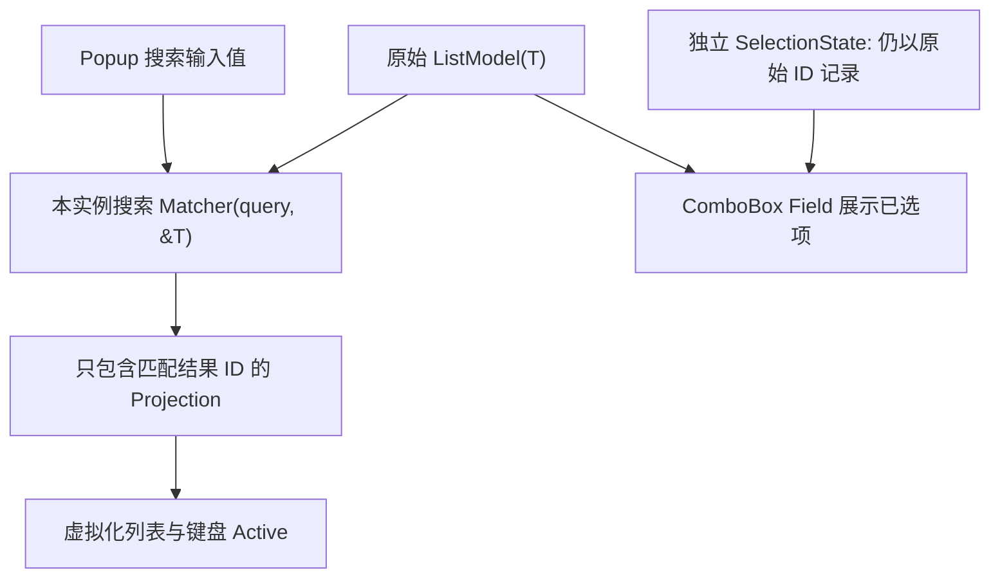

# 为 ComboBox 增加可选本地搜索与无结果展示

## 功能目标

为现有单选 ComboBox 增加一个可选择启用的本地搜索功能：应用提供匹配器，控件在 Popup 内展示搜索输入框，并通过当前 ComboBox 实例专有的 Projection 筛选原始数据。搜索不会编辑 Model，也不会将搜索结果复制成另一个 `WidgetryListModel<T>`；未启用搜索的 ComboBox 保留原有 Popup 交互。

## 查询与投影

应用提供概念形态为 `Fn(query: &str, item: &T) -> bool` 的匹配回调，查询仅作用于本地已有选项。匹配器只影响本 ComboBox 的 `ListProjection<WidgetryListItemId>`，按原始 Model 的稳定 ID 构建当前结果；不修改原始 Model 的条目、顺序、Disabled 或选择状态。每次输入变化或 Model 变化后自动刷新 Projection，多个 ComboBox 引用同一 Model 也只改变自身结果。

如果当前已选条目不满足搜索条件，Field 仍显示它，Selection 仍保存其 ID；它只是不会在当前结果中显示。若真实 Model 删除该已选项，按照上一阶段的规则修复为 `None`。搜索无结果时，Popup 显示应用可配置的提示 Scene/文字；不能把无结果误当成删除条目，也不能让隐藏的历史行继续接收 Pointer 确认。

## Popup 与键盘交互

- Field 继续是选择按钮，而不是可直接编辑的输入区域。用户打开开启搜索的 Popup 后，搜索输入框显示在结果列表上方并自动获得焦点。
- 保持搜索框焦点的同时，向下/向上键在当前匹配且未禁用的结果中调整 Active；Active 是键盘候选，不应因为焦点位于输入框而自动修改 Selected。Home/End、滚动和虚拟化应以匹配后的 Projection 为边界。
- Enter 确认当前有效 Active 并关闭 Popup；鼠标点击有效结果同样提交选择。Esc 关闭 Popup 且不改变原有 Selection。关闭后不允许剩余同批键盘输入操作隐藏列表，维持现有 Focus/Disabled 防护。
- **每次重新打开 Popup，清空查询并恢复完整未过滤的原始结果。** 无论上次是点击外部、Enter 还是 Esc 关闭，重开行为一致；已选 ID 保持不变。初次打开若 Selection 为空，可有默认 Active，但不会自动选中。
- 未启用搜索时不生成搜索输入和额外焦点逻辑，继续支持原有纯选项 Popup。

目前 Popup 的 `handle_reselection`、`handle_escape` 和内部 ListView 的 `FocusedInput<KeyboardInput>` 假定焦点落在 ListView；加搜索后不能简单附加 TextField 便认为键盘功能已经实现。需要将搜索 TextField 的输入与导航明确分流，使文本编辑正常使用方向/光标处理的同时，规定被导航键消费后的事件不重复投递。Ctrl/Shift 的多选手势不应泄漏到 ComboBox，因为它配置为单选。

Popup 空列表显示自定义无结果提示，Placeholder 只用于 Field 未选择状态，二者彼此独立。PopOver 尺寸和最大可见条目数应考虑搜索输入框、提示视图与数据行高度，不能把搜索框误算为一条数据 Row。清空查询后若有 10,000 项，只按虚拟化窗口渲染必要行。

## Gallery 演示及可验证行为

ComboBox 页面新增一个明确开启搜索的示例及一个未开启搜索的对照示例；当前纯文字、图文、图标和 Disabled Renderer 继续保留。展示区应允许输入产生少量匹配、多项匹配、零项匹配，并显示可配置无结果提示。显示当前搜索词、匹配项数量、已选 ID 和 Active 变化，直观看出查询不会自动提交选择。可以选中某项后输入排除它的查询，验证 Field 仍显示原选择；清空或重开 Popup 后显示完整结果，按 Enter/ESC/鼠标分别验证提交与取消。

演示遵循中英文本地化：搜索框提示、Placeholder、无结果提示及状态文字均加入 ComboBox 对应 i18n Key，语言切换不要求销毁整个 ComboBox，也不应清除有效选择。Disabled 示例应证明禁用 ComboBox 无法通过隐藏 Popup 或搜索框继续触发输入。

同步修订 `docs/gallery.md` 中 ComboBox 主要展示功能及新搜索交互说明，保持现有页面按需挂载和离页清理契约。

## 测试与边界

覆盖可选 matcher、频繁键入后的自动 Projection 更新、与共享 Model 的另一 ComboBox 隔离、禁用项跳过、无结果提示、首次和再次打开重置查询、选中项被过滤隐藏时依然有效、原始 Model 删除已选项后转 None、搜索输入焦点与 Enter/Esc、点击及滚动虚拟化、PopOver 关闭后清理焦点。变更检测应让同周期多次 Model/Query 变化合并计算，不把 10,000 项全部实例化 UI。保留 Popup 的 z-index、弹出方向、外部点击关闭、Style Owner 和 Theme/Override 行为，以及新内容的当帧 Text/Icon 就绪。

## 前后关系

依赖上一增量明确的空选择和单选 API，以及基础 Projection 和 Navigation。ListView 的拖拽不是本功能前提；下一个实施增量转向普通列表排序，二者只是共同使用 Projection 体系，不存在相互调用依赖。
