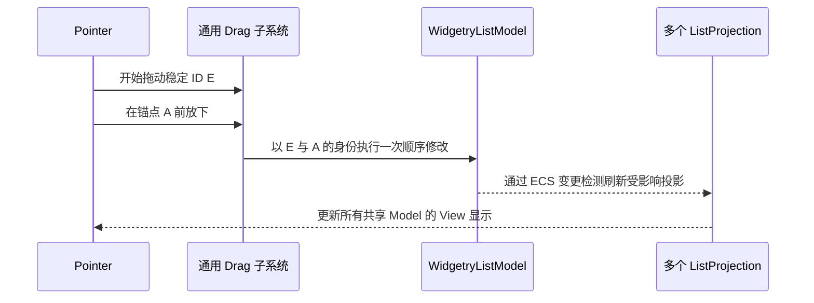
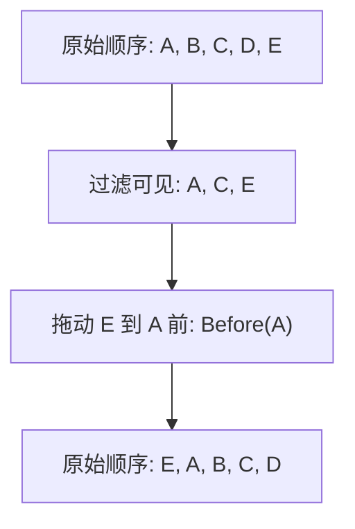

# 实现 ListView 单条目拖拽排序并写入原始 Model

## 目标与写入边界

为普通 ListView 增加默认关闭、可配置启用的单条目拖拽排序。不同于过滤或展开，拖放表示用户明确要求**修改真实数据顺序**，应直接改变共享的 `WidgetryListModel<T>`，而不是仅改当前 View 的 `ListProjection`。操作完成后 Bevy 变更检测让所有引用该 Model 的 View 更新自己的 Projection 与可见行，选择身份保持稳定。

即使当前 Selection 包含多个 ID，每次也只移动鼠标实际拖动的一条，不做批量排序。这是第三阶段已确定的拖拽行为，不能因为加入多选便偷偷改为成组移动。

Drag 机制独立于 Selection：负责处理开始、指针移动、悬停目标、插入位置提示、取消与结束，并表达一个可验证的移动意图。普通列表的数据操作层负责根据移动意图修改 Model；该机制未来可供 TreeView 重用，但不在 Drag 核心里硬编码树结构规则。拖动开始必须记录原始稳定 `K`，不能只记录某个可被虚拟化重用的行 Entity 或当前索引。

## 过滤状态下唯一确定的移动结果

放置意图用 `Move(moving_id, Before(anchor_id))` 或 `After(anchor_id)` 一类身份锚点描述。拖放时从**最新的原始 Model** 解析两个 ID，计算一次明确的 `Vec` 移动位置并提交；源项或目标项不存在则取消操作。已禁用或不合法的放置位置不能变更原始数据。放到自身附近产生的等效顺序应按 no-op 处理，不引入伪数据更改或重复通知。

过滤时不能直接使用 Projection 显示索引来调用 `move_item(from, to)`，因为隐藏数据仍占据 Model 中的真实位置。以下示例规定了明确的效果：

隐藏的 B、D 保持相互间及相对于未移动条目的原有先后关系；只有 E 被挪动。拖拽后视图 Projection 会根据原始 Model 与本视图过滤规则自动重建，不能额外持久化一份「拖拽后的投影顺序」作为第二个 Source of Truth。共享 Model 双 View 在任一侧拖动后都反映原始顺序变化，但两侧的 Selection、过滤条件、Active 与滚动状态仍属于各自实例。

拖动期间使用可见投影进行命中和目标反馈，真正提交前再校验 ID 与模型现态，避免模型同时插入/删除、虚拟化行替换或 Disabled 变化导致错误操作。全局 Disabled、禁用行和禁用内容阻止相应交互；取消或非法释放应移除拖拽视觉反馈、不改变 Model、不影响当前多选。保持 ScrollArea/Picking/焦点的现有保护；拖拽过程中的自动滚动如需实现，应仅改变视口，不构成数据修改。

## 公共 API、Gallery 与测试

启用排序的配置属于具体 ListView 实例，默认关闭；外部仍可使用 `WidgetryListModel<T>::move_item` 进行程序化改序。拖拽产生的数据变更走 Model 的真实方法与组件 Changed 链路，而不是只向应用发一个需要其决定是否执行的请求。`ListProjection` 对其他非拖拽数据源仍是只读显示结构，不因此暴露任意原始数据写入能力。

Gallery 的小列表提供启用/关闭拖拽排序的对照；共享 Model 双 View 由一侧拖动、两侧验证顺序同步，并显示每侧选择集互不影响。添加过滤结果排序案例和多选时拖一项案例，状态区域同时列出原始 Model 顺序与 Projection 显示顺序，便于辨认被过滤的节点没有错误移动。保留现有程序化 Move、Insert、Remove、Edit，以及被禁用视图不能拖动的展示，说明拖放与普通点击的差异。

测试涵盖前/后锚点、跨多个隐藏项、首尾移动、自身 no-op、拖动项或锚点操作前消失、Disabled、虚拟化 Row 复用、取消、共享 Model 双 View 自动重建、稳定 ID/Selection 不漂移、恰好一个条目移动和原有 Renderer/Revision 刷新。GUI 需验证实际 PointerDrag/Release 链路与放置反馈；BRP 模拟 Pointer 不能完全替代原生 Windows Mouse 的拖放判断，现有 10,000 条滚动基准不应因为开启功能但未拖动而出现大量额外 Row 或每帧全表工作。

同步更新 `docs/gallery.md` 中 ListView 的拖动行为与共享数据状态说明，保留 Gallery 页面按需创建、离页清理和文字本地化。

## 与后续方案的关系

该阶段形成通用拖放机制和列表写入语义；后续 TreeView 拖放使用相同的拖拽意图识别，但将移动执行权交给 ECS 树结构，并额外做祖先关系验证。TreeView 的 Entity 数据适配和独立展开状态不依赖本阶段的具体 `Vec` 排序算法。
