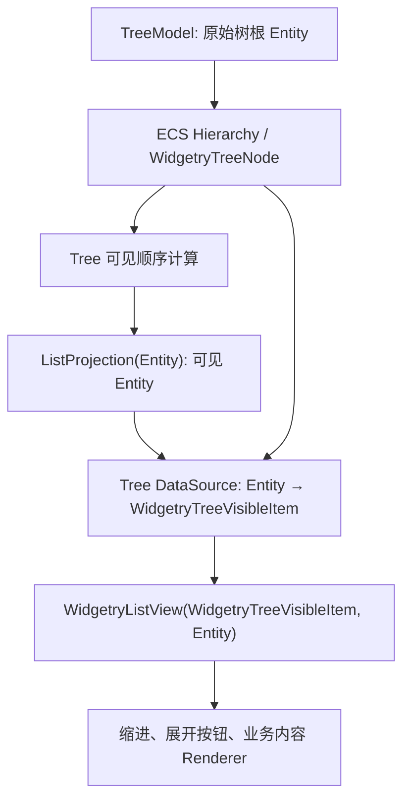

# 让 TreeView 直接使用 ECS Entity 身份与数据适配器

## 独立目标

将 TreeView 内部列表从「以 `WidgetryListModel<WidgetryTreeVisibleItem>` 作为中间可见数据副本」改为「通过 DataSource 从真实 ECS 树节点 Entity 解析行数据，并通过 `ListProjection<Entity>` 驱动 ListView」。此阶段的独立交付是消除中间 ListItemId 身份层、改用原始节点身份渲染和虚拟化。每个 View 的选择与展开状态所有权由下一阶段迁移；过渡期不把旧的共享 TreeState 重新确立为最终 API。

当前树结构由 ECS `ChildOf` / `Children` 与 `WidgetryTreeNode` 描述，`WidgetryTreeModel` 保存 root、展开/选择、可见 `WidgetryTreeVisibleItem` 和 `entity_to_index`，并要求附带 `WidgetryListModel<WidgetryTreeVisibleItem>`。`sync_models` 将树可见节点同步为中间列表，后者另外生成 `WidgetryListItemId`。树的原始身份其实是 `WidgetryTreeVisibleItem.entity`，当前还需要把中间 ListItemId 转回 Entity 才能提交树选择；新的 adapter 消除这层身份转换。

## 数据源形态与行展示

- `K = Entity`：列表行、Pointer Press 身份、Navigation Active、可见行 ID 与后续 Selection 都直接使用原始节点 Entity，不分配随折叠/展开变化的中间列表 ID。
- `T = WidgetryTreeVisibleItem`：保留行渲染所需的 `entity`、`depth`、`has_children`、`expanded` 等展示属性，允许适配器在解析时从 ECS 和投影状态生成拥有的行数据，而不要求 ECS 节点实际存储这个结构。
- 原始节点的存在性必须按是否仍可由指定 Tree root 沿有效 `WidgetryTreeNode` 层级到达判断，不是仅靠 `world.get_entity(entity).is_ok()`；脱离原树或移除标记后身份不再属于此数据源。暂时隐藏的后代仍属于原始树。
- 当前树的业务 RendererRegistry 允许不同 ECS Component 类型拥有不同 `WidgetryTreeRenderer<T>`，这一能力继续保留。内部行 Renderer 负责缩进与展开按钮，`TreeContent` 继续按真实 Entity 渲染异构业务组件，不把应用业务组件强迫转换成统一 `T` Model。

ListDataSource 的完整行元信息应包含是否可交互与内容变化依据，既支持借用 Model 项也支持树适配器生成临时展示行。节点业务组件更新、ChildOf/Children 变更、懒加载状态变化及展开状态变化都需要让受影响行及时刷新，保留 `TreeContent` 的类型注册代际/组件变更驱动渲染、Text/Icon 当帧就绪和颜色归属。未受影响的 Entity 不应因其他节点折叠、重新展开而意外失去身份或 Selected 样式。

## 从旧同步链迁移

需要替换 `WidgetryTreeModel` 对中间 `WidgetryListModel<WidgetryTreeVisibleItem>` 的 require 和 `reconcile_list` 按索引插删移动链路，去掉 Selection 事件中 `ListItemId → 中间 Model → Entity` 的反向查找。TreeView 直接创建带 Entity 键的 ListView，内部 Pointer/Keyboard 事件与 Row ID 都是 Entity。TreeModel 可继续作为指向原始 root 的 source 配置组件，但中间 `WidgetryListModel` 不应再成为投影事实来源。

该转换先复用当前树可见节点算法与基本展开结果，使行为过渡期可用；下一阶段再把算法依赖的 `expanded`、`selected`、`visible_items` 与索引缓存改为每个 TreeView 实例的状态。最终状态归属必须通过下一阶段收敛，本增量不得因为短期兼容再次发明长期的共享 Selection。

在 Typed Plugin/Scene 层同步处理 `WidgetryListView<T,K>` 的注册、`WidgetryTreeViewProps`、Owner 归属及 Row 事件目标；`WidgetryListViewItem` 的 `index` 变为可见投影索引，Tree Gallery 的行范围状态因此仍有明确含义。已有 `WidgetryTreeAppExt::register_renderer()` 的组件类型路由不得丢失。

## Gallery 与验收

Tree Gallery 保留基础树、异构 Folder/File 渲染、Unknown/Loading/Loaded 懒加载、10,000 文件节点虚拟化以及共享源双 View。此阶段 Gallery 能从 Row 身份直接追踪真实节点，Renderer、滚动、颜色、Disabled、View 回收以及对共享节点的程序化编辑/插入/删除/移动继续正常；下一阶段才将共享选择/展开示例改成真正独立的双 View。

相关测试从中间 `WidgetryListItemId` 的稳定性改为 **Entity 身份本身的稳定性**：折叠/展开不换身份、离屏滚动与行复用仍指向正确节点、数据修改后 Depth/Child 标记一致、失效节点拒绝解析、源恢复可重新投影、异构组件 Renderer/Theme/Override 与第一帧 UI 准备不退化。移除测试对中间 ListModel 的直接依赖，避免把被淘汰的数据副本当作业务契约。

## 下一阶段的接口依赖

这里先完成 Tree 的 keyed 数据通道。下一阶段将原先按 TreeModel 发起的 `expand/collapse/select`、展开缓存与可见列表迁移到每个 TreeView，并修订事件归属与 Lazy Request；本阶段不能单独宣布最终的双 View 独立状态已经完成。
