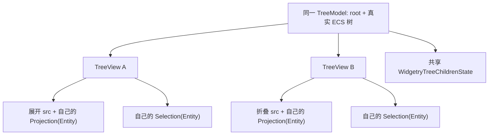
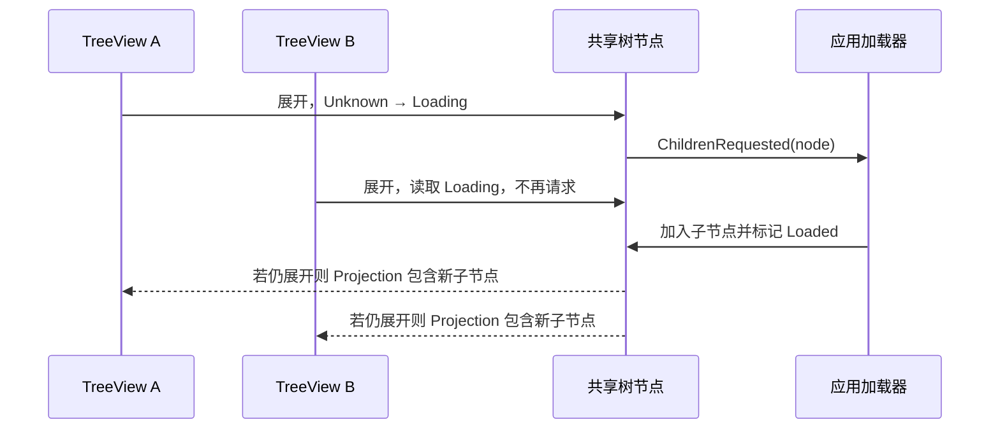

# 将 TreeView 的选择与展开状态迁移到每个视图实例

## 设计目标与状态所有权

同一棵真实 ECS 树可以同时出现在两个或更多 TreeView 中，但每个 TreeView 的展开状态、选择状态、可见 Projection、Active、焦点和滚动都相互独立。原始树节点、父子关系、子节点顺序和加载状态则由共享数据源持有。该增量将目前保存在 `WidgetryTreeModel` 上的展开/选择/可见结果迁移至实例，并调整公开 API、数据变更通知和懒加载事件。

例如用户在 A 中展开 `src` 并选中 `main.rs`，B 可以保持 `src` 折叠并选择其他节点。修改 ECS 节点的真实内容或 `ChildOf` 时，两边都更新各自可见投影，但 A 的展开和选择不被 B 的操作覆盖。所有「全部展开/全部折叠」的作用域也应是具体 View，不能通过 Model 广播给全部 View。

## 原始 TreeModel 与视图状态的分工

`WidgetryTreeModel` 继续定义 root 与源合法性，不再保存属于某一个用户界面的权威 `selected`、`expanded`、`visible_items`、`entity_to_index`。每个 TreeView 拥有其独立的 `ExpandedState<Entity>`，由它结合真实 ECS 树生成 `ListProjection<Entity>`；选择统一使用 ListView 的 `SelectionState<Entity>`，不能同时保留 TreeModel 另一份可变 selected。对于树的选中但暂时不可见后代，选择集合保留其 Entity，折叠只缩短 Projection；删除、移出当前 Tree root 或去除节点有效标记才从对应 View 选择中清理。

按现有行为，树展开状态初始为空（默认折叠，除非应用明确设置），而 `WidgetryTreeChildrenState::{Unknown, Loading, Loaded}` 是原始节点的**共享加载元信息**，不随着某个 View 折叠、关闭或消失而重置。

外部 API 中 `WidgetryTreeModel::expand/collapse/toggle_expand/select(world, source, node)` 的所有权需要改成目标 TreeView Entity，或由 TreeView 提供等价的操作入口；事件的展开、折叠与选择语义也以具体 View 为 source，不能再被多个 View 的监听器误认成全体同步结果。对应 Selection 多选事件能够表达集合变化，不再把树选中事件永久定义为单个 `Option<Entity>`。

Tree 的业务节点仍通过原始 ECS Entity 识别，所有公开查询应能从指定 TreeView 读取其展开/选择状态；Gallery 不得只知道共享 TreeModel 就去查询某个 View 的已选项目。程序化交互应在接收时验证 View、Node 与源关联；一个 View Disabled 阻止其用户输入，但不禁止应用通过公开 API 修改该 View 的交互状态。

## 懒加载的共享与视图独立

TreeView A 和 B 可能都展开尚未加载的同一个节点。两者都可以将节点标记为各自的 Expanded，但只允许共享节点加载状态从 `Unknown` 首次转换为 `Loading` 时发出一次 `ChildrenRequested(node)`。后续 View 看到的是同一个 Loading；加载结束通过原始节点 `set_loaded` 更新一次共享 ECS 数据，各个展开中的 View 各自投影新子节点，折叠的 View 仍保持折叠。避免把加载请求放进每个 View 的本地 ExpandedState 后产生重复远程请求。

节点展开、折叠、删除、重新挂接等输入和修改，应在本更新周期产生正确的 Projection 变化，并在虚拟化/渲染前完成。现有 Tree Plugin 的 `sync_models → project_selection → ListView sync_state → reconcile → render_content` 依赖链需替换为每 View 重建与选择/Navigation 修复，再同步行与内部 TreeContent Renderer。更改系统顺序时保留 Bevy `WidgetryUiSystems::Build` 中渲染节点在后续传播、Layout、颜色消费前准备完成的性质。

## Gallery 与迁移测试

Tree Gallery 顶部共享源 A/B 双 View 原有「选择与展开同步」的文字和按钮逻辑须彻底替换：分别操作左/右 View 的展开、选择和滚动，并显示每个 View 的 Visible Count、Selected IDs、Expanded Count；另有按钮真实编辑共享节点，证明两边数据同步。原有 `Action::SelectLast` 应根据被操作 View 的可见 Projection 选取节点，而不是直接查 `WidgetryTreeModel.visible_items().last()`；`Edit/Remove/Reparent Selected` 应读取指定 View 的 Selection 并修改共享原始节点。源与视图的 Gallery 页面进入/退出生命周期、独立 Disabled、Locale 和 Theme 切换仍需保留。`docs/gallery.md` 中当前写明的 Tree 双 View「选择和展开同步」也必须改为「选择和展开独立、原始树数据同步」。

迁移 `WidgetryTreeEvent` 的触发源、Gallery 监听、异构 Renderer 测试与现有 `model_behavior`/`view` 测试：两个 View 对同一节点可分别选择与展开、删除真实节点让所有受影响 View 清除无效 ID、折叠不清除隐藏选择、一个 View 销毁不销毁 Model 与另一个 View，Lazy 重复展开仅触发一次加载请求、已加载后的各自投影正确。保持对 Source/Hierarchy 失效与恢复的错误诊断、Disabled/Focus 隔离、颜色 Owner 和局部状态更新的既有覆盖。

## 相关阶段关系

本阶段依赖已能用 Entity 驱动 TreeView 的数据通道；为后续多选、全部展开/折叠和节点拖拽建立正确的视图状态所有权，不在本阶段额外建设那些交互能力。
