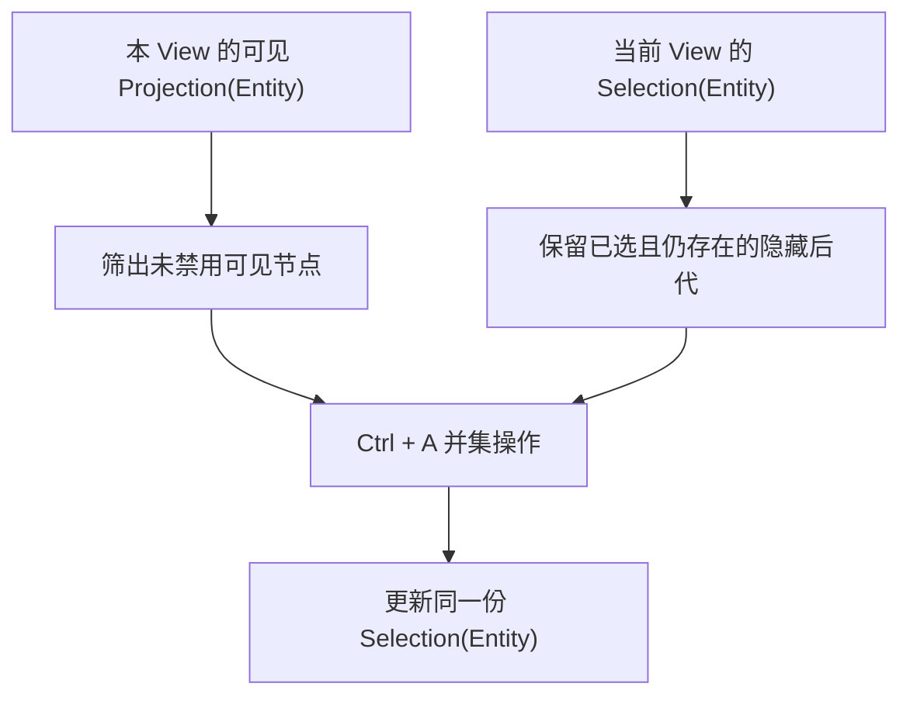

# 实现 TreeView 多选与全部展开、折叠

## 目标与通用 Selection 的复用

让 TreeView 以 `K = Entity` 使用 ListView 的 Selection 子系统，默认支持 Ctrl + 点击切换与 Shift + 点击范围选择，并增加 Ctrl + A 对**当前可见未禁用节点**的全选规则。同时支持由应用或 UI 对指定 TreeView 全部展开、全部折叠已加载节点。该功能延续每个 View 独立的 ExpandedState、Projection、Selection，不改变真实 ECS 树和其他 TreeView 的选择。

## 选择规则与隐藏选择

Ctrl + 点击对所点 Entity 做集合成员切换；Shift + 点击按照该 View 的当前**可见 Projection 顺序**对连续范围选择，包含未物化的虚拟化行，排除当前不允许用户选择的节点。范围锚点记作稳定 Entity 而非行索引，因折叠或数据变化无法继续使用时采用明确的有效锚点修复，不把已隐藏节点误判为删除。普通点击建立单项选择和新的活动项，Navigation 与 Selection 各自管理自己的状态。

TreeView 的 Ctrl + A 不同于普通 ListView 的整模型全选：只对当前可见的未禁用节点构成选择集合增量，**并入**已经选中的合法隐藏节点，而不是清空它们。因而折叠父节点后，选中的后代 Entity 虽不出现在 Projection，仍会保持；重新展开后其可见 Row 显示 Selected。真实原始节点删除或移出该树时才剪除相关选中 Entity。单击普通选择可以依正常单选手势替换集合；Ctrl+A 本身不得意外清除隐藏成员。

例如 A 节点下的 B 已被选中，此时折叠 A 并执行 Ctrl+A：可见 A 等节点被加入选择，B 仍已选；再展开 A，B 的选择自然恢复显示。高节点数时不需要让隐藏的 B 或离屏选中项保留 UI Row，稳定 ID 集合足以恢复样式。选择变化按集合语义通知，并保持真实修改先于通知、自动 Repair 静默及同值不重复通知。

## 全部展开与全部折叠

全部展开/折叠只作用于**指定 TreeView 的 ExpandedState**，不修改共享树源，也不更改其他 View 的展开或选择。批量操作作用于当前**已加载**且可以从源根到达的节点：

- 全部展开：将已加载节点的可展开标记加入该 View 的 ExpandedState，并在投影中按真实层级显示已加载后代。
- 全部折叠：从该 View 的 ExpandedState 清除已展开标记；隐藏的已选子节点继续留在 Selection。
- 不因「全部展开」强制请求 Unknown 远端节点或启动懒加载；逐个用户主动展开未知节点仍遵循前一阶段的 `ChildrenRequested` 语义。批量操作不应产生海量冗余通知或逐节点 UI 重建。

这里的「全部」不是对未知远端节点做递归查询，而是对已有 ECS 可到达且已加载的结构完成操作。未设置 `WidgetryTreeChildrenState` 的普通本地节点按已具备本地子节点处理，只有明确标记为 Unknown/Loading 的远程节点不得被批量操作强制加载。有效状态变更后，尽量合并 Projection 重建，再修复活动项与可见范围。全部折叠不代表删除节点或选中项，也不能对其他共享源 View 造成连带折叠。

## Gallery、测试和直接影响

Tree Gallery 在基础树与共享双 View 上新增 Ctrl/Shift 选择、Ctrl+A、全部展开和全部折叠的操作与状态说明。重点展示 A 侧折叠、B 侧展开，同一隐藏后代在 A 中仍被选中；A 执行 Ctrl+A 不触碰 B 的选择或展开。Lazy Loading 树应证明批量展开不引发远端加载请求，而手动展开未知节点只请求一次；10,000 节点树展示虚拟化窗口外的选择 ID 与 Visible Count 而不实际生成全部 Row。保留异构 Renderer、Disabled、语言与 Theme 演示。

相关自动化覆盖 Ctrl 单项切换、Shift 连续范围、折叠前后范围锚点、可见 Ctrl+A 并入隐藏选择、禁用节点跳过、真实删除清理 ID、重复展开/折叠无多余事件、双 View 独立和已加载边界；GUI 验证鼠标与键盘修饰符真实输入、折叠恢复选择的 Selected 样式、视口滚动与 Focus。`WidgetryTreeChildrenState::Unknown/Loading/Loaded` 不被批量操作错误推进。

## 与下一阶段的关系

完成本增量后 TreeView 的选择与展开功能形成闭环。下一增量的拖放不批量移动已选节点，也不会把折叠状态当作真实父子关系修改；它使用原始 ECS 树结构执行单节点操作。
