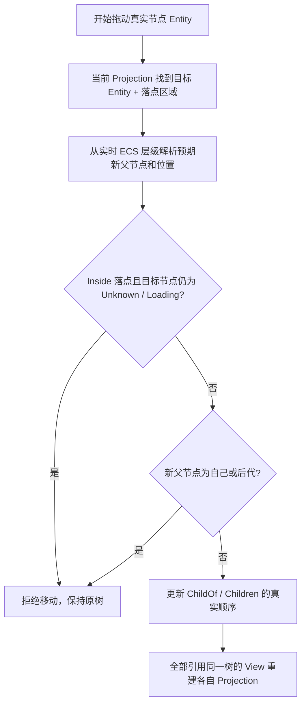

# 实现 TreeView 单节点拖放与层级安全移动

## 功能目标

在已具备 Entity 身份、每 View 投影和通用拖放机制的 TreeView 中新增默认关闭的节点拖放。用户可以改变某节点在同一层级的前后位置，或者改变其父节点；每次只移动实际被拖动的**一个 Entity**，即使 Selection 包含多个节点也不成组移动。移动结果应修改原始 ECS `ChildOf` / `Children` 层级与兄弟顺序，不把 TreeView 的 Projection 当作可写的树结构。

## 三段式放置意图与修改路径

针对当前显示的目标节点，使用上方、中间、下方三个落点区域。它们表达的不是显示索引，而是依真实 Entity 可唯一求得的树结构意图。

| 放置区域 | 语义 | 新父节点来源 |
| --- | --- | --- |
| 目标行上方 | 拖动节点成为目标节点之前的兄弟 | 目标当前父节点 |
| 目标行中间 | 拖动节点成为目标节点的子节点 | 目标节点本身 |
| 目标行下方 | 拖动节点成为目标节点之后的兄弟 | 目标当前父节点 |

例如 `A → B → C` 是原有祖先链，若拖动 A 让其成为 C 的子节点，便会构成 `A → B → C → A` 循环；把 A 放在 C 的上/下方同样意味着新父节点 B，仍在 A 的后代中，也必须拒绝。允许把 C 移到 A 下面，因为 A 不是 C 的后代。实现时在落点提交之前从拟议的新父节点沿 `ChildOf` 向上检查；遇到源节点即非法。该验证必须在真正执行原始 ECS 修改的层级中再次实施，不能只靠前端隐藏非法落点。

单个拖放操作完整表达 `moving_entity`、`target_entity` 与 `Before/Inside/After`，执行时以最新 ECS 状态重新解析父节点和目标顺序。拖动项/目标已删除、两者不再属于同一有效树、父子链无效、Self-Drop、失效/Disabled 位置等均不应提交部分修改。普通有效移动只改动一个源节点及必要的父子顺序，不自动搬运整个多选集合；其后代仍随源节点在层级上作为子树迁移。选择集合里的原 Entity 不因有效重排或重挂接而变化，在本树内仍存在的选中后代继续有效。

用户拖动期间只改变临时放置反馈和目标高亮；放下并校验成功后才修改 ECS 原始层级。更新会通过变更检测通知所有共享 Tree source 的 View，但每个 View 重新根据自己独立的展开状态决定新节点是否可见，不传播某侧 Active、Selection 或滚动。局部放置命中基于可见 Projection，不能因为虚拟化复用 Row 把目标错误套到其他 Entity。

## 与懒加载、Renderer 和 API 的关系

原始树继续支持 Unknown/Loading/Loaded 懒加载、异构节点 Renderer 和已有 `TreeContent` 更新链。节点顺序或父子结构修改应令受影响 Projection、深度缩进、是否有子节点、展开图标以及真实节点业务渲染自动刷新；不能把「修改了可见列表」冒充成功写回 `ChildOf`。

拖拽启用属于单个 TreeView 的配置，默认关闭；通用 Drag 子系统负责 Pointer 生命周期和反馈，树的数据修改层负责有效性检查和真实写入。新操作的公开表示应能准确描述前后/内部插入，支持程序化发起相同的有效移动；不必新增另一份用于保存拖后位置的 Projection 状态。

对于声明 `WidgetryTreeChildrenState` 的懒加载节点，**尚未完成子节点加载时禁止拖入其内部**，无需远端写入协议，也不允许由拖放操作触发加载或缓存待执行的结构修改。规则按目标节点当前状态和落点区分：

| 目标节点状态 | Before / 上方 | Inside / 中间 | After / 下方 |
| --- | --- | --- | --- |
| `Unknown`（未加载） | 允许* | **禁止** | 允许* |
| `Loading`（加载中） | 允许* | **禁止** | 允许* |
| `Loaded`（已加载） | 允许* | 允许* | 允许* |
| 非懒加载的本地节点 | 允许* | 允许* | 允许* |

其中“允许*”仍须通过通常的同树归属、有效父节点、Disabled、禁止循环父子关系等校验。Before/After 修改的是目标节点所在的兄弟序列，不会把拖动节点插入该目标内部，因此不因目标节点自身处于 `Unknown` 或 `Loading` 而被禁止。Inside 必须在**提交 ECS 修改时再次读取目标的实时 `WidgetryTreeChildrenState`**：拖动开始时为 `Loaded`、提交时变为 `Loading` 的情况也应拒绝且不留下部分修改。目标变为 `Loaded` 后，Inside 才可参与常规校验和提交。

UI 对 `Unknown`、`Loading` 的中间区域显示明确的禁止放置反馈，不展示可以成功放入的高亮；上/下方仍按有效兄弟插入规则展示指示线。这一规则只限制拖放写入，不改变用户点击展开时原有的 `ChildrenRequested` 懒加载机制。

## Gallery 展示与测试

Tree Gallery 在基础树和共享 TreeModel 双 View 上新增拖拽启用/禁用示例、上中下落点反馈、调整兄弟顺序、改变父子关系、拖动父节点导致子树随动、多选状态下只拖一个节点、非法循环目标拒绝。通过 A 侧拖动改变原树后，B 侧自动看到相应数据更新，但保留 B 自己的选择与展开状态；明确展示 `Unknown/Loading` 节点的中间区域禁止放入、上/下方在其他约束满足时仍可调整兄弟位置，并在加载状态变为 `Loaded` 后允许合法的中间放置；同时展示循环关系和禁用目标等无效落点不可提交。Lazy Loading、异构 Component、10,000 节点虚拟化和 Theme/Override 的原有展示继续工作，补齐双语操作说明及实时结构状态。

自动化及 GUI 验收覆盖：Before/Inside/After 三种合法落点、根级与嵌套顺序变化、同父节点位置变化、跨父节点挂接、Self-Drop、移动到后代下的循环判定、节点删除/目标失效/Disabled 取消、多选只移动一个、虚拟化滚动后的真实 Entity 命中、共享 View 数据同步但本地 Selection/Expanded 独立；还须覆盖 `Unknown/Loading` 的 Inside 拒绝与 Before/After 有效移动、`Loaded` 的 Inside 有效移动、拖动中 `Loaded → Loading` 后提交拒绝，并确认被拒绝时原树和共享加载状态均不被修改、不会生成远端写入请求。新 Tree Node 深度和有无子节点信息须与 ECS 实际结构一致；失败操作无局部层级修改、无虚假事件，正常成功操作在变更周期内刷新受影响 View。

拖放 GUI 验证需包含真实 Windows Mouse 交互，因为 BRP 的普通 Pointer 不能完全替代原生鼠标输入；Tree Gallery 的新交互文案及 `docs/gallery.md`、相关 i18n Key 必须同步更新。

## 收口条件与相邻关系

此增量依赖前序普通列表 Drag 的通用输入与目标表达机制、TreeView 的 Entity 数据适配和独立视图状态。它是链条中最后一个真实功能增量；因此跨三个控件的最终联动验收可以在本阶段完成：ListView 共享源及多选/排序、ComboBox 初始 None 与可选搜索、TreeView 双 View 独立与真实层级修改，同时保留 Gallery Header 三个程序化选择器、页面清理及 UI Build/Theme/Disabled/虚拟化回归。最终联动检查不另拆成没有新增实现产出的专门阶段。
