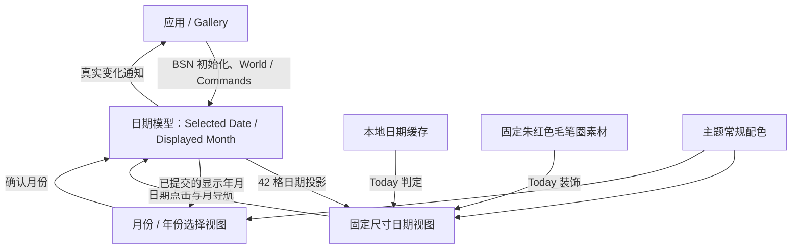

# DatePicker：从日期模型到完整交互展示

`WidgetryDatePicker` 是面向 Bevy 0.20 的内嵌单日期选择控件。它显示完整月历，允许按月浏览、在月份和年份视图中快速定位日期，并通过公开 API 访问和修改选中日期与显示月份。控件本身不负责 Popup、输入框、日程管理或键盘日期导航；弹出式使用方式可以由应用在外部通过 BSN 组合。

整体设计的关键是分开处理**已提交的日期状态**、**正在浏览的临时年月候选**、**本地今天的视觉指示**和**演示应用的观察数据**。前者只由控件公开 API 修改；候选视图不抢占业务状态；今天只是标记而非自动选择；Gallery 展示真实状态与事件而不建立另一份日期模型。

日期模型是其他交互能力的前提。完成日期模型和固定 42 格投影后，日期视图先提供可用的日期选择与清空，再扩展原位的月份/年份选择。今天指示作为独立的视觉能力叠加在已有日历上，最后由 Gallery 组合成可调试、可对照的完整演示。**Gallery 的顺序靠后，是因为它要展示前面已经实现的真实控件；它不是控件业务状态的组成部分。**

固定毛笔圈素材已随方案附带：[`assets/date_picker_today_brush.svg`](assets/date_picker_today_brush.svg) 是可直接接入的透明矢量源文件；同目录提供透明 PNG 与 4× PNG 备用。实际集成阶段只负责 Asset 注册和控件引用，无需另行创作素材。

所有功能仍遵守项目现有边界：以 Bevy BSN 构造组合 UI；Widgetry 自有 Runtime State 通过公开只读查询和同步 / 排队修改 API 管理；事件在真实状态提交后发送；`InteractionDisabled` 采用现有有效禁用继承机制；常规颜色通过既有 Theme 管理。DatePicker 专属逻辑保留在控件 crate，Facade 聚合公共入口，内建素材交给 Asset crate，Gallery 只承载演示与观测。

## 实施方案

以下顺序是唯一的实施顺序；每篇方案分别交付一个可验收的功能增量，其测试和必要文档更新在本篇内完成。

1. [日期状态与固定 42 格月历投影](01-日期状态与固定42格月历投影.md)
2. [内嵌日期视图与鼠标选择](02-内嵌日期视图与鼠标选择.md)
3. [月份与年份快速定位视图](03-月份与年份快速定位视图.md)
4. [今天标识与固定毛笔圈素材](04-今天标识与固定毛笔圈素材.md)
5. [Gallery 交互演示与状态观测](05-Gallery交互演示与状态观测.md)
