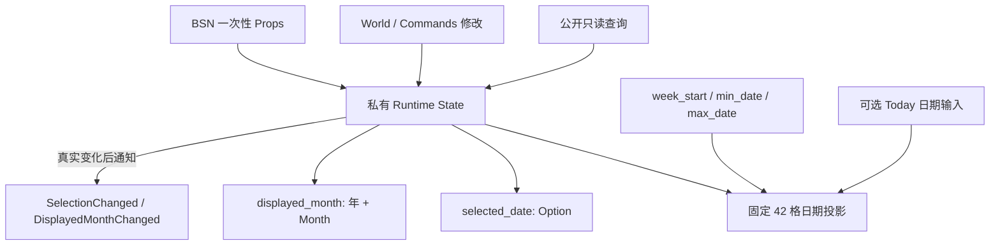

# 日期状态与固定 42 格月历投影

本方案建立 `WidgetryDatePicker` 的 Headless 日期模型、公开状态 API、变化通知和固定月历计算。交付结果是可通过 BSN 初始化、通过同步 / 延迟 API 操作、并由纯日期投影读取的一套独立控件逻辑；后续视觉层和 Gallery 直接消费它，不另存一份业务日期状态。

## 模型与数据流

控件选择单日期，同时允许查看不含该选中日期的其他月份。因此，**选中日期与显示月份必须是两项独立状态**：一个回答“选择了哪一天”，另一个回答“当前看到哪个月”。日期格子从这两项状态推导，而不是长期维护 42 份相互独立的业务状态。



本阶段为日后 Today 标记保留可选日期投影输入；本地日期轮询和毛笔圈素材不属于当前交付，它们不会成为业务状态 Authority。

## 状态与构造配置

DatePicker 保存两项相互独立的私有 Runtime State：

- `selected_date: Option<time::Date>`：当前选中的公历日期。`None` 表示未选中；构造时不自动选中今天。
- `displayed_month: (i32, time::Month)`：当前真正已提交的显示年份与月份。不能以某月“1 日”的伪日期替代纯年月。

日期不包含时分秒，也不携带时区。构造期配置中，`min_date: Option<Date>`、`max_date: Option<Date>` 是**包含端点**的日期选择边界；`week_start: time::Weekday` 指定星期标题和网格起点，默认 `Monday`，也允许其他星期起点。上述配置在构造后保持固定，不增加运行期边界或星期起点修改 API。

初始 `displayed_month` 遵循固定优先级：**显式显示年月 → 初始选中日期的年月 → 系统本地今天的年月**。因此显式年月与选中日期可以不同；使用今天初始化显示月份时，`selected_date` 仍是 `None`。

### 系统本地日期获取失败时的初始回退

读取本地日期失败不意味着选中一个日期。若初始化确实需要系统日期（没有显式显示年月，也没有初始选中日期），先记录 **Warning 级别日志**，然后：

1. 如果存在 `min_date`，将 `displayed_month` 初始化为 `min_date` 所属年月。
2. 如果 `min_date` 为 `None`，改用当下 UTC 日期所在年月作为最后兜底。
3. 两种情况都保持 `selected_date = None`，也不能将回退日期标为 `is_today`。

如果初始化已由更高优先级的显式年月或已选日期决定，就不需要为确定初始显示月份而依赖这条回退路径。本地日期恢复时的 Today 标识属于后续单独增量；恢复不会自动改写用户正在浏览的显示月份。

## 固定日期网格算法

每个月都生成 **6 行 × 7 列 = 42 个日期格子**。从 `displayed_month` 的月初与 `week_start` 计算网格起点，按天得到连续 42 个实际日期；本月前后的日期由上月和下月填满，**没有空白占位行**。

日期格子的计算结果表达为：

```rust
pub struct DatePickerDay {
    pub date: Date,
    pub is_current_month: bool,
    pub is_selectable: bool,
    pub is_selected: bool,
    pub is_today: bool,
}
```

`is_current_month` 依据显示年月计算；`is_selectable` 依据闭区间边界计算；`is_selected` 依据唯一 `selected_date` 判断；`is_today` 由传入的真实本地今天日期决定，缺失 Today 输入时不把备用日期当作今天。这里的结构描述**派生计算结果**，不要求将每个日期格子持久保存为 ECS Component。固定 42 格也无需列表虚拟化。

相邻月份的格子同样持有有效日期，可以成为后续视图中的点击目标；只要落在允许的日期范围内，选中它就会通过状态 Setter 自动切换到所属月份。越界日期仍出现在网格中，只是不可选择。

## 公开 API 和通知语义

使用项目已有 Widget API 模式：BSN Props 只负责构造期初始化；公开只读状态查询；提供同步 `World` 与排队 `Commands` 两类修改入口，不提供另一个 Binding / Callback / 事件总线。

接口的操作语义如下（列出代表性用法）：

```rust
WidgetryDatePicker::selected_date(world, entity);
WidgetryDatePicker::displayed_month(world, entity);

WidgetryDatePicker::set_selected_date_in_world(world, entity, Some(date));
WidgetryDatePicker::set_selected_date_in_world(world, entity, None);
WidgetryDatePicker::set_selected_date(commands, entity, Some(date));
```

显示月份的公开 API 同时支持**相对上月 / 下月导航**和**直接指定年月**，同样具备同步和排队入口。清空统一使用 `set_selected_date(None)`；没有独立 `clear_selection` API。

同步状态 Setter 采用 `Result<bool, BevyError>`：`Ok(true)` 代表真实状态变化，`Ok(false)` 代表合法同值操作，`Err` 代表无效请求。排队入口只负责提交 Commands；在 Command 实际执行时完成校验、状态提交与通知，失败交给宿主 Error Handler，不提前承诺入队即生效。

### 选中与浏览的联动

**选中一个不同的有效日期**时，将 `selected_date` 更新为该日期，并把 `displayed_month` 同步定位到其所属月份。仅修改显示月份不触碰已选日期；清空日期也不改变显示月份。

重复设置与当前完全相同的选中日期是纯 no-op：即使此前浏览到了另一月，也**不跳回**已选日期所在月份、不发送事件，并返回 `Ok(false)`。再次点击已选中日期不会借同一 Setter 清空选择；后续日期视图提供专用“清空”入口，但底层仍使用 `set_selected_date(None)`。

提供两个变化通知：

- `WidgetryDatePickerSelectionChanged { selected_date: Option<Date> }`：包括 `Some(date) → None` 的清空动作。
- `WidgetryDatePickerDisplayedMonthChanged`：携带新的显示年月。

事件只报告**已提交的真实变化**。同一操作同时改变两项业务状态时，应先完成两项提交，再向外报告两个相应通知；初始化、同值操作、清空已空选择不发送事件。

| 操作 | Selected Date | Displayed Month | 通知 |
| --- | --- | --- | --- |
| 选择新日期 | 更新 | 跳转到所选日期所属月份 | SelectionChanged；月份真实改变时另发 DisplayedMonthChanged |
| 重设当前相同日期 | 不变 | 不变，即使用户浏览过其他月份 | 无 |
| 有效清空 | 变为 `None` | 不变 | SelectionChanged(`None`) |
| 已空再清空 | 不变 | 不变 | 无 |
| 上下月浏览、直接设置年月 | 不变 | 真实改变时更新 | 仅 DisplayedMonthChanged |
| 未来月份/年份视图中的临时候选浏览 | 不变 | 不变 | 无 |
| 未来 Today 日期变化 | 不变 | 不变 | 无 |

### 校验与 Disabled 的边界

构造时如果两个日期边界都存在，应满足 `min_date <= max_date`；初始选中日期必须在有效范围内。无效配置返回明确错误，不自动修正。运行时程序化选中越界日期同样报错，不改状态、不发通知；范围限制影响的是**选择**，不是**显示或月份浏览**。

复用 `InteractionDisabled` 和继承后的有效 Disabled；它阻止后续用户鼠标操作，但不能阻止合法的程序化状态修改，也不会自行清空既有选择。日期合法性校验对 Disabled 下的程序化调用仍然生效。

无效根 Entity、缺少状态、不可表达的日期 / 年月等异常走已有 Widget Error 约定；非法请求不得默默视为同值。工程不引入运行期修改日期边界、不引入 `Focused Date` 和键盘日期导航、不将专属模型上移到 Core。

## 归属与本增量验证

独立控件 crate `crates/date_picker` / `bevy_widgetry_date_picker` 承载私有状态、网格算法、Plugin、API、通知及本阶段测试；Facade 增加独立 `date_picker` Feature、可选依赖与公共模块；依赖版本沿用 Workspace 的 `time` crate（支持 `local-offset`）。控件根与 Props 使用 BSN/SceneComponent 的既有构造约定，状态不以 Props 的长期副本保存。该增量可从无 UI 的业务状态和月历数据层独立验证。

- **网格**：每个月固定连续 42 个日期；周一及其他 `week_start` 下月初定位正确；月末、年末跨界及闰年日期正确；相邻月份日期真实有效；区间两端可选、越界不可选。
- **初始化**：显式年月、初始选中日期、本地日期的优先级；初始化未选中；不一致的显式年月与选中日期可以并存；本地日期读取失败时的 Warning 与 `min_date` / UTC 两级回退，不能伪造 Today。
- **状态变化**：选中日期联动所属年月，浏览不改选择；同值调用不会意外跳月；有效清空/重复清空的区别；提交完成后才观察到通知；两个状态同变时通知均能读取已提交状态。
- **错误及权限**：无效范围或初始选择报错；程序化越界报错且状态和通知均不变；Disabled 不阻止合法的程序化 Setter；Commands 在执行时而非入队时生效。

后续日期视图会真实调用本阶段 API，而不重新实现业务状态机。
