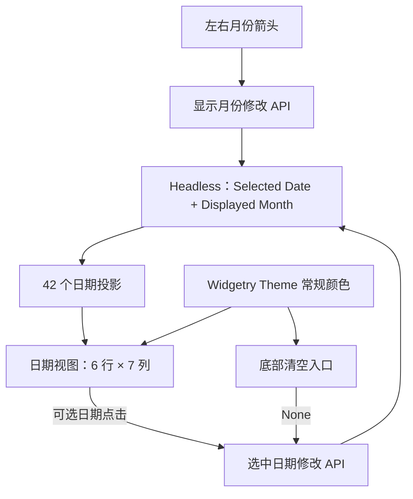

# 内嵌日期视图与鼠标选择

本方案把已有的日期状态和固定 42 格投影做成**真正可操作的内嵌月历**。它交付日期视图、上月/下月导航、允许范围内的日期选择、低调的清空入口，以及随 Theme 变化的常规交互样式。日期、月份的业务状态仍以 Headless API 为唯一 Authority；本方案不重做状态机。

## 日期视图如何消费状态

日期视图直接显示一张月历，不含文字输入框，不建立 Popup / Window，也不承担外部弹出容器的生命周期。它读取已提交的 `displayed_month`，借由 `week_start` 生成 6 行 × 7 列的连续日期投影；通过 `selected_date`、边界与有效 Disabled 判断对应格子的展示和交互。

这条闭环意味着 UI 点击和程序化修改具有相同的校验、提交、通知与同值语义。视觉刷新根据当前 Runtime State 和派生投影完成，不把某格的 Hover 或 Pressed 错当成业务选择。

## 布局和鼠标行为

顶部是两侧的左/右月份箭头和中央显示年月标题。**在当前增量中**，箭头已经可以按月浏览，标题先显示真实年月；点击标题进入月份选择视图的能力由下一增量扩展。

星期标题由 `week_start` 决定顺序，下面始终为 42 个日期，排满 6 行。无论本月本来跨 4、5 还是 6 个自然周，控件都保持完整 6 行；月初与月末不足部分显示相邻上/下月份的真实日期，而不是空格。此设计使按月翻动时高度稳定，也让邻近月份日期可以成为可点击目标。42 个格子是固定小规模，不引入虚拟化。

日期范围只限制**可选性**，不限制浏览。用户可以通过箭头查看所有允许表示的月份，即使该月没有任何可选日期，也仍然能够浏览。相邻月份日期只要处于 `min_date` / `max_date` 闭区间内，就可以点击；选中后调用 Headless Setter，真实改变时将显示月份定位到点击日期所属月份。

再次点击当前选中日期不清空，不触发新的通知，也不跳转月份。这与直接将同一日期再次传给程序化 Setter 的行为一致。

### 清空入口

日期视图底部内置一个**低对比度的「清空」文本按钮**，不使用显眼的强调色，也不成为独立控件业务状态：

- 当前 `selected_date = Some(date)` 时可点击；调用同一 `set_selected_date(None)` 路径。
- 当前 `selected_date = None` 时按钮保持显示但呈禁用状态；不产生选择事件。
- 成功清空时只改变选择并发送 `SelectionChanged(None)`，**不改变显示月份**。
- 该入口内置于日期视图，外部仍可通过已有 API 清空，不增加 `clear_selection` API。

## 常规样式与主题

视觉语义刻意把“选中”与“今天”分开：**选中日期采用中性色圆角背景；Today 的朱红色毛笔圈是独立的外层装饰**。本增量先完成日期文本、选中、Hover、Pressed、Disabled 等常规样式；Today 素材和本地时间更新由后续增量叠加，不改变已有选中语义。

- **普通日期**：使用当前 Theme 的常规文字颜色。
- **相邻月份日期**：降低文字对比度，但只要可选，仍允许交互。
- **不可选日期**：比普通日期进一步降低对比度；不接受点击，也没有 Hover / Pressed 视觉反馈。
- **选中日期**：稳定的中性色圆角背景，而非高饱和强调色；深色主题使用深灰背景和亮色文字，浅色主题使用浅灰背景和暗色文字。
- **Hover 与 Pressed**：仅通过细微变化的圆角背景提供状态反馈；Pressed 相比 Hover 略深，不让状态底色淹没日期文字或后续 Today 装饰。
- **Disabled**：复用项目的有效禁用状态与继承；不能由鼠标选择日期、翻月或清空，但仍显示当前选中状态，并允许程序化 API 按原校验规则工作。

常规配色对接 Widgetry 现有四套 Theme：Dark、Light、Pink Dream、Kamuri Violet。通过 `colors` Props 与现有 Widgetry 模式允许常规局部颜色覆盖；未覆盖的字段随当前 Theme 更新，局部覆盖不改写业务状态。约束只针对常规颜色：**朱红色毛笔圈固定颜色和笔触，不在局部覆盖 API 中暴露**。

不同 Theme 的尺寸与交互含义保持一致。选中底色、Hover、Pressed 和 Disabled 的变化只影响视觉属性，不改变格子的实际尺寸。控件以 BSN 创建，根节点/内部布局的长期状态由真实 ECS 组件维护，不把一次性 Props 当成运行时 Authority。

## 与后续视图扩展的关系

本增量的日期视图是三个视图共有外框和业务日期展示的基础。下一增量会把标题变成可点击的年月导航入口，并复用同一外部宽高区域；日期视图本身**始终保留 6 × 7 结构**，不会因为显示其他视图而缩减。视图切换和翻月都不使用滑动、淡入淡出或纸张翻页动画。

本版本暂不引入键盘日期导航、`Focused Date`、输入框、Popup 或日期范围/多选模式；这些功能不通过本增量的日期视图变相加入。

## 直接验收

- 对任意被展示月份，星期标题顺序与 `week_start` 一致，日期实际连续且固定 42 格；前后月份均有真实日期，不出现空白尾行。
- 左右箭头准确更新 `displayed_month` 并仅在月份发生真实变化时发送对应通知；不改变已有 `selected_date`。
- 点击本月及相邻月份的有效日期使用相同 Setter，跨月日期选择会定位所属月份，按实际改变分别发送 SelectionChanged / DisplayedMonthChanged。
- 点击越界日期不改变选择，没有 Hover / Pressed 反馈；合法同值日期再次点击不取消、不跳月、不重复通知。
- 底部「清空」在有值时操作有效、无值时禁用；清空保持显示月份不变，事件负载明确为 `None`。
- 根或祖先有效 Disabled 后阻止鼠标操作；通过 `World` 和 `Commands` 的合法程序化状态更新仍可执行。
- 四套 Theme 下普通、邻月、不可选、选中、Hover / Pressed / Disabled 的文本和中性底色可辨认；常规局部覆盖及清除遵守现有 Theme 行为。

对应测试与功能文档更新在本增量内完成，不单独建立“视觉验收阶段”。
