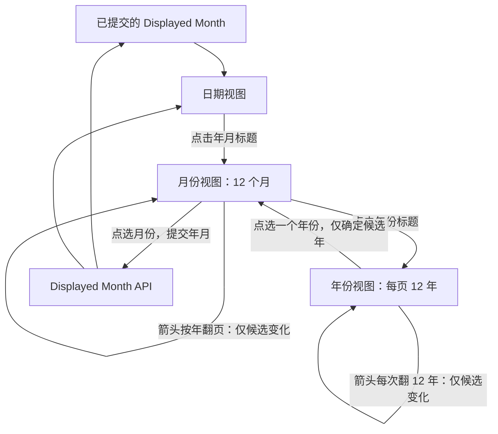

# 月份与年份快速定位视图

本方案在已有内嵌日期视图上增加**同一控件内的月份和年份快速选择**，形成日期、月份、年份三个层级。交付结果是可以通过点按标题和候选格子快速跨年定位的交互，而不靠反复点击上月/下月箭头。选择年月的候选过程与 Headless 的已提交 `displayed_month` 严格分开。

## 已提交年月与候选浏览的区别

日期视图中的 `displayed_month` 表示真正显示、已经提交的年月；进入月份和年份视图后，箭头翻页或挑选年份只是**临时导航**。只有最终点击某个月份，才通过既有显示月份 API 提交新的 `displayed_month`，发出真实变化通知。

候选年份、年份页及视图层级属于控件的私有临时交互状态，不是另一套业务年月 Authority。它们也不产生新的 SelectionChanged 或 DisplayedMonthChanged 业务事件。`selected_date` 始终独立，年月选择和浏览均不会清空或改写它。

## 三层视图的动作

1. **日期视图**：起始视图仍是星期标题加 6 行 × 7 列月历，顶部两侧箭头直接按月移动已提交 `displayed_month`，点击中央类似「2026 年 10 月」的标题进入月份视图。日期点击仍通过原有选中 Setter 完成。
2. **月份视图**：内部为 **3 列 × 4 行的 12 个月**。顶部显示年份；左右箭头改变临时候选年，不提交 `displayed_month`；点击年份标题进入年份视图。点击具体月份才确定完整年月，调用显示月份 Setter，并回到日期视图。
3. **年份视图**：每页 **3 列 × 4 行的连续 12 年**；左右箭头每次翻动 12 年。点击某个年份返回该年的月份视图，此时仍然没有提交完整显示年月。止于这第三层，不额外设计年代或世纪视图。

三个视图都在**一个内嵌 DatePicker** 中原位替换内容，不生成 Popup、子菜单或额外 Window。切换立即生效：无淡入淡出、横向滑动、模拟翻页或其他过渡动画。

### 高亮的依据

月份和年份层级高亮的是**当前真正已提交的显示年月**，而不是 `selected_date` 所属年月，也不是鼠标刚刚浏览到的候选项。

例如，`selected_date = 2026-10-15`，`displayed_month = 2026-12`：进入月份视图时高亮 **12 月**，不是已选日期所在的 10 月；进入年份视图时，若显示页包含 2026 年，就高亮 **2026 年**。日期视图中的选中底色仍然只表示 `selected_date` 对应的那一天。

如果从 2026 年 12 月进入月份视图，再按箭头浏览到 2027 年的 12 个月，候选页不包含已经提交的 2026 年 12 月，**不应伪造 2027 年某个月已选中**；年份视图翻页到不包含已提交年份的页时同理。仅点选某月并实际提交后，新的显示年月才成为高亮依据。

### 尺寸与视觉一致性

三个视图共享**相同外部宽高**，Header 与外框不因内容模式变化而跳动。日期视图保留 42 格完整月历；月份和年份只有四行，其单元格适当增加高度，填满同一个内容区域而不是让控件突然缩短。

月份/年份候选格的 Hover、Pressed、Disabled、文本及已提交高亮遵循常规 Theme 状态配色；它们不使用专属于日期“今天”的朱红色毛笔圈。常规配色可以采用控件的既有局部覆盖模式，未覆盖值随四套 Theme 变化。视图层级的暂存不需要新的业务变化通知。

## 范围、错误与直接验收

范围边界继续使用原有 `min_date` / `max_date`：**它们只限制日期选择，不阻止浏览其他月份或年份**。所以月份视图和年份视图即使在边界外也可用，不能因为某个候选月份没有可选日期就禁止查看它。点击月份只负责定位，不代表选择该月中的任何具体日期。

`InteractionDisabled`（包括祖先继承）阻止标题、候选格及箭头的鼠标交互；合法程序化日期或显示年月更新仍由 Headless API 处理。已有选中日期和 Today 视觉语义在视图切换中保持独立。直接设置与当前相同的年月不会借切换视图产生新的业务通知。

本增量的完成条件包括：

- 标题点击能够进入月份和年份视图；年份选择返回月份视图、月份选择提交并返回日期视图，三个视图没有弹窗和动画。
- 月份视图保持 3 × 4，年份视图保持连续 12 年的 3 × 4；各自箭头分别按 ±1 年和 ±12 年翻候选页；日期视图左右箭头仍按 ±1 月实际导航。
- 候选翻页、年份候选确定都不修改 `selected_date` / `displayed_month`，也不误发变化通知；选定月份仅在年月真实改变时发送 DisplayedMonthChanged。
- 已提交年月和被选中的日期不同的情况下，高亮依据正确；翻到不包含当前已提交项的候选页时没有虚假高亮。
- 切换三个层级时外部宽高稳定；月份/年份格子填充共同内容区域，四套 Theme 下与其他日期状态外观一致。
- Disabled 下无法通过鼠标切换视图或提交候选；区间外年月仍能浏览但无法借此选择越界日期。

对应的交互测试、状态通知测试、功能文档同步归属于本增量。
