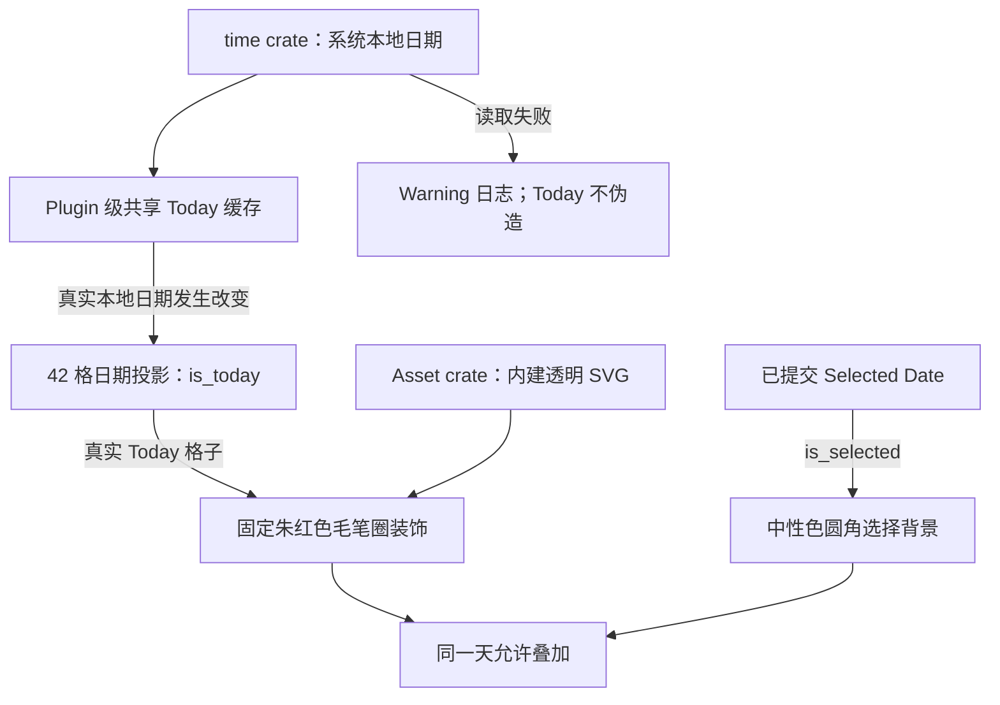

# 今天标识与固定毛笔圈素材

本方案在已经可操作的三层 DatePicker 上叠加**真实本地今天的视觉标记**。所需的独立朱红色毛笔圈矢量素材已随本方案交付，实施内容是**接入现成素材**，而不是重新绘制或制作素材。它不是生成新的选中日期能力：今天与当前选择可以相同，也可以不同；即使今天不在可选范围内，今天的标记仍然表达“本地今天”的事实。

## 本地日期与视图的关系

DatePicker 使用 `time::Date` 表达纯日期，没有时间、时区或时分秒；**系统本地日期只是今天的视觉输入**，不自动成为 `selected_date`，也不改变 `displayed_month`。内建素材把 Today 状态绘制在日期文本外侧，并允许与选中日期的中性背景叠加。

DatePicker Plugin 安装后共享本地日期缓存，而不是每个日期格分别获取时间；一次真实日期变化可使相关日历的 `is_today` 投影重新计算。这保证日期翻月、多个 DatePicker 同时显示和跨午夜时均以同一个可信的 Today 来源作判定。

## 固定朱红色笔圈：直接接入已交付素材

本方案附带可直接使用的原始矢量素材 [`assets/date_picker_today_brush.svg`](assets/date_picker_today_brush.svg)，不是效果图、截图占位或需要后续绘制的任务。SVG 由实际矢量轮廓构成，背景透明，颜色和形状已固定；另附 [`assets/date_picker_today_brush.png`](assets/date_picker_today_brush.png) 供不方便直接加载 SVG 的渲染路径使用，以及 [`assets/date_picker_today_brush_4x.png`](assets/date_picker_today_brush_4x.png) 供高分辨率位图备用或缩放检查。

接入时应使用上述现成素材，不重新绘制、替换成普通等粗圆环或要求后续实施者自行生成素材。具体视觉基于已确认的第二版笔圈：

- **颜色固定为朱红色**，四套 Theme 下保持一致，不能由控件 Props 或外部颜色覆盖修改。
- **仅左下角留一道缺口**，其他弧段连续；形态接近一圈不完全闭合的手绘印记。
- 笔触有明显但克制的粗细变化、轻微枯笔纹理；不是均匀圆形 Stroke，也不是每帧变化的随机噪声。
- 背景透明，内部留出日期数字与选中背景的空间；毛笔圈在文本外围，不盖住数字。
- 缩放保持笔触特征与可辨识度；没有进场时重复描画或视图切换动画。

素材物理文件和 Embedded Asset 注册由 `crates/asset` 统一管理；使用语义化的专用 Asset 标识（例如符合项目内建图片 / SVG 类型的标识），而不是在控件代码里直接拼接实体文件路径。内建 Asset 的注册、解析和加载遵循已有库规则；DatePicker Plugin 应确保所需 Asset Plugin 已注册，素材尚在等待加载时走既有 Asset 生命周期，不把取得标识当作已经成功渲染。

这项素材是 DatePicker 的内部视觉资源，而不是 Gallery 专用的展示图片，因此最终归属于库内建 Asset，不放入 Gallery 的应用素材目录。**素材文件本身已经交付**；本增量的代码改动仅需将随包提供的 SVG（或由它生成的渲染资源）安装到 `crates/asset`，完成 Embedded 注册、语义标识与日期视图的实际引用。无需在本增量增加美术资源制作任务。

### 今天、选中与状态反馈的叠加

- `is_today` 只取决于可信的系统本地日期与该格 `date` 是否相等，不取决于格子是不是本月或当前可选日期。
- `is_selected` 只取决于唯一 `selected_date`；选中状态采用已有随 Theme 变化的中性色圆角背景。
- 同一天既是 Today 又被选中时，**外层毛笔圈与内层选中背景共同显示**，两种语义互不覆盖。
- Hover、Pressed、Disabled 仍按既有 Theme 规则渲染，不改变固定笔圈的颜色或形状；今天处于禁选范围内也保留 Today 标识。
- 这层视觉与具体日期选择无关，因此不能在其他月份候选、年份候选或 Gallery 状态标签中误用笔圈。

## 跨午夜更新与读取失败

Plugin 级 Today 缓存以**约一分钟**为低频检查周期，只有可信本地日期实际改变时才刷新相关日期投影。应用从休眠恢复后也需要重新检查；如果宿主采用可休眠事件循环，检查机制必须能实际唤醒宿主，**不能假设普通 Bevy Timer 会自行唤醒休眠中的应用**。读取系统本地日期使用 Workspace 已启用 `local-offset` 的 `time` crate。

系统本地日期读取失败时，必须记录 **Warning 级别日志**，并且不得用其他日期伪造“今天”。当需要用本地日期决定初始 `displayed_month` 而又读取失败时，沿用日期模型中的初始化回退：

1. 优先采用构造期 `min_date` 所属年月。
2. 若没有 `min_date`，以当前 UTC 日期所在年月兜底。
3. 无论使用哪个回退，都不自动选中日期（`selected_date = None`），也不把回退日期当作 `is_today` 绘制朱红圈。

上述规则只用于**缺少显式年月和初始选中日期**、确实需要本地日期初始化显示月份的情况；更高优先级的配置仍优先。

在运行过程中，如果当次没有可信的本地日期，不能通过 `min_date` 或 UTC 日期把 Today 标记转移到某个备用日期。待重新获得可信本地日期后再依据真实值刷新 Today。**Today 变化、Today 暂不可用和恢复都不会修改选择或显示月份，也不发送两个业务状态变化事件。**

## 直接验收与资源归属

- 直接采用随方案交付的 `assets/date_picker_today_brush.svg`，确认源文件是真实的透明矢量路径（不内嵌 PNG），在默认及缩放尺寸下均能辨认出朱红色、左下单缺口、连续的其余弧线和略带枯笔的非均匀笔触；不覆盖日期数字。
- Asset crate 实际包含素材、Embedded 注册、语义标识；DatePicker 只通过语义引用加载，Plugin 确保相关 Asset 基础设施存在；四套 Theme 不改变笔圈外观。
- 同一天 Today + Selected 时同时存在固定外层红圈和中性色背景；Today 日期不在可选区间也能显示红圈，但不可点击。
- 约一分钟检查和跨午夜日期变化正确更新 `is_today`，不改 `selected_date` / `displayed_month`，也不发 SelectionChanged / DisplayedMonthChanged。
- 应用从休眠唤醒后能更新 Today；在可休眠事件循环中验证检查确实会按需唤醒，而不只是创建一个无法驱动宿主的普通 Timer。
- 模拟本地日期读取失败：有 `min_date` 时按其年月初始化，无 `min_date` 时使用 UTC 年月；两者均产出 Warning 日志、保留未选中且不显示伪造 Today 圈；后续成功读取可显示真实 Today。

本增量只实现固定 Today 标识及其日期同步，不引入日期自动选择、复杂动画、外部笔圈自定义或独立时区业务接口。相应日期控件、内建素材的功能文档同步属于本增量。
