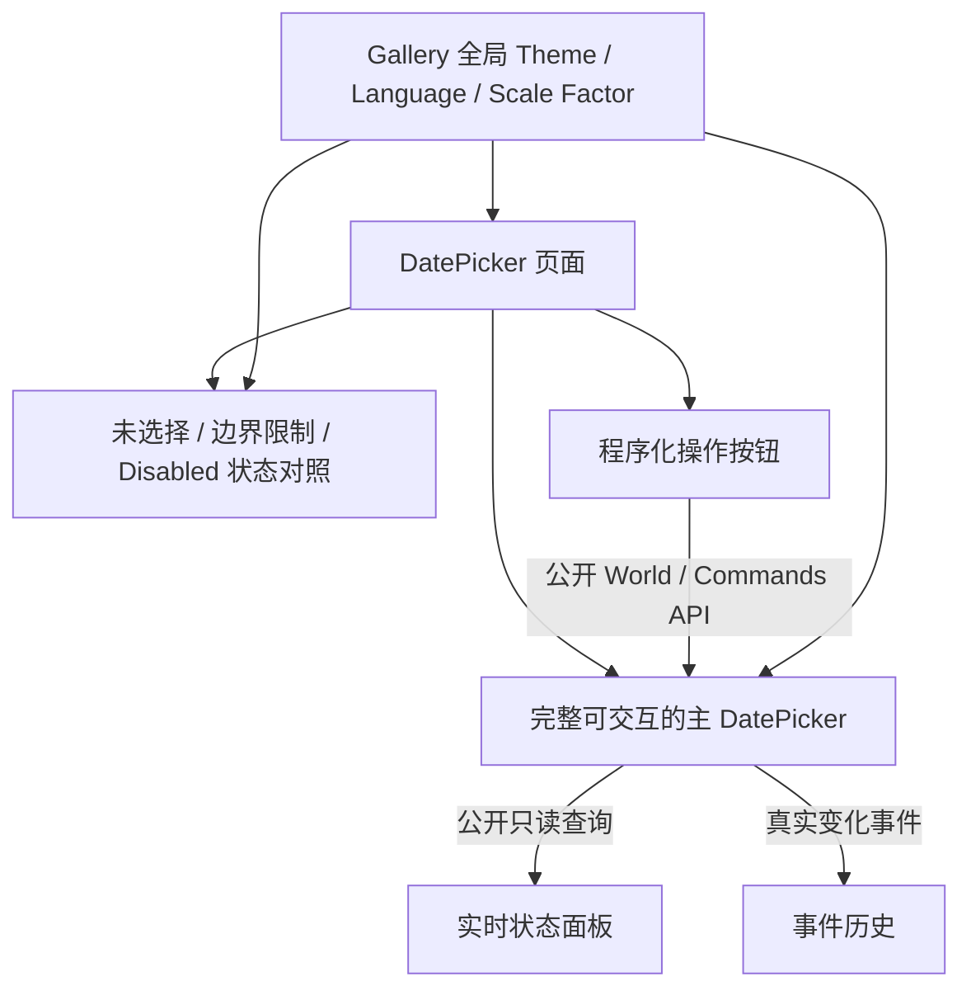

# Gallery 交互演示与状态观测

本方案为已经具备日期、月份、年份交互与 Today 标记的 `WidgetryDatePicker` 提供独立 Gallery 页面。交付的是**真实可操作的 DatePicker 示例、几组状态对照和可实时观察的状态/事件面板**，而不是另一种模拟日期控件。Gallery 既能展示用户体验，又能帮助确认“浏览月份不修改选择”“同值操作不重复通知”等关键契约。

## 页面组织与真实数据流

Gallery 保留现有的常驻应用框架，DatePicker 页面只负责本页面的演示 UI 和演示数据：进入页面时创建实例，离开时销毁，重新进入时重新初始化。Header 的 Theme、Language 和 Scale Factor 是独立的全局设置，不跟着页面销毁或重建。



核心是**Gallery 只查询控件、发送公开操作、观察真实事件**。面板显示的当前日期和月份不能以应用自建缓存取代控件内部状态；历史记录也不假装是状态本身。主实例可以直接演示选中、再点同值、清空、上下月浏览、由标题进入月份/年份视图和跨年定位。

## 主交互示例和程序化操作

页面主区域放置一个完整 DatePicker，旁边显示状态和事件记录。示意格式：

```text
Selected Date:     2026-10-25
Displayed Month:   2026-10

最近事件：
SelectionChanged(Some(2026-10-25))
DisplayedMonthChanged(2026-10)
```

上述值仅是展示格式例子，实际值必须从实例**公开只读 API**取得，事件记录只来自真正发布的 `WidgetryDatePickerSelectionChanged`、`WidgetryDatePickerDisplayedMonthChanged`。

程序化操作区至少能够触发已有 API 中与本演示目标有关的行为：设置有效日期、清空、重复设置同一日期、跳转指定年月，以及必要的跨月演示。外部按钮的存在不改变 DatePicker 自己的鼠标交互规则；`set_selected_date(None)` 依旧是清空的唯一业务入口，Gallery 不新建额外清空 API。

面板和事件区要足以辨认以下区别：

- 新选一个日期只在真实变化时更新选中状态；所选日期属于其他月份时，显示月份也会变化，两个事件都反映已提交状态。
- 浏览上个月/下个月或使用程序化跳月，只更新 `displayed_month`，不修改 `selected_date`。
- 再次点击或程序化设置相同日期不撤销选择、不自动跳回已选日期月份、也不重复发送事件。
- 清空 `Some(date) → None` 后显示月份保留；重复清空不新增事件。
- 年份页和月份页中的临时候选翻页不触发业务变化；选定月份才可能触发 DisplayedMonthChanged。
- Today 日期跨午夜或读取失败/恢复时只影响真实的今天视觉，不产生选择或显示月份变化通知。

## 状态对照与主题展示

主实例之外，提供几组简洁的状态对照，突出**未选择**、**带 `min_date` / `max_date` 的可选日期范围**以及**Disabled**。对照实例复用同一个 DatePicker 实现，并遵守它自己的有效禁用继承、日期边界与渲染规则；禁用后仍可通过程序化 API 合法改变状态。

Gallery 的现有全局 Theme 共有 **Dark、Light、Pink Dream、Kamuri Violet** 四套；Language 提供 **English / 简体中文**，Scale Factor 支持现有的多档缩放。切换这些全局选项应原位更新现有页面，不破坏选中日期、显示月份、临时视图选择等保留要求，也不重新构造日期模型。

- Theme 对照检查中性选中底色、普通文字、邻月/不可选日期、Hover、Pressed、Disabled，以及常规局部颜色覆盖；Today 的朱红毛笔圈颜色和形状在四套 Theme 下固定。
- 语言对照检查页面导航、标题、按钮、星期和月份/年份相关文字的中英文表达，符合 Gallery 现有本地化切换机制。
- 缩放对照检查 6 × 7 日期格、两个 3 × 4 候选网格、三个视图外部宽高一致，以及透明 SVG 笔圈的清晰度、数字避让和左下缺口。
- 页面可以使用既有 Theme Colors 与 Overrides 展示模式观察当前配色；Today 笔圈不加入外部覆写项。

内建毛笔圈素材本身已由库 Asset crate 管理，Gallery 使用控件即可显示，**不单独复制一套素材到 Gallery 应用目录**。

## 集成和生命周期

该页面遵守既有 Gallery 的 BSN UI 组合方式，不引入另一套非 BSN 控件创建机制。页面的演示按钮、查询面板、事件计数与显示文字归 Gallery 应用所有；库 crate 不依赖 Gallery，也不为此新增通用 Core 调试状态。退出页面应清理演示实例、观察数据和事件历史，再进入可从初始演示状态重新开始；全局 Header 设置保持原状。

Gallery 已集成 BRP Runtime，可以查询 ECS 状态和执行 GUI 输入、获取 Screenshot，用于核查状态与视觉的一致性。BRP 只是观测与交互验证手段，不替代公开 DatePicker 语义契约或控件层测试。

相关集成文档应同步更新 Gallery 页面导航与演示说明、控件功能文档及架构/Facade 所需的公开入口说明。实现仍以现有 Windows x64（MSVC）、DX12 目标为准，不因为演示页面增加其他平台兼容层。

## 完成条件

- Gallery 导航能进入 DatePicker 页面；主实例真实可点击并支持上下月、三级年月导航、有效日期选中与清空；关闭页面后局部状态回收，再进入时重新初始化。
- 状态面板从公开只读 API 获取 `selected_date` / `displayed_month`；事件历史来自真正的两个通知，能区分 SelectionChanged(`None`)、DisplayedMonthChanged、同值无事件及临时候选浏览无事件。
- 程序化操作能够验证有效设置、同值设置、清空、跨月跳转；与鼠标操作共用同一行为契约。
- 未选择、受边界限制、Disabled 对照均真实反映日期可选性和有效禁用；边界外月份仍可浏览，Disabled 不阻止合法程序化调用。
- 四套 Theme、English / 简体中文和不同 Scale Factor 原位切换；三个视图不改变外部尺寸、不产生动画，朱红色毛笔圈不受 Theme 覆盖并与中性色选中背景正确叠加。
- 使用 Gallery 交互与 BRP 观测检查 Today 变化不产生业务事件、日期显示和状态一致；完成最终的直接相关集成回归，不另拆单纯验收方案。

本增量只提供演示和观测功能，不添加日期输入框、Popup、日期区间选择、键盘日期导航或通用绑定框架。
