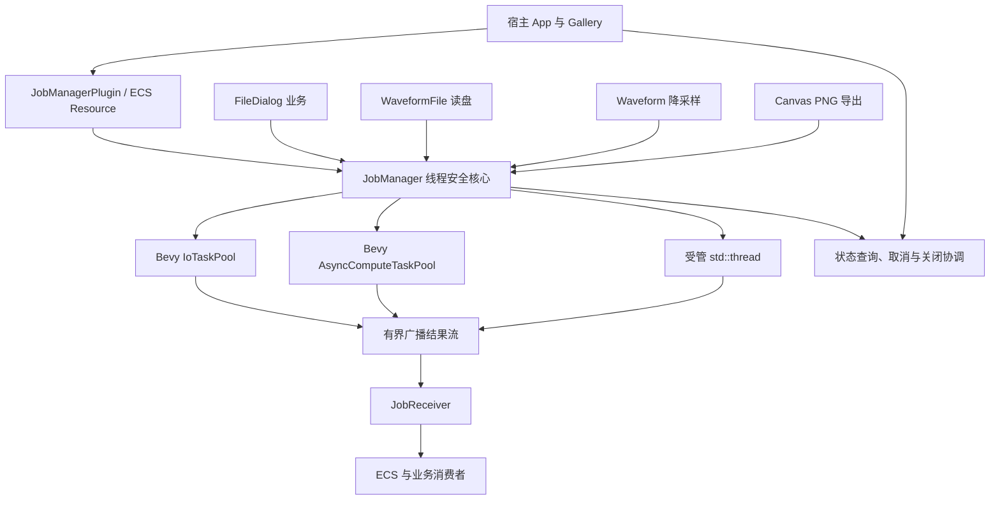

# 统一 Job 管理系统：整体设计与实施关系

项目已经拥有异步 I/O、CPU 后台计算、磁盘读取线程和 GPU 截图后的编码任务，但各功能分别持有 Task、线程、队列、取消标记与退出逻辑。统一 JobManager 的目标不是建立另一套执行器，而是在 Bevy 0.20 的执行设施之上建立**应用级任务控制面**：统一身份、状态、协作取消、真实退出确认、结果广播、显式记录移除和全局关闭。业务仍然决定处理什么数据、怎样计算、哪些旧请求应丢弃，以及何时把结果提交给 UI。取消请求只使 Job 进入 `Stopping`；未启动且确认不会执行，或已启动任务明确确认响应取消、正常返回并真实退出后，才能进入 `Canceled`。已请求取消但未确认的正常结束仍为 `Completed`，顶层错误始终为 `Failed`。

这张图有意不把 `FileDialog` 的 Session/Token、`Waveform` 的请求代数、`Canvas` 的截图阶段放入 JobManager：它们是业务身份和业务阶段，不是通用任务状态。`JobId` 只标记一项完整业务操作；一个 Job 可以在自身执行过程内协调 I/O 和 CPU 步骤，而不必将每个步骤登记成新的 Job。

## 结果与执行状态为何分离

JobManager 可先记录执行已经 `Completed`，但某个 Receiver 仍有未读 Batch。ECS 只有实际处理完该订阅的所有 `Item` 并读取到 `Finished(Completed)`，才能把对应业务画面标记为完成。进度也是业务定义的结果项，例如 `FileReadEvent::Progress`；JobManager 不存百分比，也不自动发送 `JobStateChanged`。任务的 `status(job_id)` 仍服务于关闭、取消、诊断和控制。多个订阅者消费位置独立，完成显示时刻也可以不同。

结果传输统一采用 `async-broadcast 0.7.2`，内部传递 `Arc<T>`；缓冲容量按发送的**结果项数**计，不按字节、样本数或者业务 Batch 大小计。最终执行结果独立于普通有界数据缓冲保存，Receiver 排空自己的数据后才能观察到一次 `Finished`。`tracing` 使用既有日志系统，任务启动时建立包含 JobId 的 Span；库生产代码遵守统一内部日志入口，宿主负责输出与过滤。

## 现有模块与统一管理边界

- `crates/file_dialog/src/runtime.rs`、`worker.rs`：现有两条 I/O worker、一条 CPU worker、`crossbeam-channel`、Session Token、请求覆盖及有界更新预算。迁移应保留 Session 过滤、手工 Headless Reply、偏好读写与后台释放大快照等契约，而不是照搬旧的 worker 队列到 JobManager。
- `crates/waveform_file/src/source.rs`：现有专属 `std::thread`、`Condvar`、按 reader 只保留最新请求以及 `Pending`/`Ready`。受管长期线程可以替代线程所有权，业务仍负责 reader 队列、请求身份、过期结果和 `DiskSourceStats`。
- `crates/waveform/src/runtime.rs`：大工作集使用 `AsyncComputeTaskPool` 重建降采样并校验 generation，必须继续保留快照原子提交与 Reactive 重绘。
- `crates/canvas/src/export/png.rs`：ECS/GPU 准备与 ScreenshotCaptured 回调先于后台 PNG 编码写盘；JobManager 管理完整导出操作生命周期，但不接管 RenderApp、相机或截图实现。
- `gallery/src/pages/waveform/disk.rs`：异步加载磁盘 Source 当前直接持有 `Task`，应通过 Job 结果替代手写 poll，并继续执行旧加载失效校验。
- `gallery/src/gallery.rs`、`pages.rs`、`main.rs`、`i18n/`：新增 Job 演示入口与退出收尾；可复用既有 Button、ProgressBar、MessageBox、Window、BSN、主题及中英文翻译。`app_logging`、`internal_log`、`core` 和普通 UI 控件不因统一任务管理而重新实现自己的功能。日志 appender、Bevy 内部线程、BRP 和 GPU 内部任务并非此处的业务 Job。

Gallery 的 `WinitSettings::desktop_app()` 使用 Reactive 更新，后台结果抵达时必须能跨线程唤醒主循环；否则 `try_recv()` 的确不会阻塞，却可能迟迟不被调用。另一方面，宿主需要在正常退出之前调用非阻塞的 `begin_shutdown(timeout)`，并在等待、超时通知与决定强制退出之间保持应用事件循环运行。

## 唯一实施顺序

下面的编号给出一条唯一的实施顺序，不代表每两个相邻方案之间都存在技术依赖。通用控制面先形成，FileDialog 按**可以独立使用和验收的业务动作**迁移，随后纳管其他后台功能，最后再由 Gallery 展示与衔接真实应用退出。

1. [建立 Job 注册表与异步执行入口](01-建立Job注册表与异步执行入口.md)
2. [增加有界结果广播与独立订阅](02-增加有界结果广播与独立订阅.md)
3. [增加协作取消与完整状态转换](03-增加协作取消与完整状态转换.md)
4. [纳管独立线程与真实退出回收](04-纳管独立线程与真实退出回收.md)
5. [统一应用关闭与超时通知](05-统一应用关闭与超时通知.md)
6. [接入 Bevy Resource 与 Reactive 唤醒](06-接入BevyResource与Reactive唤醒.md)
7. [迁移 FileDialog 目录流式读取](07-迁移FileDialog目录流式读取.md)
8. [迁移 FileDialog 目录投影计算](08-迁移FileDialog目录投影计算.md)
9. [迁移 FileDialog 选择意图计算](09-迁移FileDialog选择意图计算.md)
10. [迁移 FileDialog 候选确认校验](10-迁移FileDialog候选确认校验.md)
11. [迁移 FileDialog 创建文件夹操作](11-迁移FileDialog创建文件夹操作.md)
12. [迁移 FileDialog 位置查询操作](12-迁移FileDialog位置查询操作.md)
13. [迁移 FileDialog 偏好读写并退役 Worker](13-迁移FileDialog偏好读写并退役Worker.md)
14. [纳管 WaveformFile 磁盘读取服务](14-纳管WaveformFile磁盘读取服务.md)
15. [纳管 Waveform 后台降采样](15-纳管Waveform后台降采样.md)
16. [纳管 Canvas PNG 导出](16-纳管CanvasPNG导出.md)
17. [在 Gallery 展示 Job 完整行为](17-在Gallery展示Job完整行为.md)
18. [在 Gallery 接入应用退出收尾](18-在Gallery接入应用退出收尾.md)

FileDialog 第 7—13 项通过仍在使用的旧 Worker 过渡；其中候选准备和路径校验是同一项完整业务操作，所以保持在第 10 项一个 Job 内，不错误拆成两个任务。目录投影、选择 Intent、创建文件夹与位置查询则可以独立实施和验收。第 13 项是 FileDialog 的原 Worker 退役边界；第 14 项必须协调 WaveformFile 的磁盘 Source 与 Gallery 的加载调用处；第 15—16 项分别处理现有后台重建和导出阶段。最终跨模块的直接影响回归并入第 18 项，不另设只做检查的实施计划。
