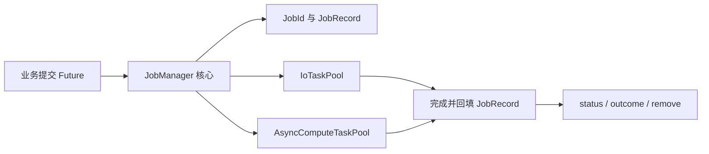

# 建立 Job 注册表与异步执行入口

目标是让一个应用内的所有普通异步业务操作具备统一身份、执行状态、错误与可查询记录，并能够在 Bevy 现有两个任务池上运行。这个增量建立核心控制面，不自行开发线程池、通用队列、优先级或并发限流器；后续广播、取消和关闭能力直接建立在这里。

## 核心与 App 实例的关系

JobManager 是一个由共享状态和可克隆线程安全 Handle 构成的 **ECS 无关核心**，由后续插件作为 ECS Resource 注入一份 App 实例。应用中只有这一份 Manager，后台线程可以持有其 Handle；绝不使用进程级 `static` 单例来决定业务归属。业务 crate 直接依赖独立的基础设施 crate `bevy_widgetry_job`，不经 Facade 反向依赖 Widget。

`JobId` 为 Manager 生命周期内严格单调递增的 `u64`，不回收也不复用；接近最大值时返回提交失败，禁止绕回。记录独立保存 `JobId`、分类（I/O、CPU，后续增加 Thread）、状态、最终错误、业务可选标识及任务运行控制柄。初始记录 `Pending`，开始执行后 `Running`，正常结束 `Completed`，返回 Job 顶层 `Err` 或可捕捉 panic 时 `Failed`。**业务内部处理过的数据项错误不自动使整个 Job Failed**。`Completed`、`Failed`、`Canceled` 为终态且不可改写。

记录永久保留直到业务显式 `remove(job_id)`。只有终态才能移除，`Pending`、`Running`、`Stopping` 返回 `NotFinished(current_state)`，未知 ID 返回 `NotFound`，移除不触发取消。这个记录生命周期独立于后续结果 Receiver 的生命周期；`remove` 不能销毁已经发给消费者的未读数据。

## 两类异步 Job

I/O 类业务提交返回 `Future` 的工作，由 Bevy `IoTaskPool` 执行；CPU 类业务同样提交 Future，由 `AsyncComputeTaskPool` 执行。可以采用 `FnOnce(JobContext<T>) -> Future` 构造接口，确保执行体最终是 Future，而不是把同步阻塞闭包伪装成异步入口。Future 返回顶层结果 `Result<(), E>`；在此基础增量中 `Ok(())` 表示正常完成，不要求产生数据。后续协作取消增量将加入 `JobContext::acknowledge_cancel()`：只有取消已经被请求、执行体明确确认因取消而退出且最终返回 `Ok(())`，才能裁决为 `Canceled`；其余 `Ok(())` 仍为 `Completed`，顶层 `Err` / 可捕捉 panic 始终为 `Failed`。不通过读取取消标志自动把 `Ok(())` 改判为 `Canceled`。没有数据流的 Job 仍使用明确的结果类型（例如 `()`），最终提交接口始终返回 `(JobId, JobReceiver<T>)`，并在 Future **获得执行机会之前**完成初始 Receiver 注册；第二份方案补全类型化数据广播能力。

JobManager 不自动判断 Future 内是否包含阻塞磁盘 API；生产业务决定使用真正异步 I/O、适当阶段划分或后续受管专属线程。CPU Job 内部可以选择自己的 Rayon 计算，但 Manager 不负责调度 Rayon，不另建 Rayon 线程池，且需要留意与 Bevy 工作线程争用。Future 内部如有分步异步操作，必须等待实际完成，不得借 `detach()` 让主 Job 先进入终态。

任务句柄保留到执行完成并被收割；错误返回与 panic 分别进入统一 `JobError` 诊断信息，既可由 `status(job_id)` 查询，也由后续 Receiver 的 `Finished(Failed(..))` 获知。未被捕捉的进程 abort 不承诺转换为 Failed。日志复用既有 `tracing`，在任务起点创建带 `job_id` 的 Span：Future 使用 `Instrument`，业务在自己的执行体内继续使用既有日志宏。Widgetry 库生产日志走 `bevy_widgetry_internal_log` 统一 target，宿主 Gallery 使用普通 Bevy 宏；库不安装订阅器。

## 交付与验证

建立独立 crate、workspace dependency 与核心纯逻辑 API，并完成异步任务成功、显式错误、panic、跨线程查询、单 App 唯一实例、并发提交 ID 唯一及 ID 耗尽路径测试。用可控 Future 验证 `Pending` 已登记才执行、`Running` 的状态可观察、终态不反转。要求无新通用执行器和无限增长的内部任务队列；记录有意长期保留而不是隐式淘汰。

本方案先形成任务执行与记录基础；广播、取消、独立线程、全局关闭以及 ECS Plugin 分别由后续增量完善。在完成独立订阅前，Receiver 可以只承载终止结果，不提前实现第二份方案的完整流式机制。
