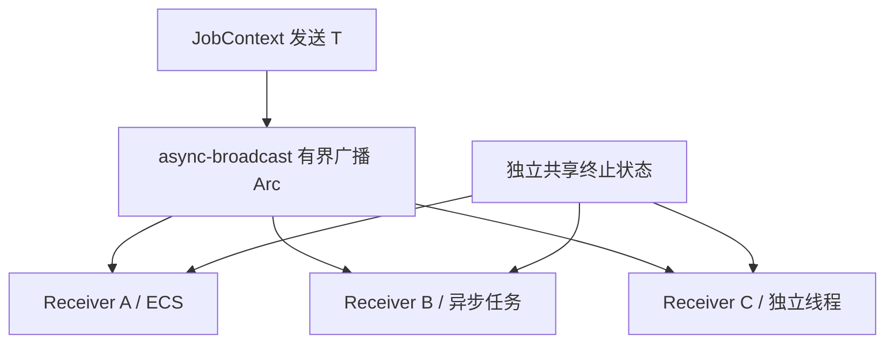

# 增加有界结果广播与独立订阅

这个增量把 Job 的数据传输从 ECS 控制面分离出来。一次 Job 可以产生零条、一条或连续多条任意业务类型结果，并允许不同线程、异步任务和 ECS System 各自订阅同一份数据，互不争抢条目，也不复制大型业务 Batch。

## 通道与结果类型

统一使用 `async-broadcast 0.7.2`，发送 `Arc<T>`，接收接口暴露 `JobMessage<T> = Item(Arc<T>) | Finished(JobOutcome)`。业务定义 `T`，例如 `FileBatch`、`DevicePacket`，或包含 `Batch` 和 `Progress` 两种变体的业务事件枚举。一个 `send(T)` 恰好是一条结果项，`buffer_capacity` 统计条数，不统计字节、样本或 Batch 的业务含义；没有 JobManager 级 `Batch` Trait 或进度 API。一般业务需要 `T: Send + Sync + 'static`，无需让整个 `T: Clone`，多个订阅者共享同一个 `Arc<T>`，允许业务为自身持有的类型选择只读约定；JobManager 不修改内容。

配置采用管理器默认容量与每 Job `JobOptions` 覆盖，建议默认 32，零容量拒绝提交。多订阅者读取位置相互独立；缓冲上限按所有活跃订阅者尚需的数据项共同约束，最慢活跃订阅者可以造成背压。关闭 `overflow`，禁止悄悄覆盖未消费的数据；接收时出现 `Overflowed` 视为内部契约破坏而不是正常数据丢失。消费者长期持有 `Arc<T>`、极大的单项负载仍可令实际内存超出条目数限制，业务负责控制结果项尺寸。

## 订阅边界与保留行为

提交时原子建立结果通道与首个 Receiver，然后才允许 Job 执行，以免首批结果丢失。`subscribe::<T>(job_id)` 通过内部类型擦除注册表恢复类型安全；类型不符返回 `TypeMismatch`。新订阅者只从**订阅发生后**的结果开始接收，不回放历史。新订阅仅允许 `Pending`、`Running`，进入 `Stopping` 后禁止创建新订阅，所有终态亦禁止。状态检查与底层 `new_receiver` 注册必须在同一同步保护下完成，不得出现检查通过但 Job 已结束的竞态。`JobReceiver` 不对外简单暴露底层 Clone，避免克隆继承已有未读记录而违反“新订阅从现在开始”的约定。

Drop 一个 Receiver 立即解除该订阅并释放其未读消息引用。业务无活动订阅者时发送结果不等待，也不产生 Job 失败：Manager 内保留 `InactiveReceiver` 使通道仍可接受后来订阅，配置 `set_await_active(false)`，把无活跃 Receiver 的返回视作该条数据正常丢弃。加入后开始接收新数据，不能恢复过去丢弃的内容。Receiver 生命周期独立于 Job 记录，终态后 `remove(job_id)` 也不能破坏已经获得的 Receiver。

## 数据结束与发送完成

普通发送只受结果容量和取消协作限制。最终结果 `JobOutcome::Completed | Failed(JobError) | Canceled` 另存共享终止状态，**不占 `buffer_capacity`**，不能因缓冲满而推迟真实任务终结。Job 终止时关闭生产侧并公布终止状态；每个已有 Receiver 按序消费自身积压的全部 `Item`，之后恰好观察到一次 `Finished(outcome)`，再之后才表现为流已结束。关闭已终止 Job 的数据通道不丢弃先前条目；Manager 记录的状态与 UI 消费到 `Finished` 的时刻可以不同。

业务消费者可使用 `try_recv`、异步 `recv`，以及底层库支持的同步阻塞接收方式，具体封装只提供保证上述语义所需的接口；普通无限期阻塞调用不能在 ECS 主线程或池工作线程中使用。`async-broadcast` 没有原生同步 `recv_timeout()`，不得把它写成可直接转发的现成 API。`try_recv` 需区分 Empty、流关闭和已经交付的 Finished；ECS 可以每帧设置处理项数/时间预算。终止状态和未读数据须由 Receiver 自己持有，使 Job 记录移除后仍能收尾。

## 交付与验证

两个以上不同速度 Receiver 各获得自己的全序消息；新订阅不回放；首个 Receiver 不丢首批结果；在 Pending/Running 允许订阅，在 Stopping/终态拒绝；类型错误拒绝；满缓冲产生背压不覆盖；Drop 慢订阅后生产者恢复；无人订阅时不阻塞；Finished 不消耗容量，即使缓冲满也不阻止 Job 转终态；移除终态记录后已持有 Receiver 仍可排空并观察失败信息。另测一次性结果、零数据 Job、大 `Arc<T>` 不复制业务负载与进度项的流内顺序。

此增量依赖前一方案的 Job 身份、状态和运行入口；取消等待中的发送、关闭应用时的行为由后续方案扩充，不在这里建立第二套调度系统。
