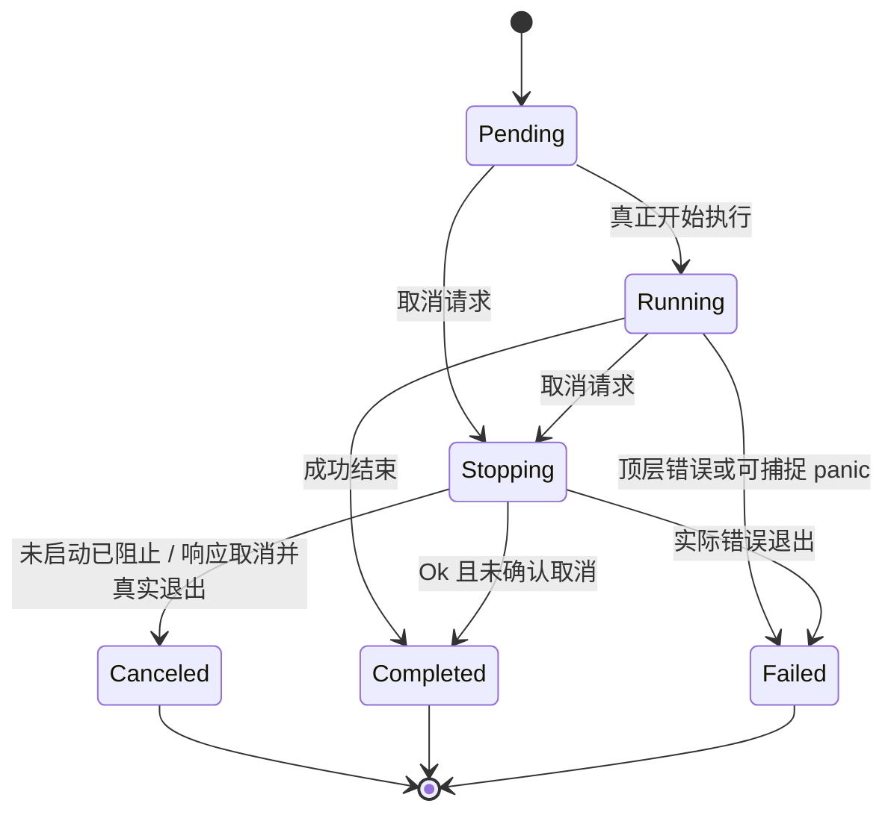
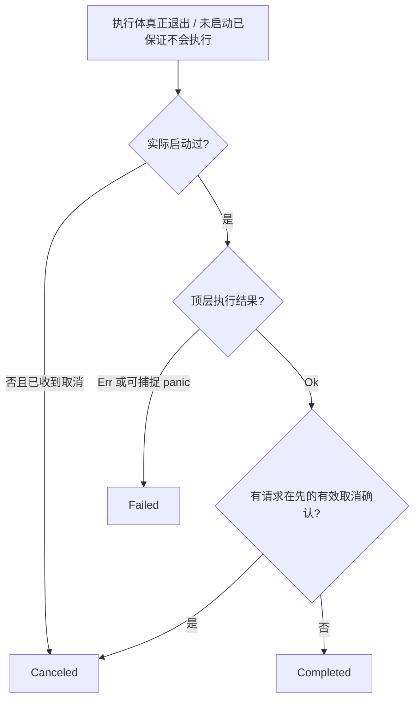

# 增加协作取消与完整状态转换

这个增量让业务能通过统一 `cancel(job_id)` 请求已登记 Job 停止，同时严格区分“已经提出停止请求”和“执行体真的停止”。只允许协作式取消，不硬杀线程、不直接借 TaskHandle 的 Drop 或 abort 伪造 `Canceled`。**终态裁决综合执行体真实退出结果和明确的取消确认，不以是否调用过 `cancel()` 或是否读取过取消标志推断退出原因。**



## 明确的状态转换矩阵

下表按**行是原状态、列是目标状态**列出合法变化，`×` 表示绝不允许发生的跳转。同态格子仅表示状态不变或重复操作的 No-op，并不是重新进入相同状态。

| 当前状态 \ 目标状态 | Pending | Running | Stopping | Completed | Failed | Canceled |
| --- | --- | --- | --- | --- | --- | --- |
| Pending | 等待中 | 开始执行 | 申请取消 | × | × | × |
| Running | × | 正在执行 | 申请取消 | 实际成功 | 实际错误 / panic | × |
| Stopping | × | × | 重复取消无效 | `Ok` 且无有效取消确认 | `Err` / panic | 未启动不再执行，或有效确认取消且 `Ok` 退出 |
| Completed | × | × | × | 终态保持 | × | × |
| Failed | × | × | × | × | 终态保持 | × |
| Canceled | × | × | × | × | × | 终态保持 |

Pending 收到取消也必须先进入 `Stopping`，待确认不再可能被调度执行后才成为 `Canceled`。对已经启动的 Job，取消与自然完成/错误退出可能竞争；终态由真实退出结果以及业务是否明确确认响应取消共同裁决，不能仅因请求发生在最终提交之前就把成功结果改判为取消。重复取消 `Stopping` 为 No-op，重复取消终态必须保留原终态及原错误。对未知 Job 返回 `NotFound`；有效调用可区别 `CancelRequested`、`AlreadyStopping`、`AlreadyFinished`。

## 退出原因与终态裁决

执行体的顶层返回仍为 `Result<(), E>`，不增加专门的 `Canceled` 返回变体。为了区分“收到了取消请求但自然完成”和“业务明确响应取消后退出”，`JobContext` 增加 `acknowledge_cancel() -> bool`：仅在本 Job 已经收到取消请求、且运行体仍处于有效执行期内，才记录一次**取消已被业务确认**并返回 `true`；否则不设置标志并返回 `false`。它只记录退出意图，**不直接把状态改为 `Canceled`**。业务应在决定停止当前工作、完成必要清理、准备退出时调用，而不是在首次检查取消标志时提前调用。



| 执行情况 | 有效取消确认 | 最终结果 |
| --- | --- | --- |
| 尚未开始执行，取消后已保证不会启动 | 不需要业务确认 | `Canceled` |
| 执行体返回 `Ok(())` | 无（包括虽然收到取消但继续做完） | `Completed` |
| 执行体返回 `Ok(())` | 有，且请求取消已经成立 | `Canceled` |
| 执行体返回 `Err(error)` | 任意 | `Failed(error)` |
| 执行体发生可捕捉 panic | 任意 | `Failed(panic 信息)` |
| 已请求取消，但执行体或需收割的线程尚未真正结束 | 任意 | 保持 `Stopping`，不能发布终态 |

例如读取文件时，即使 `cancel(job_id)` 已把任务置为 `Stopping`，任务恰好读完并正常返回 `Ok(())`、从未确认取消，则终态仍是 `Completed`。如果任务发现取消、结束读取循环、完成必要清理、调用 `acknowledge_cancel()` 并返回 `Ok(())`，在执行体真实退出后才成为 `Canceled`。清理失败而返回 `Err` 时仍是 `Failed`，不能用先前的确认掩盖错误。

异步和同步 Job 使用同一规则。示意中的取消分支必须在确认时已经完成停止所需的业务操作：

```rust
if context.is_cancelled() {
    cleanup_resources()?;
    if context.acknowledge_cancel() {
        return Ok(());
    }
}
// 未确认取消时仍按业务自身逻辑继续或返回真实错误。
```

`is_cancelled()`、异步等待取消通知以及 `send(T)` 收到 `SendError::Canceled` 都**不会自动构成取消确认**：观察到请求不等于业务决定以取消结束。业务可把 `SendError::Canceled` 当作进入停止与清理分支的正常信号，但不能未经区分直接将它上抛为顶层业务 `Err`，否则按失败裁决。允许取消后仍完成剩余工作并正常返回，此时若未确认取消就是 `Completed`。

任务结束时，由 Manager 对取消请求、有效确认、顶层结果与执行句柄收割作一次受保护的终态裁决，并将相同 `JobOutcome` 一次性公布给所有 Receiver。`cancel()` 和终态提交共用一致的状态同步边界：终态先提交则后续取消为 `AlreadyFinished`；取消请求先提交而任务仍自然成功，则先观察 `Stopping`，随后可以进入 `Completed`。一旦终态确定，不得被迟到的取消或迟到的确认改写。独立线程需要真实退出且完成 Join 收割后才发布终态。

## 统一取消机制

`cancel(job_id)` 是唯一用户可见的取消申请入口。运行体通过 `JobContext` 查询当前取消状态、异步等待取消通知或在需要时通过同一个 Manager 接口提出取消；`acknowledge_cancel()` 只确认已有取消请求，不是新的取消申请接口，也不是自定义的顶层 `Canceled` 返回值。业务主动处理的单包解析错误不改变 Job 状态。业务接到取消后主动终止 I/O 循环、释放业务资源并退出；Manager 在此之前保留执行句柄和 Stopping 状态。

JobManager 自己控制的发送背压必须能被取消主动唤醒。异步 `send(T)` 将通道空间可用与取消信号作为两个可唤醒条件，取消优先于继续等待。`SendError::Canceled` 仅表示发送操作已因取消请求退出等待，**不是业务 Job Failed，也不是自动确认整个 Job Canceled**。如果仍允许某项清理数据在 Stopping 中发送，只能由业务在取消竞争中明确完成，不能导致无限等待；最终管理器存储的 Finished 必须独立于该通道容量。取消信号发生时不得贸然关闭读端造成丢数据；发送端的关闭时机与已发结果的排空、终态公布协调。

`JobContext` 可供业务检查 `is_cancelled()`，但 Manager 不负责打断任意不可中断的系统调用。对于阻塞第三方设备 I/O，业务必须安排能退出的设备停止调用、超时或其他可中断机制；本增量不增加强制杀死线程等危险行为。

## 交付与验证

按矩阵覆盖所有合法边和典型禁止边，构造启动前取消、运行中取消、取消与完成竞争、取消与错误竞争、重复取消、终态不反转、未知 ID，以及 Job 在满缓冲等待 send 时取消能够解除等待的测试。明确使用同步栅栏覆盖：取消后 `Ok` 未确认应为 `Completed`；取消后有效确认再 `Ok` 应为 `Canceled`；无取消请求的错误确认尝试返回 `false`，随后 `Ok` 仍为 `Completed`；确认后返回 `Err` 或 panic 应为 `Failed`；确认已记录但执行体尚未退出必须保持 `Stopping`；执行完成和取消竞争时最终只能确定一个不可逆终态；`SendError::Canceled` 后未确认取消不能自动改判为 `Canceled`。Receiver 在取消前已收到的 Item 仍可全部读取，随后只得到与 Manager 记录一致的一次 `Finished(outcome)`，即便 Job 记录已被移除也能排空。

该能力服务于所有执行后端。后续独立线程和应用整体关闭均复用同一取消申请与状态转换规则，不建立“线程专用取消标志”和“应用专用取消语义”两套外部接口。
