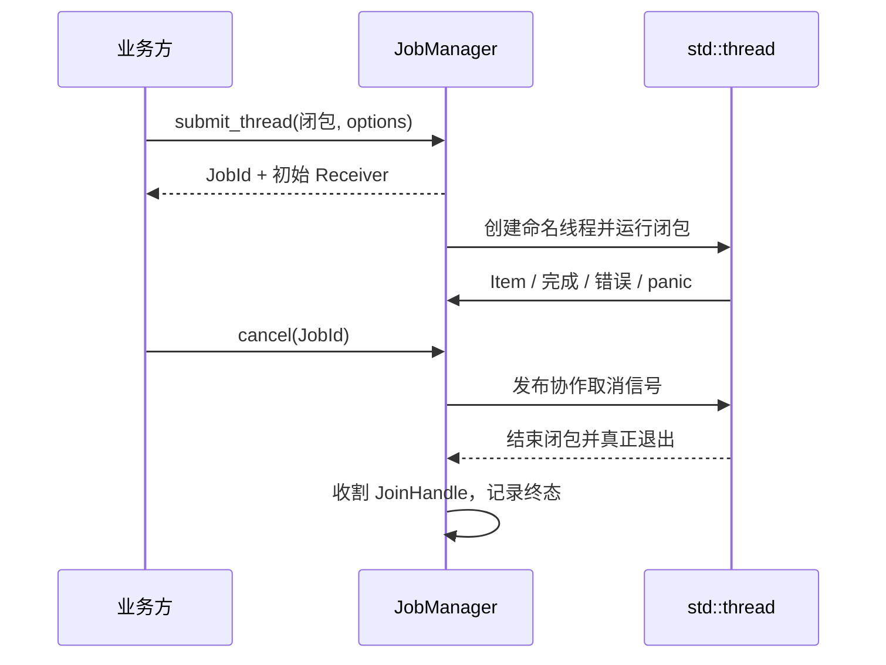

# 纳管独立线程与真实退出回收

独立线程适用于需要持续运行、并且必须调用阻塞式设备或磁盘 API 的长期业务操作。JobManager 不为这类工作建立第三套异步运行时或通用阻塞线程池，而是直接拥有每个受管 `std::thread` 的线程句柄、取消上下文和退出记录。业务线程结束后，Manager 必须完成实际回收，才能确认这项工作的生命周期。

## 独立线程执行边界

提供与 I/O、CPU Future 入口同一风格的提交方法，但线程执行体是普通 `FnOnce(JobContext<T>) -> Result<(), E>`，不强制业务方写 Future。线程使用 `std::thread::Builder` 创建可诊断的名称，便于定位设备监听、独立磁盘读取和其他有真实阻塞调用的服务。Manager 统一登记 `Pending`、`Running` 和退出状态，创建线程失败以可观察的提交/启动失败体现，不能留下永远 Running 的幽灵记录。初始 Receiver 在可能启动线程前注册，确保第一条结果不丢失。

线程内可以长时间等待设备或业务自己的条件变量，但这些等待必须能被业务自己的退出机制唤醒。JobManager 只能对自己提供的取消通知和结果发送背压保证取消唤醒；无法安全中断第三方不可中断的同步系统调用。不要在 ECS System 或 Bevy 工作线程里调用同步阻塞接收来伪造此执行模式。

## 真实回收与最终状态

Manager 保留 `JoinHandle`，线程闭包结束后在非 ECS 主线程的合适回收路径进行 `join`；不允许只在最后一个 Arc Drop 时静默 detach，或者为等待 join 阻塞 UI。需要避免线程自己 `join` 自己；捕捉可捕捉 panic，转为 Job `Failed` 和错误诊断，仍回收句柄。即使业务主动 Drop 发给自己的 `JobReceiver<T>`，任务仍由 Manager 控制，不以 Receiver 是否存在判断线程是否已退出。

`cancel()` 将 Pending/Running 转入 `Stopping`，再触发业务已约定的可中断退出路径；**取消请求之后线程仍存在时，绝不进入 `Canceled`**。线程返回业务顶层错误或发生可捕捉 panic，最终为 `Failed`；收到取消后正常返回 `Ok(())`，如果没有通过 `JobContext::acknowledge_cancel()` 明确确认响应取消，仍是 `Completed`；只有有效确认取消、最终返回 `Ok(())`，且线程真正退出并完成 Join 后才是 `Canceled`。尚未启动即被取消并保证不再执行的线程 Job 不要求业务确认。不能把“调用过 cancel”或“线程收到取消信号”作为 `Canceled` 的充分条件。终止结果独立保存，之前发送的 `Item` 保留给已有 Receiver 排空。

### 与结果通道的边界

所有线程 Job 仍使用统一 `JobReceiver<T>` 和 `Arc<T>` 广播，不建立线程专用单消费者 channel。线程可以把需要同步发送的操作适配到统一背压及取消机制；如使用底层同步 `broadcast_blocking`，Manager 必须让阻塞的发送在取消时解除，不得永久卡在满缓冲上。无活跃订阅者时，线程发送数据正常丢弃，但这不是 Job 错误。同步消费方式由业务按实际线程场景选择，不要求在 JobManager 中伪装底层库没有的超时接收 API。

## 验证与交付

提供可实际创建、取消并回收的命名线程 Job：测试正常退出、取消后未确认而正常完成、确认取消后正常退出、确认后发生错误、panic、线程创建失败、取消后业务延迟退出、阻塞发送时取消、没有订阅者、重复取消与多次回收都不触发状态倒退。通过同步栅栏制造“请求停止已发但线程还未退出”的阶段，证明状态持续 `Stopping`、主线程仍可执行，并在回收后公布一次 `Finished`。线程和结果通道相关的并发测试应有确定性同步点而不是依赖 sleep 碰运气。

这一增量在既有异步任务、广播和取消机制基础上增加第三种受管执行后端；真实业务的 Reader/Session 调度仍留待后续对应迁移方案。
