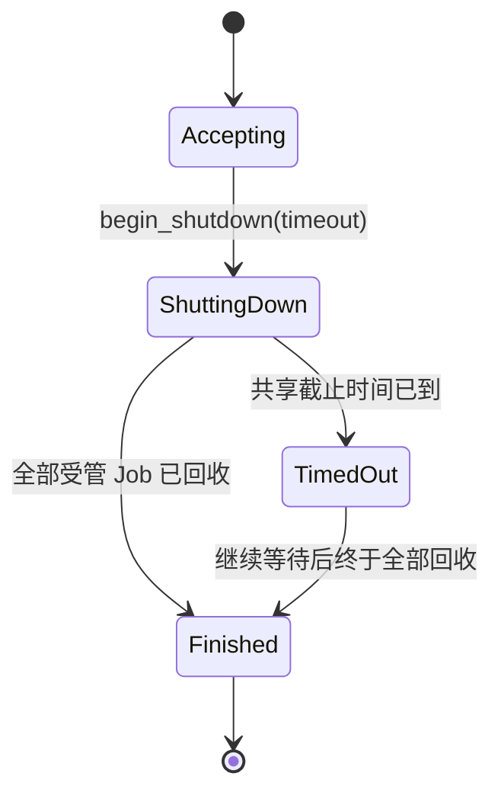

# 统一应用关闭与超时通知

统一关闭是一项独立的控制能力：宿主提出关闭请求之后，JobManager 非阻塞地停止接纳新 Job、广播取消、等待所有执行体真正退出，并在必要时报告一个全局超时。**JobManager 不能替宿主决定退出进程或展示什么窗口。**

## 关闭协调器的行为

`begin_shutdown(timeout)` 立即返回关闭协调句柄或状态，**不得在调用线程内等待 join、磁盘调用或异步任务完成**。在同一次受保护的状态提交中切换为关闭中，之后所有新提交被拒绝；对所有尚未终止的 Job 并行发起 `cancel(job_id)`，其中 `Pending` 也按既有规则进入 `Stopping`。已经为某个 Job 发出的初始 Receiver 和已有订阅仍有效；任务终止记录、错误与已有数据不因关闭而直接清空。

以**整个关闭过程唯一一个截止时间**计时，不为 N 个任务逐个等待 N 次 timeout。截止时间到达仍有活动任务时，发布一次 `ShutdownTimedOut`，其中能够查询剩余 Job 身份和状态以供 UI 展示；同一次关闭不重复刷屏。超时只是一条事实通知，既不导致自动取消等待进程，也不放弃 JoinHandle，Manager 继续协调停止并回收。宿主可继续等待，或自行选择强制关闭应用；强制进程终止不能保证析构、缓冲写盘或设备关闭协议执行，因此 Manager 不擅自执行。

如果所有 Job 在截止时间之前结束，则直接出现 `ShutdownCompleted`；如果已经超时但随后全部退出，仍须发布 `ShutdownCompleted`。完成条件是任务执行体退出且要求回收的独立线程已经收割，**不要求所有最终状态都为 Canceled**：收到退出阶段的取消后仍正常完成且没有有效取消确认的任务应为 `Completed`；明确确认响应取消并真实退出的为 `Canceled`；`Err` 或可捕捉 panic 为 `Failed`，三者均计入已退出。持久保留的终态 JobRecord 不阻碍关闭完成，不能把 `remove` 当作关闭前置条件。

## 与业务和 UI 的契约

Manager 提供一次性的关闭进展查询及完成/超时通知，让宿主在 Bevy App 继续更新时获知变化；这不是面向所有 Job 的 `JobStateChanged` 订阅系统，也不替代业务 Receiver 的 `Finished`。状态查询是执行真相，UI 如果同时展示业务流完成，需要继续以自己的 Receiver 已处理完 `Item` 和 `Finished` 为准。关闭专用通知不得因普通数据缓冲满、没有业务 Receiver、或者 GUI 当前页面已销毁而丢失关键终态。

关闭请求也应该可从非 ECS 线程提出，只以 App 级唯一 Manager 为作用域。没有任何 Job 时立即满足完成条件；重复关闭请求必须幂等，不能重新计算一个更晚的截止时间或重新通知已结束事件。超时后“再等一段时间”的策略由宿主决定，不应隐式重置 Manager 的唯一原始截止时间。

## 验证与交付

以受控 Future 和受管线程混合运行验证：正常全部退出、单个长任务拖过截止时间、多任务并行取消、截止时间只计一次、只发一次 Timeout、后续发一次 Completed、拒绝新提交、终态记录仍可查询、已订阅者可继续排空、重复调用幂等，以及阻塞发送遇取消后能继续退出。确保测量的不是单个任务的超时累加。用 headless App 保证关闭 API 不锁住主线程；线程回收相关断言必须检查真实 Join 完成。

宿主如何拦截 Windows 关闭消息、是否弹出 MessageBox 和何时写入 Bevy AppExit 由后续 Gallery 退出接入方案交付，本增量仅建设可复用的关闭协调器。
