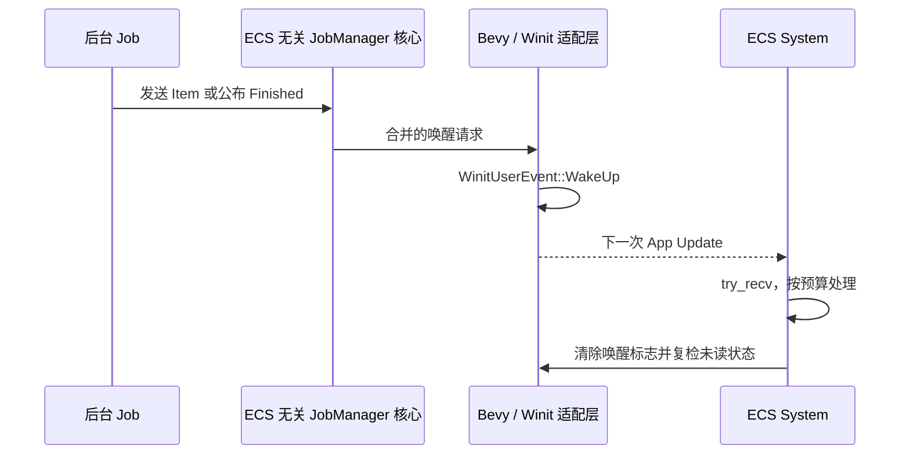

# 接入 Bevy Resource 与 Reactive 唤醒

前几个增量中的 JobManager 核心可以在普通线程访问，至此需要作为一项标准 Bevy 能力安装到 App，并解决 Reactive GUI 的实际问题：**后台已收到消息，不代表主线程下一帧就会运行。**

## App 内唯一注册与公开入口

提供 `JobManagerPlugin`，在 `build()` 时按工程日志规则记录一次 `JobManagerPlugin 注册完成`。一份 App 只注册一份 `JobManager` Resource，后台拿到可克隆的线程安全 Handle；不提供进程级 static，也不强制任务知道 ECS `World`。下游 `file_dialog`、`waveform`、`canvas` 等 crate 可以直接依赖 `bevy_widgetry_job`；Facade 只重导出公开类型和 Plugin，不把执行逻辑写入顶层 Facade。通过现有 workspace 依赖管理规则增加 `async-broadcast` 和相关必要异步工具，沿用 Bevy `=0.20.0` 的 `async_executor`、`multi_threaded` 和项目的 Windows 64 位限制。`core` 只保留真正 UI 共有能力，不承担额外 Job 执行器。

业务 Widget 插件按照现有工程使用习惯，在需要 JobManager 时幂等地确保 `JobManagerPlugin` 已安装；宿主也可以显式先注册。注册检查须使用 App/Plugin 已有的唯一性机制；同一 App 中 FileDialog、Waveform 与 Canvas 同时出现也不能产生多份 Manager。生命周期查询 `status(job_id)`、显式 `remove`、提交/取消/订阅与 shutdown 在应用和后台句柄上保持同一份记录。纯 headless 场景下，Resource 初始化不必依赖主窗口实际存在；没有 Winit 代理时，不影响任务运行和 headless 轮询。

## 唤醒必须跨线程而且无丢失竞态

Gallery 的 `WinitSettings::desktop_app()` 是 Reactive 模式。Manager 适配层只在数据新到达、`Finished` 公布、关闭超时或完成等**会改变消费者可见状态**时申请跨线程唤醒，使用已有 `EventLoopProxyWrapper` / `WinitUserEvent::WakeUp` 路径。避免每条高频 Batch 都向 Winit 投递独立事件：用原子 Pending 标记合并唤醒，ECS 消费与适配层清标记时复检是否仍有未读事件，防止清标记与生产者交叉造成漏唤醒。

唤醒不是自动替业务读取结果；ECS 仍 `try_recv()`，按页面的消息数或时间预算处理，不在主线程等待数据。不能因为某个订阅者消费缓慢而强制每帧无休止运行整个 App；对于持续未读数据，只在继续有必要消费/停止时安排下一轮刷新。Headless 与非 Winit 平台适配层可按运行环境省略 WakeUp，并保留显式 `try_recv` 语义。

状态转换不会产生通用 `JobStateChanged` ECS 事件；对业务 UI 而言，完整结果已处理并收到 `Finished` 才代表显示完成。进度由业务 `T` 的 `Progress` 结果项表达，Manager 不提供自定义百分比字段或 `set_progress`。`tracing` Span 携带 `JobId`，Widgetry 库内部异常仍使用统一 `widgetry_*` 宏，日志订阅与导出交给宿主应用既有 `app_logging`。

## 验证与交付

测试 Plugin 重复装配、资源查询和从后台线程获得 Handle；覆盖 Headless 无 EventLoopProxy 的回退；验证密集数据通知被合并、无假死、ECS 清标记竞争时不丢最后一次通知。通过真实 Reactive Gallery 场景和 BRP 观察静止页面后台任务完成后 UI 能自动刷新，而非必须先移动鼠标；不在此增量创建一整套 Gallery 演示页面。

同步更新 workspace 成员、Facade API/Feature、`docs/architecture.md` 和新增 crate 设计文档。代码按照工程 Type-Driven/TDD 与测试规则执行，必要的独立代码审查属于此增量的交付条件，不为它创建独立验收步骤。
