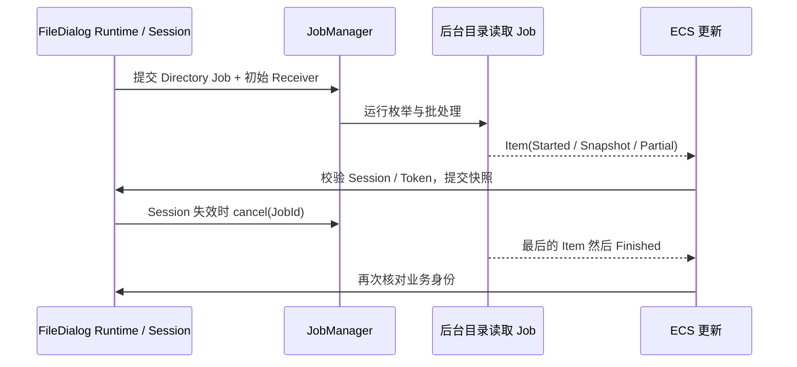

# 迁移 FileDialog 目录流式读取

FileDialog 的目录枚举是统一 JobManager 第一个真实应用：它需要连续产生结果，后台处理一定量的目录数据，GUI 逐帧吸收快照，同时正确处理会话切换、旧请求取消、无效回复以及快速滚动。该增量只迁移一条**完整目录读取业务链**，其余校验、选择、偏好操作暂时仍使用旧服务。

## 现有边界与职责划分

`crates/file_dialog/src/worker.rs` 的 `IoWork::Directory` 先解析目录和枚举条目，把最多 128 个 Entry 或经历约 8ms 的积累作为批次交给 CPU worker；CPU worker 维护缓存，调用 `WidgetryFileDialogSnapshot::prepare`、`append_batch`、最终 `reproject`，通过 `Output::Snapshot` 投影 `Loading`、`Ready` 或 `Partial`。`runtime.rs` 以 `Entity`、`WidgetryFileDialogToken`（Session、generation、query revision 等）决定哪些结果仍可提交；单次目录最多 100,000 条目，后台错误被转为 `Failed` Reply，不得在 UI 线程同步枚举。

这一增量把整条目录枚举与批快照生成看成**一个 Directory Job**。如果内部继续采用两阶段 I/O→CPU 协作，必须让父 Job 等到最后一个 CPU 批处理真正完成才公布 Finished；不能因为文件枚举 Future 返回就提前完成 Job。JobManager 只管理最外层这一份业务 Job 身份；批次和 Snapshot 的数据结构、线程池切换与 Partial 语义仍由 FileDialog 控制。能够在适用执行方式下选择运行同步文件系统调用，不允许意外把长时间阻塞磁盘调用放到 ECS 主线程；文件系统 backend 可能是同步接口，是否划分内部分阶段由业务负责，不能假称这是完全非阻塞 Future。

## 新结果流与 GUI 提交

FileDialog 业务定义承载 Started、Snapshot、失败和必要业务进度的结果类型 `T`。初始 Receiver 在开始扫描之前交到 Session，随后由 ECS 的现有更新预算消费：保留 `WidgetryFileDialogRuntimeOptions` 中默认每帧最多 8 条回复、约 2ms 更新预算、Session 数量上限等业务调节，不改为无限制 `while let`。JobManager 的容量仅约束 Result Item 条数；目录 Batch 含 128 条目只是 FileDialog 自己的分批规则，两者无须一致。

每次准备提交 Snapshot/Reply 时，都重新核实 Root 是否仍存在、Session 和 generation 是否匹配、查询/投影版本是否有效。旧 Batch 即使已经进入结果缓冲也不得覆盖新会话；取消只会请求旧 Job 协作退出，不能代替结果身份校验。确实因取消停止目录链并完成清理时，业务通过 `JobContext::acknowledge_cancel()` 确认后正常返回，才在真实退出后进入 `Canceled`；如果取消与最后一批结果竞态，工作仍完整成功且未确认取消，就保持 `Completed`。只有在 Receiver 真正处理到适用的末尾消息时，业务 UI 才显示对应读取流程完成；JobManager 的 `Completed` 不意味着 UI 已应用所有快照。`Finished(Failed(..))` 与业务内部部分错误区分：少量单项枚举错误仍然可能产生 `Partial` 的成功结果，而不能自动使整个 Job Failed。

## 与旧 Worker 的可控过渡

本增量中保留 `Service` 及未迁移操作的 channel/worker，移除或隔离 `IoWork::Directory`、`CpuWork::Batch` 对目录链的使用。业务 Session 从原有 `Control` 的取消行为映射到 `JobId`，但不删除 Token。必须维持 `HeadlessPlugin` 自动服务开关及手工 Backend Reply 接口；`automatic=false` 时不能强行提交新的自动 Job。原有 `wake` WinitUserEvent 路径与新 Manager 的统一 Reactive 唤醒不能互相干扰；更新预算退出时若仍有未读结果，要能保证后续帧继续处理。

旧 CPU worker 依赖 `Retained::Snapshot` 在后台持有大型 Arc，防止资源在 App Drop/UI 线程上执行昂贵的最后释放；目录改造后仍须保留等价的受控释放时机，不能通过共享 `Arc<T>` 暗中把大 Snapshot 的最终 Drop 转移到 ECS 主线程。不要将这条约束错误地要求为 JobManager 所有业务通用行为：它是 FileDialog 大快照的性能契约。

## 验证与交付

使用真实目录和可控慢 backend 覆盖：超大目录流式响应、128 条目/时间阈值边界、100,000 条目上限、文件读取失败与 `Partial`、双 Session 并行、快速导航、重复搜索/排序及旧 Token 结果丢弃、取消并重开、无 Receiver、消息容量背压。证明最后一个 Batch 处理完之后才向本订阅报告 Finished，ECS 每帧预算和 Reactive 唤醒仍工作；校验手工 headless 契约没有受自动 Job 影响。针对 `file_dialog` 既有 Runtime/Contract 测试与目录读取 GUI 路径验证，不改目录选择 UI 对外行为。

同步调整 `docs/crates/file_dialog.md` 与必要的局部依赖，其他业务操作保持旧 Worker 直至各自增量迁移。
