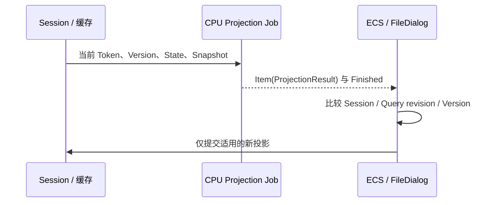

# 迁移 FileDialog 目录投影计算

目录流式读取已经作为完整 Job 到达 FileDialog 后，用户仍可以通过修改 Query、Filter 或 Sort 对已缓存 Snapshot 重新投影，而不再次扫描文件系统。这项**独立的 CPU 业务操作**可以单独迁移、观察和验收，适合作为一份单一功能增量。

## 缓存不变，重新计算视图

当前 `crates/file_dialog/src/worker.rs` 的 `CpuWork::Projection` 输入包括 `Control`、`Arc<WidgetryFileDialogState>`、`Arc<WidgetryFileDialogSnapshot>`、目录状态和 `version`。如果原 Snapshot 的 `query_revision` 与当前 State 不同，则调用 `reproject`；否则复用原 Snapshot。投影完成后继续按同一 Query 构造所需的选择准备信息，再形成 `WidgetryFileDialogReply::Snapshot`。现有 `runtime.rs` 利用 `Session::project_inflight`、`project_applied` 以及 Session Token/Version 防止重复计算和过期结果覆盖。这些业务含义不应因为统一 JobId 而消失。

每次对具体快照的一次完整 Projection 是一个 Job，交给 Bevy `AsyncComputeTaskPool`。投影内部与选择准备发生的函数调用是这次投影的组成步骤，不再单独登记新 Job。业务结果由 FileDialog 定义为只读 `T`，通过 `JobReceiver<T>` 返回；`JobMessage::Finished` 仅表明执行体真正结束，不自动代表 UI 已经确认投影适合当前会话。

## 请求覆盖和提交守卫

对同一 Session/查询版本继续最多保留所需在途投影，新的 Query/Version 使旧结果失效，必要时向旧 Job 发出协作取消。取消未即时成功时，旧 CPU 结果仍可能到达，所以 ECS 提交前必须校验 Root、Session、generation、query revision、snapshot version 和 `project_inflight` 对应身份。只有校验成功才更新 `project_applied` 并投影 Selection；即使旧 Job `Completed` 也不能改写新一代的 UI。取消只用于尽早结束不再需要的计算，只有业务确认停止并以 `Ok` 真实退出才判为 `Canceled`；旧计算即使已收到取消但仍正常算完、未确认取消，终态仍是 `Completed`。此前已提交的 Snapshot 在 Pending 期间保持显示，不因后台工作切换而清空。

处理 `Arc<WidgetryFileDialogSnapshot>` 等大型共享结果时，必须遵守原 `Retained::Snapshot` 的性能假设：尽量让大型数据的最后一次 Drop 避免在 ECS/UI 主线程执行。`JobReceiver<T>` 共享 Arc 并不自动保证这个析构路径；需要在业务层选择合法的后台释放时机。Window/Headless 模式、每帧消息条数和更新时间预算继续采用 FileDialog Runtime 的原配置。

## 独立交付与测试

删除或停用原 `CpuWork::Projection` 分支及其专用结果路由，改为独立 CPU Job。验证 Filter、Search、Sort、查询 Revision 与 Snapshot 版本的各种组合，重复相同 Query 的 No-op、旧任务慢到、Session 关闭和新建、Selection 与显示行一致、Pending 期间保留上次快照，以及大型 Snapshot 释放和更新帧预算。保留 `automatic=false` 的 Headless 手工 Reply 模式，不能因本次迁移强行启动后台服务。测试结合现有 `file_dialog` Contract/Runtime 测试与受影响的 GUI 更新路径，必要时用 BRP 检查。

与上一份目录读取增量共享 Session 状态，但此增量的可观察交付是“缓存重投影受统一 CPU Job 管理”，并不依赖下一份选择意图计算已迁移。同步更新 `docs/crates/file_dialog.md` 中的后台投影说明。
