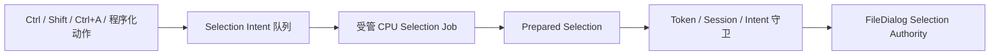

# 迁移 FileDialog 选择意图计算

FileDialog 的 Ctrl+A、Ctrl 点击、Shift Range 及程序化选择有一条独立于目录读取/重新投影的准备链。它要把输入顺序和业务模型中的 Stable EntryId 转化为一份能够原子提交的选择结果。这个增量让**一次完整 Selection Intent 准备**由受管 CPU Job 执行，仍由 FileDialog 决定是否提交。

## 选择权威不移入 JobManager

当前 `crates/file_dialog/src/worker.rs` 的 `CpuWork::Selection(Control, WidgetryFileDialogSelectionJob)` 调用 `job.prepare()`，产生 `WidgetryFileDialogPreparedSelection`；`runtime.rs` 用 `Session::selection_submitted` 避免在同一 Token 下重复提交，已准备的 Selection 通过业务 `WidgetryFileDialogReply::Selection` 回到 ECS。具体选择资格、输入顺序、Active/Selection 分离、Ctrl+A 冻结当时已到达条目的范围、Shift 依可见投影范围选中，均属于 FileDialog 本身，不是 JobManager 可以推断的通用数据规则。

一个完整意图准备 Job 可返回一份准备结果，使用初始 `JobReceiver<T>` 的 `Item`、随后 `Finished`；不为每个 SelectedId、每一步集合操作创建独立 Job。业务仍限制每次最多 128 个 Intent 等已有业务容量，不能把统一 JobManager 当作新的一般队列。Pending Selection 继续阻止确认；Cancel 不必等待 CPU Job 停止，即刻关闭当前交互，但旧结果不得提交给后续新会话。处理过期 `WidgetryFileDialogToken`、Generation 或失效 Root 时拒绝结果，必要时向旧 Job 协作取消。确实中止计算并完成所需清理时应通过 `JobContext::acknowledge_cancel()` 确认；仅因过期而忽略一个已经正常算完的结果，不把该 Job 的 `Completed` 改写为 `Canceled`。

选择集合可能规模巨大且由多个 Snapshot/View 共享，现有 `Retained::Selection` 在 CPU worker 持有最后引用，避免大集合的最终释放阻塞 UI。迁移时应保留等价的业务释放路径，并核验 `Arc<T>` 对象所有权。`remove(job_id)` 只删除终态记录，不代替释放还在 Receiver 中的 Selection 结果，也不能在非终态时自动取消该 Selection。

## 独立交付与验证

替换 `CpuWork::Selection` 入口和回传通道为 JobManager CPU Job，保留 `WidgetryFileDialogSelectionJob` 与 `WidgetryFileDialogPreparedSelection` 的业务结构。测试选择 Intent 的顺序、同一项重复操作、Ctrl+A 已到达范围、Shift Range、禁用/不可见项、原 Session 消失、最新目标取代旧目标、Cancel 在 Pending 中立即响应，以及新的 Reader 消费完 Item 后才获得 Finished。验证 Session 状态与 UI 显示一致、Selection/Active 不混淆、放弃旧结果不会造成主线程大量 Drop，继续使用现有 Contract/Runtime 测试并针对受影响交互做 BRP 回归。

这份迁移只处理 Selection Intent 准备，不改目录重新投影逻辑，也不触及下一份候选路径确认操作。同步维护 `docs/crates/file_dialog.md`。
