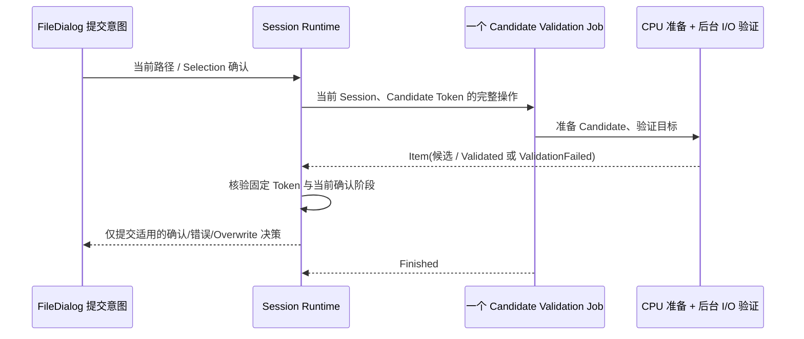

# 迁移 FileDialog 候选确认校验

文件/路径确认不是单独的 CPU 辅助函数，也不是孤立的文件系统 `validate()` 调用。它是一条**从候选准备、后台路径验证到将确认事实提交给 FileDialog 的完整业务操作**。本增量将这一整条链记为一个 Job，避免为了使用不同执行后端人为拆成两个对外 Job。

## 实际业务链

原 `worker.rs` 的 `CpuWork::Candidate(Control, WidgetryFileDialogValidationJob)` 用 `prepare()` 计算 `WidgetryFileDialogCandidate`，对应 `Output::Candidate` 经 `runtime.rs` 校验 Token 和 `WidgetryFileDialogConfirmation::Validating` 后保存到 `Session::candidate`；随后 `IoWork::Validate` 使用 `backend.validate(&candidate)`，返回 `WidgetryFileDialogReply::Validated` 或 `ValidationFailed`。对用户而言，这是一份确认请求在后台的完整处理，不应因为内部 CPU→I/O 边界拆成两个 JobId。

CPU 准备和 I/O 文件系统校验可在同一受管操作内部按业务需要切换 Bevy `AsyncComputeTaskPool`、`IoTaskPool` 或同步阶段；外层 Job 必须等到文件系统结果已经明确之后才结束。后台 `FileSystem` backend 可能执行阻塞 OS 调用；不能因为 API 接受 Future 就宣称同步文件访问已变为真正异步。Job 的结果 `T` 由 FileDialog 定义，数据/错误需要能复用现有公开 Reply 契约。

## Candidate、Overwrite 和取消语义

确认过程中必须核实 Root/Session/Token/Generation 以及候选的固定 Token。用户编辑 Filename、改变选择、重新导航、新建 Session 或关闭 Dialog 后，旧 Candidate 和旧 I/O 校验结果不能影响当前状态。`Exists` 的唯一含义是决定 SaveFile 是否还要弹出 Overwrite 确认，而不是宣告整个文件导出已经发生；用户按 No 回到当前 Session，必须保证下一次确认使用新合法的候选身份。`SaveFile` 只返回目标 PathBuf，不替应用写文件；文件类型和路径表示继续使用原始 PathBuf 的真实身份，不用地址栏显示文本重新拼接。

取消请求只转变 Job 执行状态，不能撤销已完成的 OS 校验，也不能让旧 Reply 写进新的用户状态。已完成验证并返回 `Ok` 的操作即使收到取消仍是 `Completed`；只有主动停止、清理并有效调用 `JobContext::acknowledge_cancel()` 后正常退出，才进入 `Canceled`，顶层错误仍为 `Failed`。UI 的 Pending Selection/Projection/Validation 继续按既有契约阻止 Confirm，Cancel 不等待后台验证完成。对已被业务处理的单步错误不必把整个 Job 强行映射为 `Failed`；如果完整候选操作无法执行，其失败应通过 FileDialog Reply/诊断和 Job 顶层错误清楚表达，不能只记录日志。

## 交付与验收

退役 `CpuWork::Candidate` 和 `IoWork::Validate` 的完整旧协作链，代之以一个复合业务 Job 的执行与结果流；保留其余尚未迁移的 Worker 操作。通过可控后台文件系统验证单选/多选/目录/SaveFile、候选准备失败、路径无效、存在与不存在、Overwrite Yes/No、确认时修改 Filename、两个 Session 并发、Cancel 与旧结果竞态，校验仅当前 Token 的合法回复被提交且 `WidgetryFileDialogResultEvent` 仍最多一次。Headless 手工 Reply 注入与 Modal / Owned Window 交互不回退，针对 FileDialog Contract/Runtime/Window 测试和相关 BRP 路径进行验证。

该增量依赖前面通用 Job、FileDialog Runtime 的已有业务身份，但不依赖 Folder/Locations 操作的迁移。同步更新 `docs/crates/file_dialog.md` 中有关后台确认的表述。
