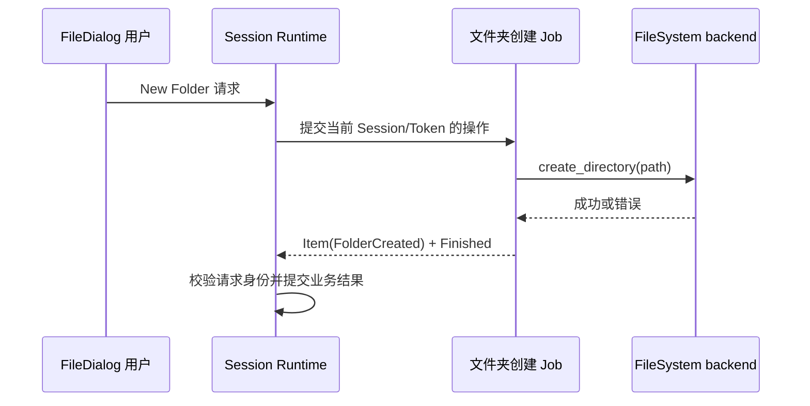

# 迁移 FileDialog 创建文件夹操作

FileDialog 的 New Folder 是一次具有明确文件系统副作用的用户操作。它不属于目录枚举的一步，也不属于通用任务管理器的内部操作，因此作为一项独立的 I/O Job 迁移，保留当前的请求身份、错误反馈和不保证撤销的行为。

## 完整创建操作的流程

当前 `worker.rs` 的 `IoWork::Folder(Control, WidgetryFileDialogFolderRequest)` 调用 `backend.create_directory(request.path())`，无论成功或失败均产生 `WidgetryFileDialogReply::FolderCreated`，由 `runtime.rs` 的 `folder_submitted` / Session Token 控制 Admission。一个实际创建请求就是一个 Job，使用 `IoTaskPool` 运行可协作式取消的 Future；业务仍负责确保后台文件系统调用不阻塞 ECS 主线程。JobManager 不建立 Folder 专属队列，也不自动推断路径、重试次数或 UI 要不要刷新目录。

## 副作用、版本与重复提交

一旦 OS 文件系统创建调用生效，即使用户关闭 Dialog、Cancel Job、界面换 Session，也**不保证撤销该目录**；这不是 Job 取消失败，而是文件系统副作用的正常边界。`folder_submitted` 等原有去重机制必须保证同一业务 Intent 不因结果尚未被 UI 读取、Job 尚在 Stopping 或重绘循环而被多次创建；后续主动刷新/导航仍需要用当前 Session 的业务状态判断。后台返回的 `FolderCreated` 即使晚到也须通过 Session/Token 守卫，不能对新 Dialog 做错误提交。

当前 FileDialog 旧 Service 的 `(Entity, u8)` 请求槽会去重、覆盖最新请求，容量 64 且 `try_lock` 尽量避免主线程等待。迁移后有关同一 Folder Intent 只执行一次的 Admission 由 FileDialog 局部逻辑承担，不把跨业务通用队列引入 JobManager。线程内不可中断的 OS API 仍遵循 `Stopping` 等待真实结束，取消未完成不能虚构 `Canceled`；即使 OS 创建最终成功，业务未确认响应取消而正常退出也应为 `Completed`。只有确实提前停止并有效确认取消、随后正常退出才是 `Canceled`；失败应既保留 FileDialog 原始错误语义又能够在 Job 失败诊断中观察。

## 交付与验收

只替换 `IoWork::Folder`，保持已有 Directory/Projection/Selection/Validate 等功能原交互；构造可控 FileSystem backend 验证创建成功/权限拒绝/路径冲突、慢创建期间 Cancel、快速重复点击、Session Reopen 后旧 Reply 不能提交、OS 副作用实际至多一次、正常成功后目录状态正确刷新。保持手工 Headless Reply 方式可用，不让 `automatic=false` 自动启动 Job。由现有 FileDialog Runtime/Contract 测试保护业务语义，并在必要的 Gallery New Folder GUI 路径使用 BRP 验证。

同步更新 `docs/crates/file_dialog.md` 与移除旧分支后的相关代码引用；Locations/Preferences 将由后续独立增量迁移。
