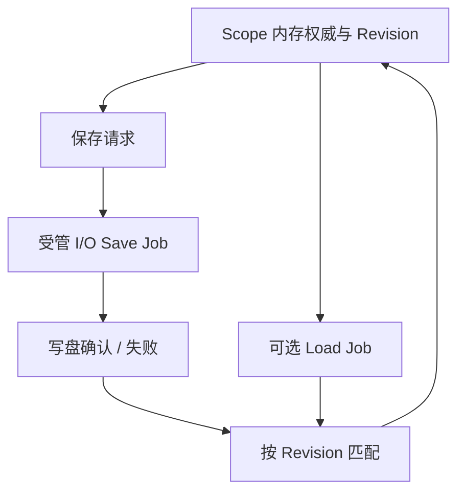

# 迁移 FileDialog 偏好读写并退役 Worker

前面的目录、投影和操作已能在 JobManager 中独立完成后，最后将 FileDialog 的偏好持久化 `Load`/`Save` 纳入统一 I/O 生命周期，并退役原三线程 `Service`。偏好写盘与对话框可见 Session 有不同的生存期，不应因为某个 Dialog 关闭就立即取消正在向磁盘提交的偏好版本。

## 偏好读写的真实事务

现有实现保留默认内存偏好，只有显式配置 `WidgetryFileDialogPersistence.path` 才尝试读写。`flush_preferences` 申请异步写盘，`Runtime` 使用 `load_admitted`、`loaded`、`saving`、`failed_revisions`、`disk_revision` 等跟踪内存更新与磁盘写入确认。多个 Session 共用 Scope 偏好时按字段 Delta 合并，较晚到达的 Load 只影响后续 Session；取消选择不更新 Last Picked Directory。路径及跨 Windows 扩展长度/UTF-16 的存取格式由现有 `storage`、`persistence` 业务保持。

一次异步 Load/Save 各自是一项完整 Job，结果通过已有业务版本和状态验证后提交。原 `Output::Loaded`、`Saved` 路径可以转换为新的单项结果流，错误必须仍反映在公开 `WidgetryFileDialogRuntimeStatus` 中，不能仅进入 JobRecord。写盘时允许内存已更新而磁盘失败，失败不能回滚内存事实；晚到的旧保存 Ack 不能将较新 revision 误标为已保存。路径有效性与序列化格式不随任务执行方式变更。

## 退役旧服务而不破坏生命周期

移除已经没有业务操作的 `Service::start`、两条 `io_loop`、一条 `cpu_loop`、原 `crossbeam-channel` 专有请求/回复路由、wake/io 队列和三条 `JoinHandle` 的所有权，并从 FileDialog Manifest 删除不再使用的 Worker 专属依赖。此时 FileDialog 后台统一交给 JobManager；保留它自己的 Session、Token、请求更新节流、业务缓存、Snapshot 持有与可控析构、`RuntimeOptions`、`Persistence`、`RuntimeStatus`。`RuntimeStatus.workers`、`queued` 等原指标原来含专用线程数量，迁移后必须重新定义为真实可观测含义或清理无效指标，不能继续报告虚假的三条线程；这种调整要同步相应文档与调用方测试。

`automatic=false` 的 Headless 手工 Reply 通道继续独立工作，不强制默认启动 Job；`WidgetryFileDialogBackend` 仍允许宿主自定义文件系统/存储后端。FileDialog Widget 的外部选择、确认、Cancel、Modal/Owned Window 时序与事件恰好一次行为不得因 worker 移除改变。App 退出时未完成偏好写入被统一取消与通知，不能把主动退出等同于已持久化；由宿主决定是否等待更多时间。写盘已经真实成功且未确认取消时，Job 返回 `Completed` 并由业务独立确认落盘 Revision；确实响应取消停止写盘并有效确认后正常退出才是 `Canceled`，写盘失败仍为 `Failed`。

## 验证与交付

测试首次 Load、无配置时纯内存、正常 Flush、多 Scope 合并、跨 Session revision、新写盘覆盖旧 Ack、失败路径以及 Load/Save 竞态；核对 Windows 路径无损编码、取消不修改 Last Picked Directory、SaveFile 仅返回 PathBuf 不代写实际目标文件。运行受影响 `file_dialog` 性能 Benchmark，关注大 Snapshot 最后释放是否回到主线程、更新预算与 Resource 状态是否失真。GUI 交互测试包含取消、关闭窗口、重新打开与偏好恢复，针对 UI 可观察行为按 BRP 验证。再运行 FileDialog 相关测试和检查未使用的旧 worker 引用；仅此最后一个 FileDialog 迁移方案执行本 crate 完整收口回归。

同步更新 `docs/crates/file_dialog.md` 和实际依赖；不可把 Headless 手工模式、业务错误通道、Slot 请求覆盖、容量限制等能力随着旧 Worker 一起删除。
