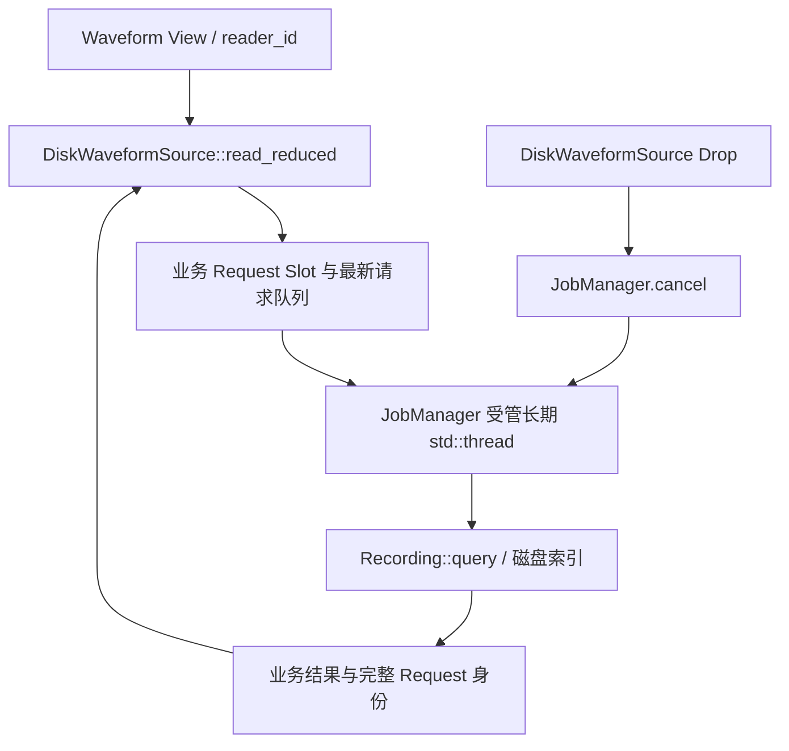

# 纳管 WaveformFile 磁盘读取服务

`DiskWaveformSource` 的磁盘线程是典型的长期阻塞式业务服务：它不是 UI 每次读取请求都新建一个 Job，而是一个 Source 维护一条持续运行的磁盘读取操作。这个增量将该线程的**创建、取消、退出和收割**交给 JobManager，同时保留 `WaveformSource` 的 `Pending` / `Ready` 同步查询接口与磁盘索引算法。

## Source 的公开读取语义不改变

当前 `crates/waveform_file/src/source.rs` 在 `open(path)` 内同步 `Recording::open(path)`，随后启动名为 `waveform disk reader` 的线程，由 `Arc<(Mutex<State>, Condvar)>` 持有 `slots: BTreeMap<reader_id, Slot>` 与 `queued: VecDeque<reader_id>`。每个 reader 只保留最新目标；排队的旧目标被覆盖，已经算出的过期结果也被丢弃。`read_reduced` 对尚未就绪的请求返回 `Pending`，对身份完全一致的结果返回 `Ready`，磁盘错误通过 `WaveformReadError` 传播。相同 Source 的不同 reader 彼此隔离，`cancel_reads(reader_id)` 仅取消该 View 的请求。

以上读盘、缓存、MinMax/LTTB 选层与身份校验继续由 WaveformFile 负责。JobManager 不记录每一条 `WaveformReadRequest`，不抢占 `reader_id` 身份，不重建最新请求合并队列。一个 Source 实例的整个 Reader 服务是一个长期 Job；它可以使用 `JobContext<()>`，无需把 per-query 的同步 `Pending` 协议强行映射成通用广播结果。对于业务需要订阅的其他工作，仍可使用完整 `JobReceiver<T>`；本例可以立即丢弃初始 Receiver，底层不会因此阻塞长期 Job。

## 线程纳管与所有权

为 `DiskWaveformSource` 提供获得 App 级 JobManager Handle 的创建途径，可以调整现有 `open` 调用契约，不要求兼容旧签名。`Recording::open` 的文件头/索引校验是同步操作；在 Gallery 中继续后台执行，不得把它迁回 UI。Source 持有受管 `JobId` 和业务队列 Handle；线程由 JobManager 创建命名并保存 JoinHandle。`Drop` 设置业务队列的关闭标记、通知 Condvar、向 JobManager 发起取消，**立即返回而不是在 UI Thread join**。管理器在后台确认线程实际退出且 Join 完成后才进入真正终态。因关闭请求正常退出的读取服务，在业务完成清理并通过 `JobContext::acknowledge_cancel()` 确认后方可判为 `Canceled`；如果最后一轮服务自然成功结束且未确认取消，则为 `Completed`，不能单凭 Drop 或 Cancel 调用判定。

独立线程中的阻塞 I/O 可能暂时不可打断；Manager 关闭时只能协调停止，不能将超时假装为已回收。线程错误/可捕捉 panic 需映射到 Job 失败，尽可能保留原 `WaveformReadError` 反馈；仍在运行的 Source 不能因 Job `Completed` 推断已提交最后一次显示快照。`DiskSourceStats` 原有查询次数、过期/取消次数、排队 reader 数、最后一次读取耗时及 `DiskReadStats` 指标必须保留，不能由 JobManager 的通用状态取代。

## Gallery 打开磁盘 Source 的对接

`gallery/src/pages/waveform/disk.rs` 当前另外维护一个 `IoTaskPool::spawn` 的 `Task<Result<DiskWaveformSource,...>>` 负责打开磁盘源。该打开动作也应纳入统一 Job；Result Item 携带创建好的 Source，`DiskReplay` 保留自己的 `revision`、`LoadState::Missing/Loading/Ready/Failed` 以及 reload 后旧任务无效的判断。这里涉及“后台创建的 Source 自己拥有长期 Reader Job”的两层关系，但它们是**不同的完整业务操作**：一次有限的 Open，和后续持续服务多个 Query 的 Reader。不要把每个 `query` 再嵌套成 Job。`Arc<DiskWaveformSource>` 可作为 Result Item 共享；源析构时仍由业务触发受管线程取消。

## 验证与交付

围绕既有 `waveform_file/tests/source.rs`、`tests/recording.rs` 和随机读取 Benchmark 验证真实索引查询、数据缺口、两种算法、跨通道独立 reader、连续最新请求覆盖、旧请求读取完成后不提交、取消单 reader 不打断其他 reader、文件错误、Drop 不阻塞 UI、线程真实退出/Join、App 关闭等待或超时、统计字段真实可用。Gallery 的 Disk Replay 重载和换会话也应实测：Pending 保留先前画面，最终 Ready 只采纳适用请求；禁止把旧结果写入新 Source。需要的 API/Manifest、直接调用处与 `docs/crates/waveform_file.md`、`docs/gallery.md` 同步在本增量中。
