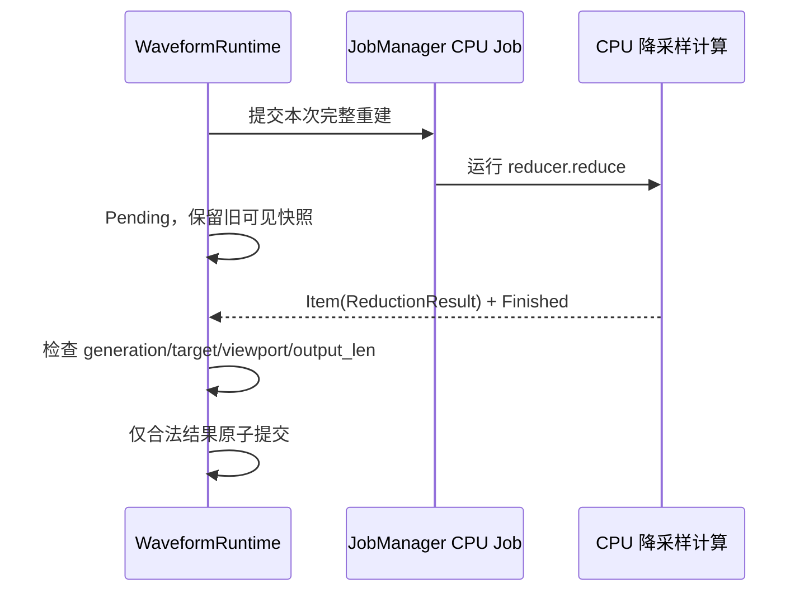

# 纳管 Waveform 后台降采样

Waveform 自身已经用 Bevy `AsyncComputeTaskPool` 处理大工作集，但该任务当前由 `PendingReduction` 私有持有。这个增量不改降采样算法，而是让每次**完整的大范围重建运算**成为一个可查询、可取消、真实结束可确认的 CPU Job。

## 原有重建机制必须保留

`crates/waveform/src/runtime.rs` 在待处理采样达到大规模阈值（现有逻辑使用约 262,144 个通道样本的判断）时，使用 `AsyncComputeTaskPool::get_or_init(TaskPool::new).spawn` 运行 `reducer.reduce`；返回 `ReductionResult { reducer, reduced, stats }`，用于将受业务状态约束的缓存重新提交。在 `PendingReduction` 中保存 `ring`、`viewport`、`output_len`、`generation` 和 `target_generation`，并通过 `poll_reduction` 核对身份。结果过期则丢弃，Pending 期间保留先前波形/时间轴一致快照，`redraw_pending_reductions` 通过 `RequestRedraw` 让 Reactive Window 保持更新。

原业务的“单个 Waveform 实例最多一个在途重建”和“新目标可能覆盖旧目标”的限制必须保留；不能因为 JobManager 能提交任意多个 CPU Future 就让同一 Runtime 任意并发地更改 reducer 状态。用户拖动 Replay、改变算法、通道或窗口密度时，旧任务可以被请求取消，但**即使取消来不及生效，也必须执行已有 generation 校验**。Raw/Reduced 两类 Source 与 `WaveformReducer`、MinMax/LTTB 算法逻辑不作额外功能更改。

## 任务结果所有权与状态恢复

后台计算的 `ReductionResult` 目前携带需要继续由 Runtime 持有并可能再次更新的 `Box<dyn WaveformReducer>`。统一 Receiver 返回 `Arc<ReductionResult>`，而不是自动将业务结果复制一份。迁移设计必须为这一份**独占可变 reducer 状态**提供可靠的所有权交还方案：若单订阅情形确认可安全 `Arc::try_unwrap`，需要以测试验证 Channel 是否仍持有内部引用；否则业务应调整结果承载结构，确保 reducer 交还时不依赖不可保证的 `Arc` 引用计数，而不是为 JobManager 引入通用可变广播协议。此处是 API/所有权适配技术细节，不改变已有“共享结果只读、业务必要时恢复所有权”的原则。

JobManager 的 `Completed` 不等于 Waveform Runtime 已采纳结果；只有身份校验通过并提交一致缓存、更新 `revision` 后 UI 才改变。失败/取消不应清除最后完整快照。业务如仍需要新一轮重建，在旧 Job 的实际退出后再提交新目标，避免后台处理结果与当前 reducer 交叉修改。异步 CPU Future 须确保内部运行真正结束后才向 Manager 报告终态。过期重建被主动中断、完成必要 Reducer 所有权交接并有效调用 `JobContext::acknowledge_cancel()` 后正常退出，才能判为 `Canceled`；若已算完并未确认取消，即便结果被 generation 守卫拒收，Job 仍是 `Completed`。

## 渲染帧与验证

此变更不把 `WaveformRuntime` 的同步 `Source::read` 变成 Job，也不改 RenderApp、Viewport、Mesh、原生 Source 的 Pending 契约；跨线程只有降采样计算。保留 `Last` 阶段的 `RequestRedraw`，尤其处理 PostUpdate/布局后发起工作而窗口无新输入的情况。GUI 仍以自己的结果处理和成功提交后的投影作为状态依据。

扩充或调整 `crates/waveform/tests/requests.rs`、`algorithm.rs`、`session.rs` 等，覆盖大数据触发、正常结果、无效 session/算法/密度、取消竞态、一份 Reducer 状态正确恢复、失败时保留最后快照、不产生两个并行 reducer、工作完成后停止多余重绘，以及受影响的降采样 Benchmark；通过 Waveform Gallery 的真实播放/暂停/切换观察 Pending→Ready 与 UI 稳定性，按项目规则执行必要 BRP 和性能验证。同步更新 `docs/crates/waveform.md` 中关于后台重建的执行描述。
