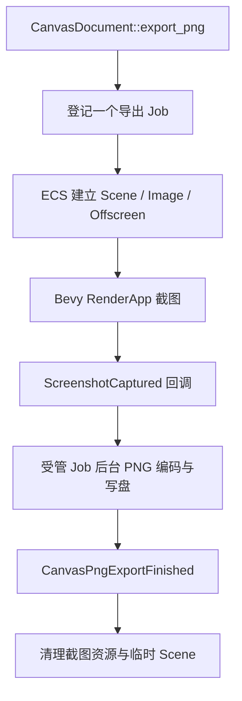

# 纳管 Canvas PNG 导出

Canvas PNG 导出由 ECS/GPU 准备、ScreenshotCaptured 回调以及后台编码/写盘组成，是我们“一项完整业务操作对应一个 Job”的重要边界案例。目标是把**整个导出操作**交给 JobManager 追踪，但继续让 Bevy RenderApp 执行 GPU 渲染和截图，而不是把 GPU 工作强行搬进 I/O/CPU ThreadPool。

## 保存现有业务阶段

`crates/canvas/src/export/png.rs` 当前对外提供 `CanvasDocument::export_png(world, document, path, options) -> Result<Entity, CanvasExportError>`，使用内部 ECS `Job` Component 保存 Document、路径、尺寸、OffscreenTarget、临时 Scene、`Probe`、准备/截图/写盘三个阶段、30s GPU 等待超时及最终清理状态。RenderApp 根据 Mesh/Material、Image 和 pipeline readiness 标记 `ready`；`Screenshot::image` 的 `ScreenshotCaptured` Observer 取得 Image 后才在 `AsyncComputeTaskPool` 运行编码写盘，完成时触发既有 `CanvasPngExportFinished`，释放 Camera、Mesh、Image、层号和 Screenshot Entity。

应继续使用该业务阶段 Component（避免与 `JobId` 概念混淆，可以重命名内部 `Job`），但为同一次导出附带唯一 `JobId`。JobManager 统一执行记录从请求获得实际执行资格开始，到 GPU 结果、编码写盘和必要收尾结束才进入终态；截图等待中的 ECS Component 不是一个独立业务 Job，编码器也不对外单独提交第二份 Job。截图回调只把已取得的 Image/错误通过受控交接传给该 Job 的后续执行阶段，不能在渲染线程中直接访问 ECS 外部不可线程安全的数据。

## 完成、失败和取消的顺序

截图资源仍由 Canvas 生命周期管理；30s 等待超时需从 GPU readiness/截图阶段传播为整个导出 Job `Failed`，且通知回调/业务事件仅报告一次结果。编码成功必须确保 PNG 文件保存操作真实完成，再给出 `Completed`；写盘失败需产生 `Failed` 并保持已有 `CanvasExportError` 语义。保留公开 `CanvasPngExportFinished` 事件及其中的 document、path、size/error，以免外部业务必须使用 JobReceiver 才能获知 Canvas 专有导出结果；这是**业务层已有公开事件**，不是重新引入全局 `JobStateChanged`。

导出取消在尚未启动 GPU 截图或可控交接阶段应尽量及时生效并释放临时资源；如果底层 GPU 回读或同步文件写入已经不可安全中断，Job 在 `Stopping` 等待真实完成，不能假称已取消。晚到 `ScreenshotCaptured` 必须检查导出 Entity、JobId 和阶段是否仍有效，不能为已销毁或重用的 Job 再次写盘。取消后确实在可控阶段提前结束、完成必要清理并有效调用 `JobContext::acknowledge_cancel()`，才在整个导出执行体真实退出后得到 `Canceled`；收到取消但已把文件成功写完、未确认取消时应得到 `Completed`，实际写盘错误仍为 `Failed`。Cleanup 应继续正确跨 `Render Extraction` 与延迟 Commands 的执行时序；不能在仍由 Bevy 内部 Screenshot 任务占用时提前销毁其目标。

## 接口迁移与回归

可以调整 `CanvasDocument::export_png` 内部调用 JobManager 的方式，但需要保留外部 `Result` 错误与 `CanvasPngExportFinished` 一次通知的业务契约；旧公开 Entity 身份与新的 JobId 不互相替代。Canvas GUI 展示仍然操作 Document 和 PNG/SVG 导出；SVG 是同步矢量导出，除非已有实际后台任务，不应为了统一而新增一项 SVG Job。宿主日志继续走项目的内部 Log Macro。

测试 GPU 准备错误、超时、成功保存、磁盘错误、取消和 screenshot 晚到、导出 Entity 提前销毁、重复 Observer、不产生重复 PNG 写入、RenderTarget 与 Asset 清理、多个并发导出，以及 `CanvasPngExportFinished` 结果身份与 Job 终态一致。按 Canvas 既有测试和 Gallery 导出交互进行定向回归，涉及可见行为用 BRP 检查、涉及 GPU/Native Window 的能力边界按项目规则记录。同步更新 `docs/crates/canvas.md` 与直接依赖。
