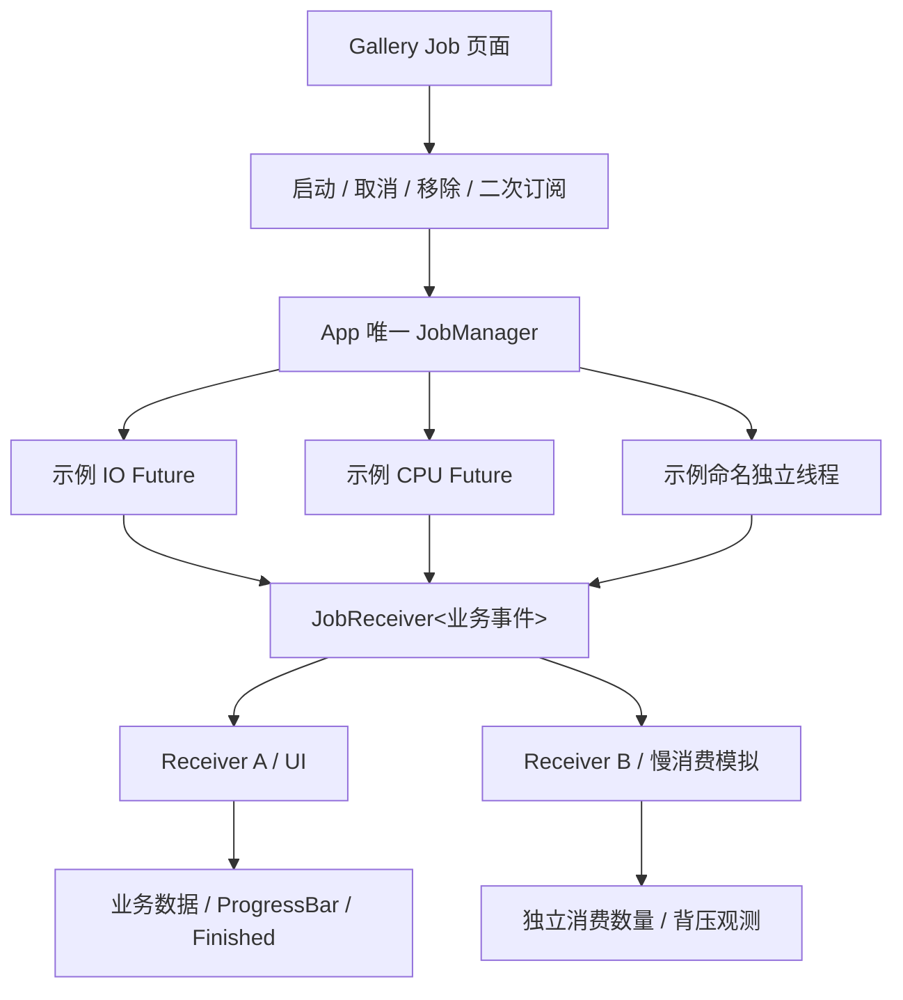

# 在 Gallery 展示 Job 完整行为

JobManager 是非 UI 基础设施，但需要能在真实 Bevy GUI 中直观展示多执行后端、协作取消、广播、背压、业务进度和状态与消费完成的区别。Gallery 新增一个**Job 专属页面**，直接使用正式 JobManager API 与现有 Widget 组合，不做第二套模拟调度器或假的 Job 状态。

## 页面结构与业务演示

`gallery/src/gallery.rs` 的 `GalleryPage`、Sidebar 入口、`GalleryPlugin`，`pages.rs` 的模块注册、`gallery/src/main.rs` 的插件组装，以及 `gallery/src/i18n/{key,zh_cn,en_us}.rs` 的中英文标签均增加 Job 页面接入。沿用 BSN、WidgetryButton、WidgetryProgressBar、适当的状态文字/可滚动列表/MessageBox 和主题样式；不建立一套新的 Job 专属通用控件。提供稳定、语义准确的 `Name`（例如启动、取消、订阅、移除和主要状态读数），便于 BRP 查询输入与 ECS 状态。

演示至少有三个真实工作模式：短时 I/O Future、纯 CPU 计算 Future，以及有可取消等待机制的命名独立 `std::thread`；输入确定性的演示数据，不依赖外部设备、联网或随机磁盘性能。每个示例通过公开提交 API 得到 `(JobId, initial JobReceiver<T>)`，结果业务类型可自行包含 `Batch`、`Progress { processed, total }` 及必要统计字段。JobManager 只发送 `Item(Arc<T>)` 与 `Finished(JobOutcome)`，不理解 Progress 是什么。一个终止后未读积压不能被假装已经在 UI 消费完。

## 多订阅与背压观察

页面在相同 Job 的 `Pending`/`Running` 阶段可以新增第二个 `JobReceiver<T>`。通过两侧独立显示的已消费数与最新 Item 序号体现：首次订阅者获得全部后续数据，后加入者只从订阅时起收数据，两侧处理快慢可以不同，结果本体共享 Arc 而非每侧复制大 Batch。提供可选慢消费者模式和较小 `buffer_capacity`，直观呈现背压：慢订阅者拖住生产，但不丢活跃订阅的数据；丢弃慢 Receiver 立即解除其订阅并让生产继续。无 Receiver 时新数据丢弃，之后再订阅不会回放旧项。

确保示例不会意外把 ECS 主线程阻塞：每次 `try_recv()` 有显式消息数量或处理时间预算；慢消费通过**减少每帧读取**模拟，不在 UI 调用 `recv_blocking()` 或 `thread::sleep()`。ProgressBar 根据 UI 当次实际读取到的 `Item(Progress(...))` 更新；用户按下取消时可显示执行状态正在 `Stopping`，但不得把它当作已完成。只有该 UI Receiver 完整处理所有 Item、最后观察 `Finished(Completed/Failed/Canceled)` 时才显示业务流终止。

## 清理、状态与错误展示

UI 允许按 `JobId` 查询真实 `Pending` / `Running` / `Stopping` / 终态供诊断对比，但不将这个查询直接转化为“此页面已消费完”的结论。错误 Job、协作取消、收到取消后未确认而仍正常完成（`Completed`）、明确确认并退出的 `Canceled`、重复取消、`remove` 非终态失败、终态 remove 后已获得 Receiver 仍可排空都应有可见场景；页面也可展示 `JobId`、已缓存条目数、当前订阅数（若暴露快照）、最后错误等有限辅助信息，不能要求 Manager 引入业务 Progress 字段。日志沿用 Gallery 的普通 Bevy 宏和现有 File/Terminal Layer，业务操作及确定结果按明确语义记录，不能日志轰炸每个 Batch。

Gallery 同时只能挂载一个页面。离开 Job 页面时，按其自己持有的 JobId 请求取消正在运行的演示任务、Drop Receiver、释放页面实体；任务若尚在 `Stopping`，由 App 全局 Manager 持续回收，不能为了销毁页面同步阻塞。已结束的演示 Job 可由页面显式 `remove`，也可在其生命周期真正结束后由页面私有清理路径移除记录；这种清理不能违反 Manager 对非终态拒绝 `remove` 的统一契约。再次进入页面不应沿用旧 Receiver 或旧页面进度。

## 验证与交付

用 `bevy_brp_mcp` 在真实 Gallery 验证启动 I/O/CPU/Thread、进度变化、两 Receiver 独立消费、慢消费者背压、取消时 Stopping、取消后自然完成与确认取消两个对照结果、重复取消、真实错误、Finished 前积压、页面切换不假死、再次进入默认状态；使用 ECS Query/Resource State 与 Screenshot 结合确认业务进度和最终可见状态，没有操作鼠标才能刷新的 Reactive 饥饿情况。适当设置短/长任务来观察中间态，不只看最终静态图。BRP 运行时验证不替代前面各 Job 机制的 Unit/Integration Tests；Gallery 不要求为了形式另造一套模拟业务的 TDD 框架。

同步更新 `docs/gallery.md`、适当的 demo 导航与双语文本；不要在该页面提供“立即关闭整个 App / 全部 Job”按钮，以免让正常后续示例失去提交能力。全局关闭是下一份真实应用能力。
