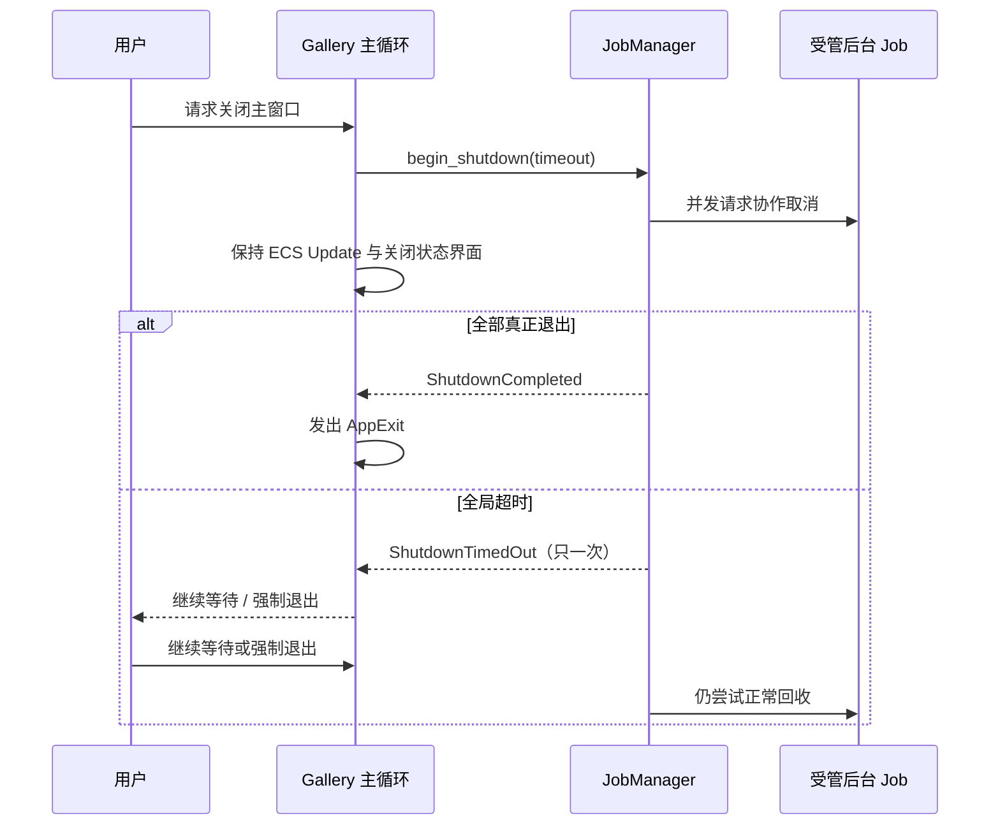

# 在 Gallery 接入应用退出收尾

应用级关闭是 JobManager 生命周期的最后一个真实集成环节：用户关闭 Gallery 主窗口时，应用不能在后台线程仍在处理或发送结果时立刻被 Bevy 的默认窗口关闭路径终止。由 Gallery 接管**退出意图、关闭中 UI、全局停止截止时间和最终 AppExit**，JobManager 只执行之前确定的非阻塞后台收尾。

## 接管正常退出，而不是在 JobManager 里退出进程

`gallery/src/main.rs` 当前通过 `DefaultPlugins.set(WindowPlugin { primary_window: ..., ..default() })` 安装默认窗口行为。如果继续让默认 `close_when_requested` 自动移除主窗口、或让 `ExitCondition::OnPrimaryClosed` 直接发送退出通知，主循环可能先于 JobManager 收尾而结束。设计上对 Gallery 应配置 `WindowPlugin { close_when_requested: false, exit_condition: ExitCondition::DontExit, ... }` 并接管 `WindowCloseRequested` 的主窗口分支；系统在合适的主循环调度点只调用一次 `begin_shutdown`，由 App 自行决定何时发出 `AppExit`。

`close_when_requested: false` 影响**全部窗口**而非仅 Primary Window。Gallery 当前有 Widgetry Owned Window、FileDialog 独立 Window、MessageBox 等，所以替代关闭处理系统必须继续对非主窗口执行等效的窗口关闭生命周期，尊重其 Close、Cancel、Deferred Consumer、`WindowClosing` 与跨 Render Extraction 清理序列；不能通过忽略所有非主窗口关闭消息换来主窗口的优雅退出。来自自身标题栏关闭、菜单退出、OS 主窗口关闭及程序请求退出的行为应收敛到同一 App 退出意图，避免绕过 JobManager 关闭。

## 关闭页面与用户决策

正常请求关闭后在主界面展示可观察的“正在等待后台任务停止”状态，记录本次全局超时和仍在运行/Stopping 的任务数，保持 ECS 响应、Window 可见、后台结果消息可以继续被消费或被业务安全丢弃。不要求 UI 先处理完各 Receiver 才宣告**执行体**关闭完成：只要所有真正的后台任务终结并完成受管线程回收，Manager 就可以通知 `ShutdownCompleted`，进程可以按 App 决策退出。如果 UI 需要表示某项业务自己已经处理完，则仍以对应 Receiver 的 `Finished` 为准，二者不应混用。

超时只显示一次 `ShutdownTimedOut`，给出继续等待和强制退出两种明确的用户决策。继续等待不重新打开 Job 接纳，也不清空原始截止时间；Manager 持续回收，直到以后依然可能产生 `ShutdownCompleted`。强制退出由 App 决定，必须告知用户该路径不保证后台 `Drop`、设备结束握手、缓存刷盘或外部副作用一致；Manager 本身不调用进程终止。没有 Job 的普通关闭应迅速触发 `ShutdownCompleted` 并正常退出，不能因为设计了关闭页面就延迟空任务退出。

对还在写盘的 FileDialog Preferences、WaveformFile Reader、Canvas PNG 导出和 Gallery 自己的磁盘 Source 加载，必须让受管取消与关闭结果能被统一看见；特别是 `Stopping` 不可冒充已退出。正常退出流程中各 Job 不要求一律 `Canceled`：确认响应取消并结束的是 `Canceled`，未确认取消而正常完成的是 `Completed`，真实失败的是 `Failed`；全部真实退出并完成必要线程回收才触发 `ShutdownCompleted`。页面自身临时 Receiver Drop 不应阻止执行体收尾；被所有页面放弃订阅时，Manager 的广播通道没有活跃消费者也不能陷入等待。库内部诊断继续沿用 `JobId` Span 与日志宏，Gallery 按操作及超时事实记录 Info/Warn，而非每帧记录。

## 针对性验证及整体收口

针对退出控制新增可复现测试：没有后台 Job、全部任务正常停止、一个受控线程长时间 Stopping、单次全局 Timeout、Timeout 后最终 Completed、继续等待、用户强制退出意图、重复主窗口关闭请求、退出开始后拒绝新 Job、多个副窗口的关闭不意外触发全 App 退出，以及 UI/后台消息同时到达时不丢失 WakeUp。验证 `WindowPlugin` 的关闭拦截不会破坏原有 FileDialog/MessageBox 的 WindowClose、Cancel 和 Deferred Cleanup。

运行时通过 BRP 进行针对性 GUI 交互、状态查询和 Screenshot，验证普通 Job 页面、关闭等待/超时界面与业务结果完成时序；**BRP 自定义 Pointer 不等同于原生 OS 主窗口 X/Win32 WM_CLOSE**，对应系统级关闭路径需真实 OS 验证或记录 BRP 能力边界，不得以点击 UI 按钮冒充系统窗口 X 已通过。检查静止 Reactivity 下最后一个 Job 退出后能主动刷新关闭界面、发送一次 `AppExit` 且不留下无窗口进程。整体收口检查仅覆盖本次真实受影响的 JobManager、FileDialog、WaveformFile、Waveform、Canvas 和 Gallery 功能；涉及大文件释放和后台渲染需按相关 Benchmark 定向衡量，避免无意义的全项目重复性能测试。

这一增量同步更新 `docs/gallery.md` 的宿主关闭流程、必要配置和受影响公共文档。涉及代码的各增量均按工程规则完成对应 Type-Driven/TDD、必要验证与独立 Code Review；不额外设置一个仅执行测试/写报告的后置方案。
