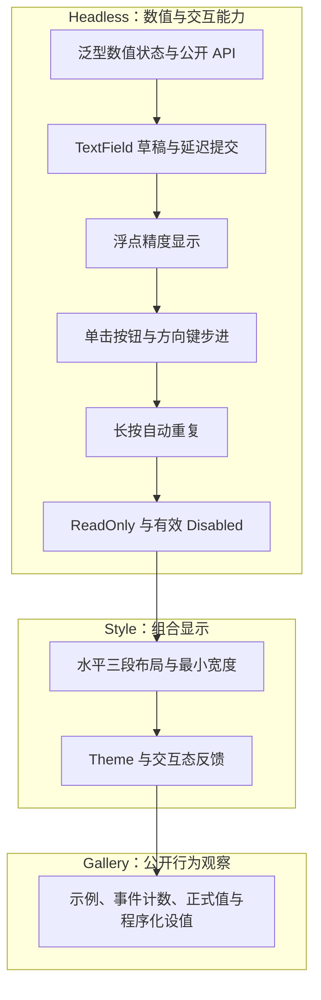

# NumberInput 控件整体设计与实施关系

NumberInput 与 SpinBox 作为一个泛型数值控件实现：允许直接编辑整数、浮点数，也可以通过左右增减按钮和聚焦方向键步进。正式值始终是合法的 `T`，内嵌 TextField 保留编辑草稿；仅当提交成功且正式值发生变化时，以 NumberInput 根实体为来源发出 `ValueChange<T>`。

整个工作按 **Headless → Style → Gallery** 形成唯一顺序，但不是把三大主题直接各压成一份大方案。Headless 先建立可复用的数值 Authority，再分步接入文本、精度显示、步进、长按和用户输入限制。Style 在交互已成立后固定三段几何结构并接入 Theme；Gallery 最后以实际控件和公开 API 展示可观察行为。各增量的实现、直接相关测试及必要文档同步在同一份方案内完成。

## 设计连接点

Headless 不重复造文本编辑器或数值事件总线。**NumberInput 根**是应用侧的查询、设置及通知来源；**内部 TextField**只负责输入文字、光标选择、剪贴板和 IME；**按钮/键盘输入**调用同一数值步进和提交逻辑。程序化更新可以覆盖未提交的草稿，ReadOnly/Disabled 仅限制用户输入而不禁止应用合法设值。

Style 使用 BSN 组合三个交互区域，宽度变化只影响中间编辑区；整个控件共用一圈边框、焦点反馈和 Theme 配色。Gallery 通过公开 API 查询正式值、监听 `ValueChange<T>`，不依赖私有 Component 来“伪造”展示状态。跨层接口、约束和测试要求都写入实际受影响的子方案，不依赖只阅读本页才能实施。

## 有序子方案

1. [建立 NumberInput 的泛型数值状态与公开更新 API](01-泛型数值状态与公开更新API.md)
2. [组合 TextField，实现数值编辑、延迟提交与取消](02-TextField编辑与延迟提交.md)
3. [为浮点 NumberInput 增加显示精度与焦点切换格式](03-浮点精度格式与焦点显示.md)
4. [增减按钮与键盘方向键共享数值步进](04-按钮与方向键步进.md)
5. [为增减按钮实现有界频率的长按自动重复](05-按钮长按自动重复.md)
6. [补齐 NumberInput 的 ReadOnly 与有效 Disabled 行为](06-只读与有效禁用交互.md)
7. [实现 NumberInput 三段式水平组合布局](07-三段布局与最小宽度.md)
8. [将 NumberInput 组合外观接入 Theme 与交互状态](08-主题样式与交互状态反馈.md)
9. [在 Gallery 展示 NumberInput 与可观察交互状态](09-Gallery示例与交互观测.md)
