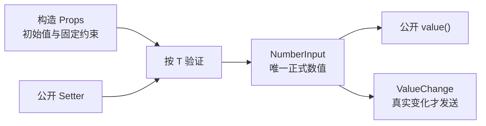

# 建立 NumberInput 的泛型数值状态与公开更新 API

NumberInput 与 SpinBox 是同一个控件，不维护两套业务数值模型。这一增量先建立可靠的数值基础：以 `WidgetryNumberInput<T>` 根实体为公开身份，保存经过校验的正式值 `T`，并提供从该根实体读取和程序化更新数值的能力。文本输入和按钮步进会在后续增量接入，不能改变这里确立的数值所有权。



## 以原始类型保存正式数值

泛型模型面向常见 Rust 有符号整数、无符号整数和浮点类型。`value`、`min`、`max` 和 `step` 始终以同一个 `T` 表示，不以 `i64` 或 `f64` 作为统一运行时存储，也不要求调用者在写入或读取时做类型转换。这样既避免无符号或大整数的转换边界问题，也避免将整型转为浮点导致精度损失。

具体支持哪些标准数值类型，以及这些类型共用的数值 Trait 约束方式，需要在建立类型能力时明确；它们不是泛型设计已自动解决的问题。无论选用何种 Trait，实现都必须能安全区分整数和浮点的合法性，并为后续类型内步进、解析和格式化保留原始 `T`。

正式数值始终存在，类型为 `T` 而不是 `Option<T>`。构造时**必须显式提供初始 `value: T`**，不采用自动填零、自动取最小值或其他隐式初始化；初始化本身不发 `ValueChange<T>`。

## 构造约束与只读配置

构造提供以下配置：

| 配置 | 约束与含义 |
| --- | --- |
| `value: T` | 显式必填；类型和值都合法，并处于有效范围 |
| `min: Option<T>` | 可省略的下界；不提供时不增加应用层下界 |
| `max: Option<T>` | 可省略的上界；不提供时不增加应用层上界 |
| `step: T` | 默认同类型的数值 `1`；必须严格大于零 |

两端点同时存在时，**`min == max` 合法**，控件可处于一个固定的数值位置；只有 `min > max` 是非法配置。浮点值、端点和步长必须有限，不接受 `NaN` 或正负无穷；`step` 为零或负数同样非法。对于整数 `T`，`step: T` 使小数步长在类型层面不成立。

初始值必须落在显式约束内，否则 Scene 构造明确失败，不做隐式 Clamp 或吸附。没有显式范围时，`T` 自身的可表示区间仍是后续数值运算的隐含安全边界。运行时配置固定：**`min / max / step` 不提供 Setter**，可修改的正式数值只有 `value`。后续浮点显示配置 `decimals` 也不因采用 Props 而自动获得运行时 Setter。

与 Slider 的区别要保留：Slider 的步进模式对部分数值有端点可达性校验，而 NumberInput 的 `step` 只约束增减操作，不约束手动或程序化设入的合法数值。这里的数值验证只关心类型有限性和取值范围，不要求落在某个步进网格上。

## 数值读取、提交与通知

沿用现有 Slider 的 Widget API 形式：

```rust
WidgetryNumberInput::<T>::value(&world, root)
WidgetryNumberInput::<T>::set_value_in_world(&mut world, root, value)
WidgetryNumberInput::<T>::set_value(&mut commands, root, value)
```

- `value` 读取已提交的 `T`，而不是未来可能出现的未完成编辑文本。
- 同步 Setter 立即验证并提交，返回 `Result<bool, BevyError>`：`Ok(true)` 表示真实变化，`Ok(false)` 表示合法同值，`Err(...)` 表示不合法或不能执行。
- `Commands` 入口仅排队；到命令实际执行时才验证和提交，失败交给宿主 Error Handler，不把入队当成已执行。
- 只有正式值实际变化后才以 **NumberInput 根实体**作为 `source` 发出 Bevy `ValueChange<T>`。必须先写入 Authority，再发通知；初始化、合法同值和失败均不发。

对不存在、不是 NumberInput 或缺少必要运行时状态的目标，按现有 Widget API 规则返回错误。失败时保持旧正式值，不产生通知。内部数值状态为控件自有 Runtime State，外部不能通过替换组件绕开 Setter；构造 Props 用完即结束，不保留同义的 Props 状态副本。

后续文本编辑增量要进一步保证：即使合法的程序化 Setter 传入同值，仍可用于清除陈旧草稿；数值未变依然返回 `Ok(false)` 且无事件。本增量保持独立的数值提交入口，为该行为留出集成点，而不预先构造文本编辑层。

## 工程边界与完成条件

数值核心作为独立控件能力通过 Bevy BSN / `SceneComponent` 声明和构造，使用既有 Scene 错误适配，不建立替代的 Spawn Builder 或自定义事件总线。作为新 crate 进入 Cargo Workspace，在对应 Cargo 配置中接入依赖；经 Facade 可选 Feature、公开模块和 Plugin 形式暴露，并遵循现有默认控件装配方式；必要的公开 API 和 crate 功能文档随实现同步。具体泛型类型注册必须覆盖实际声明支持的 `T`。

完成条件包括：

- 支持的各个 `T` 能分别构造、查询、合法设置和同值设置；验证传递过程中不退化为 `f64`。
- 缺少初始值、非法类型范围、`min > max`、错误步长、非有限浮点值及越界设值均明确失败；`min == max` 正常创建。
- 程序化写入在 Disabled 或 ReadOnly 状态下仍应可用，该语义由对应输入限制增量接入并复验；本增量不因为用户交互状态而限制数值 Setter。
- `ValueChange<T>` 的根来源、先提交再通知、恰好一次真实变化通知、初始化与同值静默、Commands 延迟执行以及无效目标诊断都有针对性测试。
- 同步相应 Facade API 测试和数值核心文档，不把后续文本/按钮的行为误记成现状。

本增量不实现编辑文本、按钮、长按、样式或 Gallery；相关增量通过同一正式值提交入口协作。
