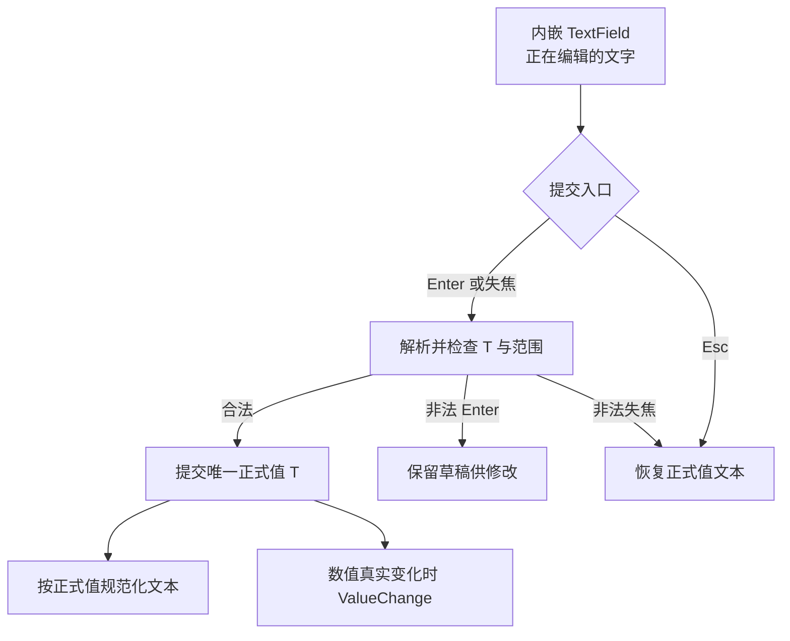

# 组合 TextField，实现数值编辑、延迟提交与取消

这一增量使 NumberInput 能让用户直接编辑数值，但仍由根实体的泛型正式值 `T` 负责业务状态。文本只是一份暂时草稿，不因键入过程、选择或 IME 预编辑而立即提交。沿用既有 `WidgetryTextField`，避免重新实现光标、选区、复制粘贴与组合输入。

## 复用输入编辑能力与状态归属

使用现有 TextField 的内容、焦点与编辑机制，包括光标、选择、复制、粘贴和 IME；NumberInput 自行负责将正式文本解析为 `T`、检验有限性和范围、决定提交或撤销。TextField 的 `EditableText` 不能成为另一个“业务数值状态”。对它的程序化内容改写走 TextField 公开 `set_text_in_world` / 排队 API，以复用清除待处理 Edit、Paste、IME 组合态和调整光标选区的既有路径；不能外部直接替换它的内部 `EditableText`。

NumberInput 根保持外部身份与数值 API 目标，实际编辑焦点落在内部 TextField 的编辑实体。内部编辑实体与根之间需要明确焦点映射；普通的焦点移动到控件外应触发失焦提交，后续按钮内部的焦点动作则不能误当成外部失焦。

## 延迟提交与取消语义

用户可能需要把 `12` 改成 `-3.5`，中间经过 `-`、`-3`、`-3.`。因此编辑时不逐字符要求其已经是合法的 `T`。允许暂时空串、孤立负号、不完整小数及任意尚未正式提交的草稿；正式数值仍维持上一次成功提交的值。

| 用户动作 | 可提交内容 | 不可提交内容 |
| --- | --- | --- |
| Enter | 解析、校验并提交，显示重新规范化 | 草稿保持原样，便于继续修改 |
| 输入框失去**键盘焦点** | 解析、校验并提交 | 丢弃草稿，恢复原正式值对应文字 |
| Esc | 无论草稿是否合法，都丢弃并恢复正式值；**保留焦点** | 同左 |

失焦包括鼠标点到其他控件或通过 Tab 切换；鼠标只移出范围不属于失焦。Enter、失焦后的合法同值、Esc、非法提交都不能生成“数值发生了变化”的事件。正式值没有空值分支，不允许将空串提交成 `None`，也不隐式替换为零或最小值。

## 可提交的十进制文本

仅接受普通十进制数字，不支持科学计数法 `1e3`、其他进制前缀 `0xFF`、千位分隔文本 `1,000` 或 `NaN` / `Infinity`。整数 `T` 接受十进制整数，有符号类型允许负号，无符号类型不接受负数；浮点 `T` 接受普通整数和小数文本。

浮点编辑允许简写 `.5`、`-.5`、`1.`，提交后根据正式值规范化为 `0.5`、`-0.5`、`1.0`；不会保留用户输入文本原样。`12.50` 提交后也可规范化为 `12.5`，正式显示的具体小数位数再由下一增量的 `decimals` 规则覆盖。用户键入尚未结束的 `1.` 时，不在编辑过程中主动把它改成 `1.0`。

用户输入的数值需要满足同类型 `T` 的可表示范围，以及构造期设置的 `min / max`，但**不要求是 `step` 的整数倍**。例如 `min=0`、`max=10`、`step=3`，输入 `4` 仍然可以提交。超出范围的 `120`（`max=100`）与 `abc` 都属于不可提交草稿；手动输入越界**不能 Clamp** 到端点。

## 程序化更新和草稿的优先级

应用通过公开 Setter 合法设值时，即使用户正在编辑，也立即以新的正式数值为准，并覆盖尚未提交的草稿。例：正式值 `10`，草稿 `25`，应用设为 `50` 后立即显示对应 `50`，旧 `25` 不能在后续失焦时提交回去。

无效 Setter 返回错误，既不改变正式值，也不碰当前编辑草稿。合法同值设置仍可以清除旧草稿并重新显示正式数值；其结果为 `Ok(false)`，不发 `ValueChange<T>`。文本同步需沿用 TextField 的内容 API 清理未处理队列和组合状态，防止旧输入在下一帧恢复。

## 与后续增量的关系和验证

这一增量依赖前一增量的泛型状态、范围检查、Setter 与根来源通知。之后的精度显示增量会把未聚焦/聚焦的格式化策略加在此处的“正式文本投影”上；按钮步进增量会额外接管草稿，但不能让内部按钮引发提前失焦提交。

完成条件：

- 整数、有符号/无符号、浮点各类合法文本、非法文本、越界文本，以及 `.5`、`1.`、`-.5` 和空串按规则处理；禁用的科学计数法、千位分隔和特殊浮点文本不能提交。
- 逐字输入、选区、复制粘贴、IME 的现有 TextField 能力保留；草稿期间 `value()` 始终是旧的合法 `T`。
- Enter、失焦、Esc 的提交/恢复/焦点行为和通知次数精确符合表中规则；鼠标移出不会误提交。
- 程序化合法更新、同值更新、非法更新和未处理编辑队列之间的优先级有针对性测试；外部仍只操作 NumberInput 根。
- 与 TextField 集成直接相关的功能文档及测试同步更新，而不复制 TextField 本身已有的全部编辑测试。

当前阶段不引入独立文本 Model、自定义数值输入键盘管线或第二份业务数值缓存。
