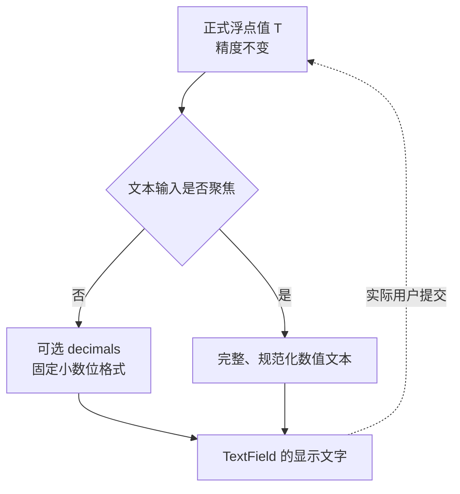

# 为浮点 NumberInput 增加显示精度与焦点切换格式

在正式数值和编辑草稿能够分离之后，本增量给浮点类型增加可选小数显示位数 `decimals`。这是一项显示能力，不应改变上一个增量建立的 `T` 的存储精度、合法数值边界、提交规则或 `ValueChange<T>` 语义。

## 显示规则与数值规则分离

- `decimals` 是浮点数可选的**显示小数位数**，只在构造时配置；方案未定义运行时修改它的 Setter，本增量不额外添加。
- 未聚焦且指定 `decimals=2` 时按固定小数位显示，例如 `1.0` 显示 `1.00`、`1.234567` 显示 `1.23`。
- 未指定 `decimals` 时显示完整、规范化数值文本，不强制固定小数位；浮点类型恰好为整数时也应保留完整表示，如 `1.0`。
- 获得文本键盘焦点时显示正式值的完整精度，例如 `1.234567`，不把未聚焦时舍入的 `1.23` 当成真实数值。
- 失去焦点后重新投影固定小数位格式。**单纯焦点切换或显示舍入不写回数值，也不发数值变化通知。**

完整精度显示与“用户正在编辑草稿”不是同一概念：编辑期间仍保留用户刚键入的临时文字，不应因为焦点变化以外的样式刷新反复覆盖草稿。只有成功提交、显式取消、外部合法 Setter 覆盖草稿等已定义的契机，才按相应规则重建文字。

## 规范化示例

下面的例子说明值的实际精度与显示文本之间的关系：

| 正式 `T` 或手动输入 | 聚焦时的规范文本 | 失焦 `decimals=2` |
| --- | --- | --- |
| `1.234567` | `1.234567` | `1.23` |
| 手动输入 `.5` 后成功提交 | `0.5` | `0.50` |
| 手动输入 `1.` 后成功提交 | `1.0` | `1.00` |
| 手动输入 `-.5` 后成功提交 | `-0.5` | `-0.50` |

浮点运算可能产生超出当前显示位数的尾数；本增量不对此进行数值舍入。例如 `0.1_f64 + 0.2_f64` 对应的内部结果可能是 `0.30000000000000004`，设置两位显示 `0.30`，并不意味着内部变为 `0.30`。

### 极小与极大有限浮点数的规范文本

聚焦时的“完整精度”指**能往返恢复原类型 `T` 的实际浮点值**，不是要求把二进制浮点数的精确有理数表示无限制地展开。格式化结果使用普通十进制文本，不出现 `e` / `E` 指数形式，也不因为数值很大或很小而自动截断、降低精度或改写正式值。对于恰好为整数的浮点值，仍保留 `.0` 等完整浮点格式约定。

例如应用以 `f64` 设置一个数值极小但有限的值（如 `1e-300_f64`），编辑器的规范文本应以 `0.` 开头并包含足以恢复该 `f64` 值的小数位；即使文本非常长，也不切换成 `1e-300`。极大有限值同样以不带指数的十进制文本显示。这里的 Rust 字面量仅用于说明程序化设值，不意味着允许用户输入科学计数法。

格式器与 NumberInput 的普通十进制解析器使用同一数值契约：对每个合法有限 `f32` / `f64` 值，**规范文本可以作为用户文本再次提交，并恢复到相同类型、相同数值**。不采用先转换为另一个浮点类型再格式化的中转路径。很长的规范文本由内嵌 TextField 原有的文本视口和光标滚动处理，既不要求无限增大控件宽度，也不因此截断实际可编辑内容。`decimals` 仍仅影响失焦时的显示投影；重新获得焦点必须回到可以往返的规范文本。

## 焦点、输入和步进的衔接

后续增减按钮会使内部 TextField 保持焦点，因此操作期间显示完整精度，步进针对真实 `T` 而非 `decimals` 舍入后的文本。否则，真实值为 `1.2344`、`step=0.001`、显示两位小数时，用户可能看到第一次点击由 `1.23` 跳到 `1.24`，第二次仍为 `1.24`；焦点期间的完整精度显示用于消除这个交互歧义。

不能把聚焦事件当成数值提交事件；TextField 光标和选择仍按其已有模型运作。这里新增的是正式数值到编辑器的显示投影，不创建另一份数值 Authority。

## 完成条件与边界

- `decimals` 能按固定小数位显示，未配置时使用完整规范文本；整数 `T` 不需要小数显示语义。
- 聚焦/失焦显示切换不改变 `T`，也不会产生多余的 `ValueChange<T>`；用户草稿不被普通状态刷新覆盖。
- 对 `.5`、`1.`、`-.5` 的规范化结果以及长尾浮点值的显示/真实值差异建立测试。
- 对 `f32` 和 `f64` 分别验证极小正数、最小正规数、最小正次正规数、最大有限值及对应负值等边界：生成的聚焦规范文本不含指数记法，能够通过 NumberInput 十进制解析再次提交，并恢复原类型相同的数值；焦点切换和再次提交不应因为格式问题失败。
- 与该能力相关的 Props、文档与测试随这一增量落地；不引入 `decimals` 的运行时 Setter，也不让格式化文本参与步进计算。
