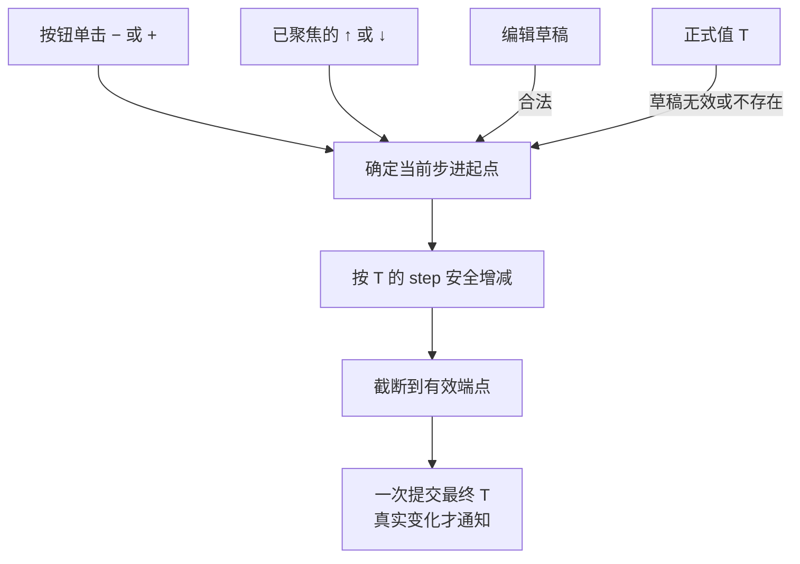
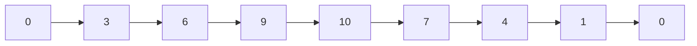

# 增减按钮与键盘方向键共享数值步进

在 NumberInput 已具有正式值、文本编辑和精度投影之后，为它接入 `− / +` 单击和聚焦时的 `↑ / ↓`。本增量只负责一次输入对应的一次步进；持续按住按钮的定时重复属于后续独立能力，外观布局与主题也留给 Style 增量。

## 每次从当前值递进，端点始终可达

`step` 是构造期固定的 `T`，默认数值一且严格为正；整数实例不能使用小数步长。每次增减都从**当前有效起点**出发，跨过显式 `min / max` 时停在端点。不将任意当前值强行对齐到相对 `min` 的步进网格，因此手动输入以及程序化 Setter 都不受步进对齐限制。

例如 `min = 0`、`max = 10`、`step = 3`：

从 `10` 往回减一次得到 `7`，而不是退回 `9`；若用户此前手动输入并提交 `4`，按一次 `+` 得到 `7`。这沿用 Slider 的“从当前值按方向递进、端点可达”交互方式，但**不沿用 Slider 对手动值的步进网格校验**。

即使没有显式范围，整数类型自身的边界也要使用安全运算。`u8` 当前为 `253`、`step = 5`，加一步得到 `255`，不能回绕。浮点数保持有限性，不得因为加减得到 `NaN` 或无穷大；类型固有边界与配置端点一起决定可到达值。到达端点继续点击时数值保持，既不产生新的数值变化，也不发通知；此时不因到达端点就禁用按钮。

## 未提交草稿与按钮输入的合并

单次步进首先判断当前 TextField 是否留有未提交草稿：

- **合法草稿**：先把草稿代表的 `T` 当作步进起点，算出最终数值后只提交**一次**；中间草稿值不作为独立提交事件。例如正式值 `10`、输入 `25`、`step = 5`，点击加号后直接提交 `30`，最多发一个 `ValueChange<T>`。
- **非法草稿**：丢弃草稿，回到原正式值作为步进起点。例如正式值 `10`、草稿 `abc`，点 `+5` 得到 `15`。

提交使用数值核心的共同入口，按最终值判断实际变化。最终值与旧正式值相同，合法操作仍不发变化通知。这一交互不通过“先用 Enter 提交草稿，再点击按钮”的两个业务更新来模拟，以免重复事件或给消费方暴露中间数值。

按钮点击要令内嵌编辑器获得并保持键盘焦点，并使聚焦时的完整精度显示规则生效；**内部按钮不能被视为控件外失焦**。否则尚未确认的草稿会在按钮处理前被外部失焦规则抢先提交，与上述优先级冲突。内部 NumberInput 根仍是外部事件身份，不把按钮子实体当成 `ValueChange<T>` 的 `source`。

## 方向键与鼠标滚轮

只有 NumberInput 持有有效键盘输入焦点、且有效启用时，`↑` 增加一步、`↓` 减少一步；允许键盘系统的重复按键。即使用户没有选中文字，只要获得焦点，方向键也能增减。方向键复用按钮的草稿优先级、边界判定、数值提交和通知路径，不另建一套计算规则。Disabled / ReadOnly 对方向键和按钮的一致过滤由对应增量补齐。

**不响应鼠标滚轮**。滚轮留给父级 ScrollArea 的正常滚动路径，以免指针恰好悬停在输入框上时意外改值。

## 本增量的交付与验证

实现 BSN 组合中必要的增减输入区域与焦点转发交互，之后的 Style 增量再确定三段统一外框、尺寸和具体颜色。它不能依赖新增独立事件总线，仍通过 `WidgetryNumberInput<T>` 统一提交正式值。用户输入只影响一次最终 `T`，同步修正涉及按钮与键盘的功能文档。

验收时重点检查：

- `0 → 3 → 6 → 9 → 10` 和 `10 → 7 → 4 → 1 → 0`、手动数值 `4 → 7`、`min == max` 与无显式范围。
- `u8` 等整型边界不溢出，浮点边界仍保持有限；到端点后多次点击保持原值并静默。
- 合法草稿 `25` 加五得到 `30`、非法草稿 `abc` 从原值步进，以及两种情况最多一次最终通知。
- 点击内部按钮获取焦点后展示完整精度，未触发额外的失焦提交；方向键只对当前聚焦输入起作用，键盘重复操作有效。
- ScrollArea 中滚轮不更改数值，也不阻止父级滚动；公开 API 仍以根实体为目标。
