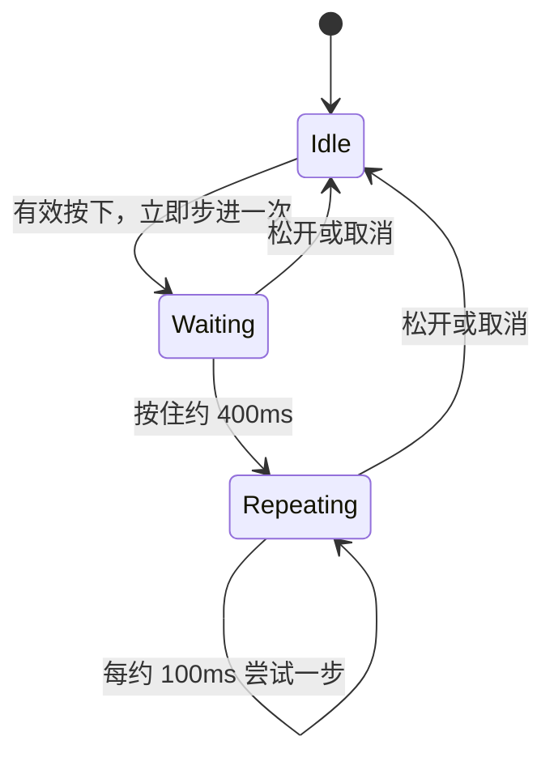

# 为增减按钮实现有界频率的长按自动重复

在单击已经可以对 NumberInput 增减一次数值的基础上，增加**同一次 Pointer 按住期间的连续步进**。这项能力可以独立验收：单击、键盘方向键和程序化 Setter 的语义保持不变，长按只是把同一条步进提交路径按时间重复触发。

## 单击和自动重复的关系

按下增减按钮立即计算并提交一次 `step: T`。如果仍然按住，约 `400ms` 后开始自动重复，此后约每 `100ms` 尝试增减一次，即每秒至多约十次，不与渲染帧率绑定。遇到掉帧不补发积压的所有“本该发生”的重复输入；恢复后继续按当前时序推进。

每一次尝试仍然使用既有单步计算：由当前有效起点前进 `step`，按配置范围和 `T` 自身边界停在端点。**只有真正改变正式值时发送一次 `ValueChange<T>`**；在端点上保持数值，后续重复不会继续刷变化通知。事件仍在数值提交后发出，`source` 是 NumberInput 根。控件不额外建立“长按期间先缓存、松手才通知”的批量提交模式。

例如范围 `0..10`、步长 `3`，持续按住加号达到 `10` 后，其余重复周期只会得到合法同值；松开前控件仍处于正常按住状态。到达边界时**不自动将按钮设为 Disabled 或显示灰态**，避免动态 Disabled 打断现有 Pointer 交互。

## 终止与输入来源

释放指针、Pointer 取消，以及控件变为有效 Disabled 等已定义的正常取消条件，都必须及时终止自动重复；重新可用后不继续之前的计时。按住时可保持内部 TextField 的焦点和完整精度文本，避免每次自动重复重新触发失焦提交。与单击一样，重复步进不触发单独的中间草稿通知。

现有 `WidgetryHoldButton` 的语义是充能达到阈值后一次性 `Activate`，不是间隔式重复激活；它的“成功后只触发一次”不能直接复用为 NumberInput 的重复输入。可以复用工程现有的 Pointer 生命周期和取消基础能力，但实际重复计时要符合本增量规定的频率和停止规则。

## 消费方负载边界

连续增减时，消费方可能以约十次每秒收到 `ValueChange<T>`；这属于已提交数值的真实变化，不是无节制的逐帧事件风暴。Widget 不为事件再新增内部节流或合并层。业务观察者如果执行昂贵操作，可以自行跳过中间事件、合并处理、延迟工作，再通过公开 `value()` 取得最新正式值。

这里的上限约束的是自动重复尝试频率，不能把“只处理每秒十次”误解释成忽略掉来自合法程序化 Setter 或其他输入来源的变化通知。

## 完成条件

- 短按只立即执行一次；持续按住约 `400ms` 才开始重复，之后间隔约 `100ms`，不是每帧加一次。
- 连续真实数值变化各自提交并通知；到范围端点和类型边界后不产生同值事件，也不主动改变按钮可用外观。
- 松开、正常 Pointer 取消、有效 Disabled 等情况停止计时；不残留重入后继续触发的按住状态。
- 掉帧不会追补积压的每一个周期；自动重复与按钮单击、键盘方向键公用数值步进逻辑。
- 对按住启动、自动重复次数、端点保持、取消与再次按住建立针对性测试，并同步交互文档。Gallery 对长按的实时可见验证归入后续 Gallery 增量。
