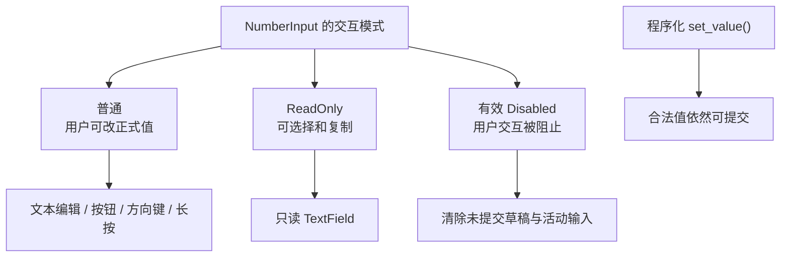

# 补齐 NumberInput 的 ReadOnly 与有效 Disabled 行为

NumberInput 既有文本编辑也有按钮和键盘步进，只在 TextField 层禁止打字还不够。本增量将**同一个“用户能否修改数值”语义**落实到文本、按钮、方向键、长按以及中途禁用状态，并保持既定的程序化 Setter 能力。

## 普通与只读实例

ReadOnly 选择在**构造时固定**，不添加运行时切换入口；这与现有 `WidgetryTextField` 和 `WidgetryReadOnlyTextField` 的不同 Scene 构造方式一致。普通 NumberInput 使用可编辑 TextField，能键入、选择复制、点击按钮、方向键步进与长按。只读 NumberInput 使用已有只读 TextField 组合，保留数值文本的选择和复制，同时禁止用户打字、粘贴修改、`− / +`、方向键和长按改变数值。

ReadOnly 不等于 Disabled；两者都**不拦截合法程序化 `set_value()`**。应用侧即使在只读实例上改值，仍经过统一验证和提交，在数值真实改变时触发根来源的 `ValueChange<T>`。只读文本投影跟随新的正式数值。ReadOnly 与普通实例共享同一套泛型数值类型、范围与步长约束，不另做一个业务状态模型。

## 有效 Disabled 及其继承

采用项目现有的 `InteractionDisabled` 与祖先继承语义。当前根或祖先有效禁用时，NumberInput 不再响应会修改数值的用户操作，也禁用其内部按钮和文本编辑交互；与 ReadOnly 不同，Disabled 不保留用户选择、复制的交互能力。

如果禁用发生在编辑草稿过程中，**立即放弃未提交的文本并恢复当前正式数值的规范显示**；重新启用后不能把禁用前残留的编辑/Paste/IME 请求补交进去。如果禁用时正处于长按自动重复，计时和有效 Pointer 操作应终止，不在解除禁用后自己恢复。依赖 TextField 已有禁用编辑队列的处理，并由 NumberInput 对自身长按/步进请求做同样的有效禁用检查。

例：正式值 `10`，当前草稿 `25`，父容器此时进入 Disabled：控件恢复正式值 `10`；父容器重新启用后，不能通过失焦再次提交旧草稿 `25`。与此同时，应用程序调用合法 `set_value(50)` 仍可提交 `50`，其显示同步及通知规则不变。

## 优先级、状态与错误边界

普通模式下 Enter、Esc、失焦的提交规则保留不变；ReadOnly 不制造新的编辑提交通道；Disabled 更严格地过滤用户输入。有效 Disabled 变化只影响用户交互的可用性与必要取消，不应凭空产生一次业务数值变化通知。

程序化无效 Setter 在 ReadOnly/Disabled 模式下仍返回原来的错误，失败不改变正式值，也不影响草稿；程序化合法同值依然不发通知。不能为了统一模式，绕开现有 TextField 的内部编辑和聚焦管理，或者以直接写内部状态模拟程序化更新。

## 完成条件

- 普通与 ReadOnly 构造变体各自正确复用现有 TextField / ReadOnlyTextField；只读仍支持选择复制，但文本、按钮、方向键和长按都无法改数值。
- 当前控件 Disabled 与祖先继承 Disabled 均有效；用户输入路径不修改正式值，程序化合法 Setter 仍可修改。
- 编辑中途变 Disabled 清空旧草稿与待处理输入；禁用期间或禁用后的恢复不会补交旧内容。
- 长按中途禁用立即停止计时；重新启用不接续旧按住动作；模式变化不额外制造 `ValueChange<T>`。
- 每类模式的数值读取、合法设值、非法设值和真实变化通知都纳入相关测试；同步 Headless 契约文档，Theme 视觉在之后的样式增量落实。
