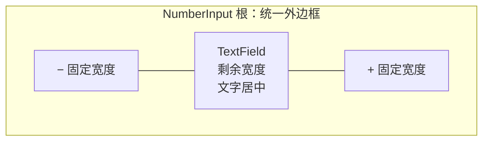

# 实现 NumberInput 三段式水平组合布局

NumberInput 的固定外观为**左减号、中间数值输入、右加号**。这一增量将 Headless 已有的 TextField 与两侧增减操作组合成一个可正常参与 Bevy UI 布局的控件，保证宽度变化时按钮仍可用、文本仍可编辑。主题色和焦点视觉反馈由下一个样式增量负责，这里先确立结构和几何关系。

## 一个完整控件而不是三个分离按钮

布局只支持这一种水平变体，不额外实现右侧上下堆叠的传统 SpinBox 排列，也不将 NumberInput 与 SpinBox 拆为两种公开控件。三个区域处于同一个整体外框内：外层提供一圈边框和圆角，内部通过**两条竖向分隔线**区分减号、输入区域、加号；左右按钮不各自绘制完整外边框。

`− / +` 按钮始终显示，无论 Normal、Hover 或焦点状态都不隐藏，不通过 Hover 展开或收缩布局。中间数字文字**默认水平居中，编辑时也保持居中**。输入区域仍使用现有 TextField 的文本视口、光标与选择行为，不重新实现文本渲染或处理较长数字的滚动。

## 宽度分配和最小可用尺寸

- 左右两个按钮宽度相等且稳定，默认接近控件高度，形成便于点击的近似正方形区域。
- 通过 NumberInput 根实体的 `Node.width` 控制整体宽度，不新增专用宽度 Props；控件变宽时仅中间输入区域伸长，按钮宽度不被拉大。
- 默认高度与字号参考现有 TextField 视觉尺寸，避免引入与库中输入控件明显冲突的尺寸体系。
- 整体设置**最小可用宽度**，保证两个按钮和中间至少有一块可编辑文本区域。即使父容器极窄，内部也不把按钮或中间编辑区无限压缩。

举例说明：假设按钮各 `36px`、输入区至少 `60px`，可形成 `36 + 60 + 36 = 132px` 的最小宽度。这仅用于解释布局关系，**不是已确认的固定像素常量**；实际最小宽度及默认控件高度应根据现有 TextField 规格和具体布局验证后确定。

如果父容器宽度比控件最小宽度还小，NumberInput 仍保持自身最小宽度，不自动隐藏按钮、缩小文字或切换排列方式。超出父级的部分由调用方布局选择裁剪、滚动或扩大容器；NumberInput 不暗中改变用户选择的三段式结构。文本太长则遵循 TextField 自身的编辑可见区域机制，不改变左右按钮的可用宽度。

## BSN 组合与交互边界

按照项目的 BSN、`SceneComponent`、`Scene` 和 Children 组合方式组织根实体、内嵌 TextField 与增减按钮，不以额外 `spawn_*` 或 Builder API 替代声明式 UI 构造。构造 Props 只负责初始化，后续反映正式值的文字来自现有泛型数值状态，不增加重复 Authority。

外部程序与数值变化通知继续以 **NumberInput 根** 为目标/来源，内部具体哪些节点负责点击、文本、分隔线只属于组合结构。内部按钮必须保留 Headless 的 Pointer、长按和保持编辑焦点行为；布局调整不能在点击按钮时触发“失去焦点，抢先提交草稿”。

本增量完成的只是结构与尺寸：Hover / Pressed、焦点环、Theme 下的边框/文本/按钮配色和组合样式归属放在后续主题增量，不在本增量自行创建与 Theme 冲突的永久颜色权威。

## 完成条件

- 三个区域保持 `− / 数值 / +`，左右按钮始终可见、等宽，中间文本始终居中；整个控件只有统一外框及两条内部分隔线。
- 修改根的 `Node.width` 只改变输入区可用宽度；按钮尺寸保持稳定。窄容器和极窄容器下不发生无限压缩或自动变体切换。
- 在最小宽度附近，左右按钮仍能点击和长按；较长数值能按 TextField 的光标、选择和文本视口语义处理。
- 布局变化不造成额外的正式值更新、通知或失焦提交；外部根身份与公开 API 保持可用。
- 通过实际布局/GUI 行为验证必要的尺寸常量，并同步控件布局文档；不把示例中的 `132px` 误写成正式预设值。
