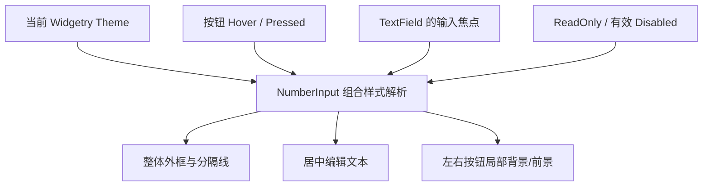

# 将 NumberInput 组合外观接入 Theme 与交互状态

在三段式布局稳定后，本增量为统一外框、输入文本和两侧按钮接入项目既有的主题/状态颜色体系。它不改变数值计算、编辑提交或长按语义，只让现有状态在视觉上被正确表达：普通、Hover、Pressed、Focus、ReadOnly 和有效 Disabled 都需与组合控件的实际行为一致。

## 外框、按钮与焦点反馈

整体 NumberInput 使用**一圈共同的边框和圆角**，不为 `− / +` 按钮再添加各自的完整边框；内部保留两条竖向分隔线。焦点出现在内部文本编辑器时，**整个 NumberInput 外框**体现输入焦点反馈，不仅给中间文字画局部焦点边框。不能因为按钮获得指针 Hover 或 Pressed，就改变整个组合的几何尺寸。

左右按钮的 Normal / Hovered / Pressed / Disabled 状态使用当前 Theme 的语义配色。每侧 Hover / Pressed 只影响自己区域的视觉反馈，不更改输入区的尺寸或按钮是否显示。Theme 切换时同步更新外框、分隔线、文字与按钮颜色，不能由于组合样式归属冲突让内部 TextField 或按钮被其他独立样式消费者覆盖。

控件整体有效 Disabled 时呈现 Disabled 配色，禁止用户编辑与增减的实际行为由既有 Headless 规则负责。ReadOnly 仍可选择/复制文本而不可通过按钮改值；其外观应反映只读语义，同时不额外削弱对程序化更新的数值显示。内部按钮的事件过滤与样式状态都不能脱离根的 ReadOnly / 继承 Disabled 事实。

## 端点不转换为局部 Disabled

**数值到达 `min` / `max` 不改变按钮 Normal/Disabled 的选择条件。** 即使某一方向已经无法继续修改数值，该按钮仍保持对应的普通、Hover、Pressed 视觉状态并继续接受点击或长按；操作得到同值，因而不发变化通知。

这样可以防止连续按住过程中因“碰到端点就自动 Disabled”而中断 Pointer 状态。真正禁止按钮输入的情形仅来自控件的 ReadOnly 或有效 Disabled（包含祖先继承）。这些状态由现有输入契约决定，而不是由数值端点推导出另一份互相冲突的禁用状态。

## 依赖已有配色和刷新机制

按现有 Theme 系统的颜色来源、局部交互状态、Focus 可见状态以及组合 Style Owner 规则实现更新，复用必要的色彩解析和变更驱动机制。NumberInput 作为复合控件需要统一拥有其内部 TextField 和按钮的视觉输出，避免各子控件独立样式刷新把根部协调后的颜色覆盖。现有 Theme 提供 Dark、Light、Pink Dream、Kamuri Violet 等模式，新增控件应能在这些模式切换时连贯更新。

对于调用方颜色定制，只沿用总方案明确要求的**现有配色机制与局部状态刷新原则**。总方案没有决定 NumberInput 专属逐字段 Overrides 的公开类型及 Getter/Setter 形状，因此不能在这一拆分中自行扩展新的公共定制协议；如现有组合控件集成方式要求提供此类接口，应先按项目既有惯例厘清范围，而不是在文档中虚构完整字段清单。

样式更新只影响配色、边框和焦点视觉，不触发 `set_value`、清空编辑草稿、重设光标或发送 `ValueChange<T>`。创建后 Theme/Focus/Hover/Pressed/Disabled 改变时，文本的正式值与用户编辑中的草稿仍按 Headless 规则保持。

## 完成条件

- 正常、Hover、Pressed、Focus、ReadOnly、Disabled 等状态在统一外框/文本/按钮中一致反映，按钮始终常显且状态切换不改尺寸。
- 内部编辑器获得焦点时，整个外框显示可见焦点反馈；按钮 Hover/Pressed 仅影响本侧局部背景/前景。
- 到达任一数值边界不自动变灰、不禁用按钮、不打断长按；真正 ReadOnly/有效 Disabled 的视觉与禁止用户输入的行为一致。
- 在现有各 Theme 切换中，边框、分隔线、输入文字和两侧按钮正常更新；不会发生组合样式被其他子控件刷新覆盖。
- 通过样式/状态测试和 GUI 观察检验，同时同步 Theme 与控件相关功能文档；切换颜色、焦点可见性或状态时无意外数值变化通知。
