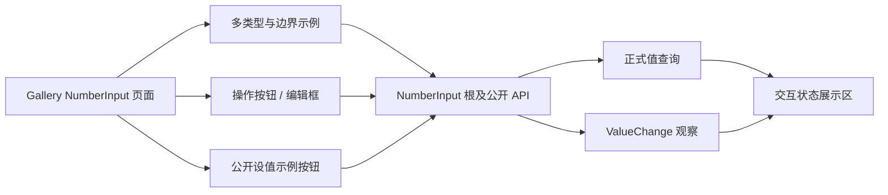

# 在 Gallery 展示 NumberInput 与可观察交互状态

这一增量为已经能够独立使用的 NumberInput 提供 Gallery 页面：既能体验整数和浮点、步进与精度、只读与禁用、窄布局等组合，也能通过**正式数值和事件计数**直接观察延迟提交及真实变化通知的结果。程序化设值示例与状态展示属于同一个可运行的控件展示页面，因此不为了增加提交数而人为拆成两篇。

## 独立页面与覆盖场景

Gallery 新增一个 NumberInput 页面，沿用现有导航、按需装载/卸载、Theme、语言/i18n、Scale Factor 与 GUI/BRP 可观察机制。页面应在切离时销毁临时状态，不能保留未结束的长按计时、演示实体或事件计数资源导致返回页面后继承上一次的动作。

示例覆盖范围直接来自控件契约：

- **类型**：有符号整数、无符号整数和浮点值，展示不同 `T` 的合法数值和输入差别。
- **边界**：显式 `min/max`、`min == max`、无显式边界、`step` 不整除区间、类型自身最小/最大值及端点同值。
- **步长与精度**：不同 `step: T`，浮点 `decimals`，聚焦期间完整精度、失焦后的固定位数显示，以及长按自动重复。
- **交互限制**：普通、ReadOnly、Disabled 和由祖先继承的有效 Disabled。
- **尺寸**：正常宽度、较窄容器和触发最小宽度约束的外部容器；检验按钮可用、文本居中与外部裁剪/滚动边界。

示例无需为原生 TextField 的每一种低层编辑细节复制演示页；这里只展示它们与正式数值提交有关的部分。Theme 和字体缩放演示使用已有 Gallery 能力，不再单独增加新的全局控制器。

## 每组示例的交互状态展示区

每组 NumberInput 示例旁提供可观察状态，明确区分草稿和已提交数值：

- **当前正式数值**：使用公开 `value(&World, root)` 查询，不直接读内部 Component，也不误把 TextField 正在输入的草稿当成值。
- **变化次数**：统计以 NumberInput 根为 `source` 的真正 `ValueChange<T>`；初始化不计数，合法同值、Esc 取消、非法 Enter / 失焦也不计数。
- **最近事件的数值**：展示最近一次正式变化通知的已提交 `T`，与当前数值查询可对照检查。

这样能直接观察按钮一次点击只触发一次最终结果、长按每次实际变化才通知、到达端点后不再增加计数、修改草稿未提交时计数不变，以及程序化更新是否覆盖草稿。

## 公开 Setter 的实际使用演示

在适合这些目标值的示例旁提供预设设值按钮，如 `Set 0`、`Set 50`、`Set 100`，使用 NumberInput 公开的 `set_value()` 或对应同步 World API，不直接修改内部数值状态或编辑器文本。只有某个示例的 `T` 和取值范围允许的目标值才应被用于该示例；不为了展示预设按钮而改变其原本的范围约束。

预设按钮的目的既是演示公开 API，也帮助验证程序化合法值覆盖用户未提交草稿、成功设值后文本规范化、合法同值不生成事件等已定义的行为。范围以外的程序化设值须遵守原有错误报告契约，不允许把错误当作静默无操作。页面的展示值始终取自公开数值 Authority，而非预设按钮自己保存的一份假值。

## 集成与完成条件

Gallery 只在页面进入时按既有 BSN 页面机制建立相应示例，退出时卸载；为不同 `T` 的事件观察建立与实际泛型事件类型匹配的订阅或观察处理。新页面的导航和页面专属文案按现有 i18n Key 体系接入，并保持四套 Theme、Scale Factor 和按需销毁机制。

完成条件：

- 导航进入/退出 NumberInput 页面正常，离开再进入时不留旧实体、旧长按或陈旧统计；适用的 i18n 文本在现有语言切换中工作。
- 各类型、范围、步长、浮点精度、长按、ReadOnly/Disabled、祖先禁用与窄布局的示例能实际交互并展示正确状态。
- 每组状态区只读公开 `value()` 和 `ValueChange<T>`，能观察初始化不计数、同值静默、草稿不提交、Esc 取消、边界保持和长按多次真实变化。
- 预设 Setter 按钮实际调用公开 API；覆盖草稿、同值设置和非法目标的行为与 Headless 契约一致。
- 通过现有 GUI/BRP 流程验证 Theme 切换、输入焦点、按钮状态、窄布局和页面生命周期，并同步 Gallery 文档；全局收口回归只针对本新增控件及它直接触及的公共接口，不再增设单独的“最终验收方案”。
