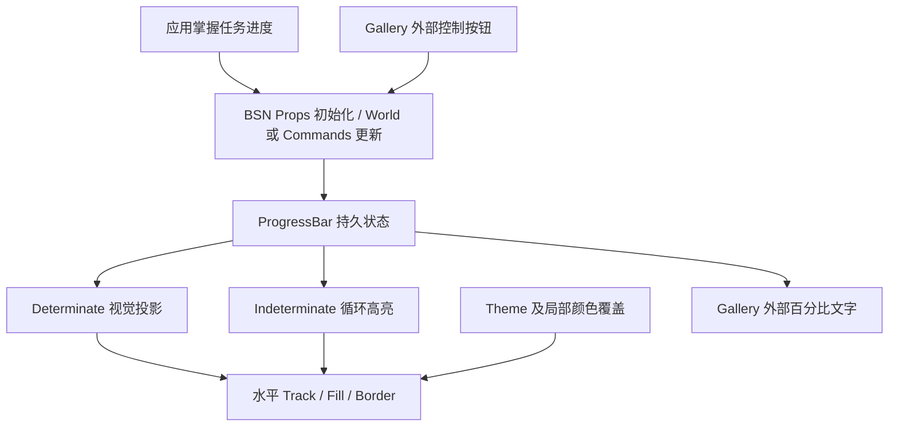

# ProgressBar 整体设计

ProgressBar 用于把应用已经掌握的任务进度显示给用户，不参与任务调度、进度计算或用户输入。确定进度（Determinate）展示精确完成比例；不确定进度（Indeterminate）通过持续移动的高亮段表达“任务仍在运行，但还不知道完成比例”。控件只支持水平从左向右的布局。

与 Slider 相似的部分是数值合法性检查、BSN 构造、`World` / `Commands` API 的调用形态，以及 Track / Fill 的布局和主题机制；不同的是 ProgressBar 不接受指针或键盘输入、不提供 Thumb 或步进规则，也不发送 `ValueChange` 等业务变化通知。可借鉴或抽取确有共同语义的底层实现，但不把 Slider 的私有 `SliderState` 当成 ProgressBar 的状态源，更不为了复用而让两个控件共享输入语义。

状态本身是唯一的任务进度显示依据。动画只保存绘制所需的临时位置和计时，不回写真实进度。确定进度值采用有限 `f32`，范围固定为 `[0.0, 1.0]`；`0.65` 表示 65%。两种模式允许运行时切换，也允许直接以非零进度创建控件。默认初始状态为 `Determinate(0.0)`。数值更新允许增加、减少和重置，不强行制造单调增长的假象。

样式上以清晰的圆角 Border 表示轨道的完整范围，填充始终位于 Border 内部；因此不再添加曾讨论过的两端刻线或圆点。确定进度用短暂的平滑过渡展示数值变化，不确定进度用向右循环移动的高亮段展示活动状态。控件内部不内置百分比文字，外部应用可自由组合文本。默认高度 `12px`，宽度填满父容器可用空间，尺寸可由 BSN 布局和 Props 调整。

Style 使用项目现有的颜色机制，覆盖 `Dark`、`Light`、`PinkDream`、`KamuriViolet`，响应运行时主题切换，支持局部 Track、Fill 和 Border 颜色覆盖。由于它只是展示控件，不引入 Hover、Pressed、Focus 或 Thumb 的外观状态。

## 实施顺序

以下顺序体现逐步增加可交付能力，而不是将测试或文件改动单独当作目标。每个功能增量都随实现提供相应验证和受影响的正式文档更新。

1. [Headless 状态与程序化 API](01-headless-state-api.md)
2. [确定进度的可视轨道和主题样式](02-determinate-style.md)
3. [确定进度的平滑过渡](03-smooth-transition.md)
4. [不确定进度动画与模式切换](04-indeterminate-animation.md)
5. [Gallery 交互演示](05-gallery-demo.md)