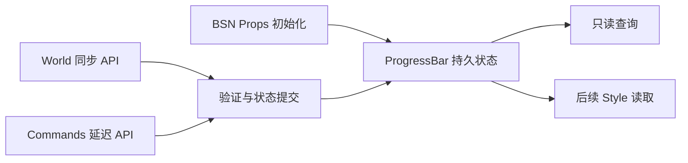

# ProgressBar Headless 状态与程序化 API

## 目标与设计思路

先交付一个无需依赖填充绘制或循环动画，就能通过 Bevy 0.20 BSN 创建、查询和程序化更新的 ProgressBar。它是**只读展示控件**：任务系统拥有业务进度，ProgressBar 只存储应用提供的当前展示状态，并通过 Widget API 接受更新。该增量交付有效的状态语义、BSN 初始化、查询与同步/延迟写入，不同时建设完整视觉层。



ProgressBar 与 Slider 采用相似的外部 API 习惯，但不共用 Slider 的 `SliderState`：后者还存有 `min/max/step`、方向与交互所需的语义，且实现为 Slider crate 内部结构。这里的值域固定，无步进、无指针/键盘输入、无 Thumb，不为复用引入对 Slider 内部状态的依赖。

## 状态与初始化

对外用一个带模式的状态表达展示内容，而不是并行维护 `mode` 和一个可能失去意义的 `value`。以下代码表达接口语义，命名按实际 Widgetry 公共类型命名习惯落实：

```rust
pub enum ProgressState {
    Determinate { value: f32 },
    Indeterminate,
}
```

- `Determinate` 的 `value` 是 `[0.0, 1.0]` 的归一化比例：`0.0` 表示 0%，`1.0` 表示 100%，`0.65` 表示 65%。不提供可配置 `min`、`max` 或 `step`。
- `Indeterminate` 表示当前没有可呈现的比例，不保留一份虚假的确定进度数值。将来切回确定模式时，调用方提供新的确定值。
- BSN Props 可提供初始 `ProgressState`，省略时使用 `Determinate { value: 0.0 }`。初始值允许合法的非零比例，尤其适合任务已经运行一段时间后才打开的进度详情。
- 运行时允许双向切换模式，也允许进度增加、减少、归零以及从完成状态重新设为较小值。控件不判断任务是否应当倒退。

通过 `SceneComponent + Props` 构造 ProgressBar 根实体；Props 只在创建时消费，随后以持久 ECS Component 表达当前状态。不在运行时持续同步 Props，也不保留第二套进度值。Headless 阶段只需建立可被 BSN 实例化和识别的根实体及状态，不引入尚未需要的可视子节点和动画计时。

## 公开查询与写入

提供从 `World` 对根 Entity 查询当前 `ProgressState` 的只读接口，以及同步 `World` 和延迟 `Commands` 的状态更新入口。沿用项目现有 Widget API 习惯，不设计通用 Binding、Callback 或 Setter 总线。下面是意图示例：

```rust
WidgetryProgressBar::state(world, entity)?;
WidgetryProgressBar::set_state_in_world(
    world,
    entity,
    ProgressState::Determinate { value: 0.65 },
)?;
WidgetryProgressBar::set_state(
    &mut commands,
    entity,
    ProgressState::Indeterminate,
);
```

同步写入在当前调用中验证和提交。与现有数值控件的返回契约一致，`Result<bool, BevyError>` 表达三种结果：`Ok(true)` 为状态实际改变，`Ok(false)` 为合法同值，`Err(...)` 为无效输入或目标，拒绝更新。延迟入口只入队，待命令实际执行时验证和提交，不将成功入队误认为更新完成；错误依项目统一的 Commands 错误处理路径传播。

**不发送业务变化事件。** 这里的状态是应用传给控件的外部展示进度，而非通过用户操作产生的业务变化请求。状态提交后，后续 Style 使用 ECS `Changed`/相关更新机制刷新可见内容。此规则只针对 ProgressBar 的展示输入，不改变其他自有交互控件的状态通知契约。Gallery 如需显示文字，应读取真实状态，不监听并不存在的 `ValueChange`，也不维护另一份进度权威值。

## 状态完整性和异常输入

确定值要求 `f32` 有限且位于闭区间 `[0.0, 1.0]`。`NaN`、正负无穷、负数与大于 1 的数一律报错，不静默 Clamp 或吸附。目标 Entity 不存在、不是 ProgressBar 根实体或缺少预期的运行时状态时，同样明确报错。

无效初始化不得产生看似成功的控件；无效更新必须保持原状态，不报告成功，也不发业务事件。对同值设置返回 `Ok(false)`，不人为触发状态变化。状态 Component 的外部直接替换、删除不属于受支持的更新方式，应用统一经公开接口修改展示状态。

## 工程集成与完成条件

建立独立 ProgressBar crate 和 Plugin，纳入 Workspace，并在顶层 Facade 提供与现有控件一致的可选 Feature、类型与 Plugin 导出；Headless 的初始化和公共 API 不依赖后续 Style 或 Gallery 页面才能进行逻辑验证。相关 Workspace/Facade 结构变化同步正式架构文档，Headless 行为及 API 同步 crate 功能文档。

Unit Test 和从 crate 外部观察的 Integration Test 至少覆盖：

- 默认 `Determinate(0.0)`、合法非零初始值和直接创建 `Indeterminate`；非法初始值报错。
- `0.0`、`1.0`、区间中值；增大、减小、重置；两种模式双向切换及合法同值。
- 无效浮点值、范围越界、无效 Entity、非目标 Widget、内部状态缺失；失败不改变已有状态。
- `World` 同步结果的 `Ok(true)` / `Ok(false)` / `Err(...)`；`Commands` 入队时状态不变、执行时才校验与提交，并按项目错误处理方式报告失败。
- 真实 BSN 创建、读回状态、程序化更新；确认状态改变不触发任何 ProgressBar 业务变化事件。

Integration Test 对应的 `tests/COVERAGE.md` 描述实际状态、外部刺激、转换、边界与不变量；测试行为遵循现有工程规则，不把样式、动画或 Gallery 验收提前挪到此阶段。