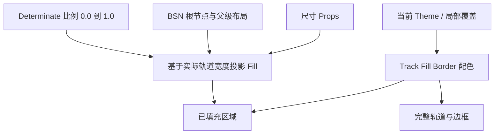

# 确定进度的可视轨道和主题样式

## 目标与设计思路

在已有 Headless 状态之上增加可见的水平 ProgressBar：真实的 BSN UI 树负责 Track、Fill 和 Border，Style 根据持久 `ProgressState` 与实际布局计算填充长度，并按当前 Theme 解析颜色。此增量先把**确定进度的静态投影**做正确；从一个比例平滑移动到另一个比例，以及不确定模式的循环动画，分别由后续增量增加，不在这里混合完成。

Slider 已有 Track / Fill 的 BSN 和主题刷新实践可以作为实现参考，但 ProgressBar 不添加 Slider 的 Thumb、命中区、指针、键盘、焦点或步进逻辑，也不要求为了复用修改 Slider 现有公开契约。样式始终是状态的投影，不允许通过几何节点回写真实进度。

## 轨道、填充与布局

ProgressBar 只支持水平从左向右填充。整体是一个边界清楚的圆角矩形：未完成部分为 Track 背景，已完成部分为内部 Fill，外围有完整且始终可辨识的 Border。Fill 限制在 Border 内侧，不能在进度达到 100% 时覆盖边框，也不能伸出圆角外侧。0% 时轨道内没有填充；100% 时内部可用长度全部填满。

Border 已经明确标出完整的 0%—100% 范围，因此**不绘制端点刻线或圆点**。不放 Thumb、不画刻度，也不把 `0%`、`100%` 或当前百分比等文字嵌入控件。应用若需要文字，由外部 BSN 布局组合 Text，例如 `正在下载`、`65%` 或 `65 / 100 MB`。进度条作为展示部件，既不接受用户操作，也无 Hover、Pressed、Focused 等交互视觉态。

默认总体高度为 `12px`，主轴宽度默认填满父容器可用宽度，而不是使用 Slider 的固定 `200px` 主轴长度。允许通过 BSN Props 自定义高度，并允许父容器和根 Node 的布局设置控制宽度。进度条在父容器大小改变时应保持正确的相对填充比例；不可把构造时的像素宽度缓存成进度的唯一几何依据。边框与内部填充适应高度变化，整体圆角与裁剪保持正确。

这个样式增量只计算确定模式 `value` 对应的可见比例。其它模式的持续运动交由后续动画增量处理，不用在这里引入第二种业务数值。

## Theme 配色与局部覆盖

沿用 Widgetry 的主题及局部 Color Overrides 模型，为 ProgressBar 增加与其他控件同等级的配色入口。配色至少覆盖三个实际视觉部分：Track 背景、Fill 和 Border；不为不存在的 Thumb、Focus Ring、Hovered、Pressed 预设颜色类型。

当前 Theme 包含 `Dark`、`Light`、`PinkDream`、`KamuriViolet` 四种模式，四套配色都应有完整 ProgressBar 定义；不能只适配 Dark / Light，再对其余模式使用不协调的回退值。用户切换 Theme 时，已有进度条的 Track、Fill、Border 应原位更新，不需要重建控件，当前进度状态也不改变。局部 Overrides 可覆盖 Track、Fill、Border 中的部分或全部颜色，未被覆盖的颜色仍来自当前 Theme。

这些配色属于现有 Theme Palette 的延伸，而不是让 ProgressBar 自行用 Theme 枚举分支硬编码颜色。新的视觉定义与 Theme 公共类型、四套主题常量、crate 导出保持一致。局部覆盖的保存与解析方式沿用 Slider 等已有控件的颜色层级习惯。

## 完成条件与验证

本增量完成后，真实 BSN 创建的 ProgressBar 已能显示确定进度，并可在值或布局改变后重新投影；状态仍只来自 Headless 的唯一 `ProgressState`。与本增量相关的 crate 文档、Theme Palette 文档和测试覆盖模型随实现同步。

测试与针对性视觉检查至少覆盖：

- `0.0`、中间值（例如 `0.65`）、`1.0` 的填充方向和长度；不存在负方向填充、隐藏 Border 或 100% 溢出。
- 默认 `12px` 高度、父级宽度变化、BSN 自定义尺寸；圆角裁剪后 Fill 不越界，0% 仍有清晰完整的轨道轮廓。
- Border、Track、Fill 分层独立正确；不出现两端刻线、圆点、Thumb 或内置数值 Text。
- 四套 Theme 下的默认颜色、运行时切换，以及局部 Overrides 生效和未覆盖部分仍随 Theme 更新；Theme 改变不重置进度。
- 运行时状态更改和布局变化能够刷新 Style；Style 更新不会反向修改 Headless State 或发送进度事件。

对几何计算和 ECS/BSN 集成使用必要的 Unit / Integration Test，更新 `tests/COVERAGE.md`；可观察外观依项目 GUI / BRP 规则进行针对性验证。后续加入过渡和循环动画时，仍需重验受它们影响的填充裁剪、边框和主题表现。