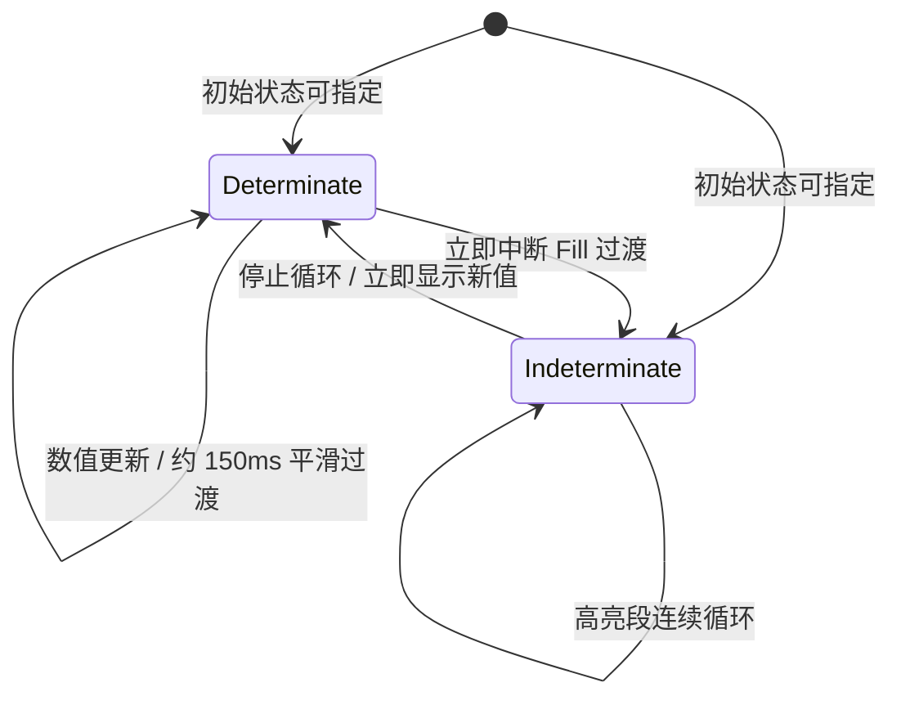

# 不确定进度动画与模式切换

## 目标与设计思路

在已经能正确显示确定比例、并具备短暂平滑过渡的 ProgressBar 上，补齐 `Indeterminate` 的持续活动效果，并把两种模式之间的视觉交接规则一次处理清楚。用户看到不确定进度时，应理解为“任务仍在运行，但目前没有准确比例”，而不是错误地以为进度停在 0%。

动画使用**一段高亮色块从左向右穿过水平轨道、到达右端后循环播放**的表现。轨道和圆角 Border 始终静止，运动区域仅在边框内部。高亮色块的颜色跟随当前主题的 Fill 及局部覆盖；不写死成某个主题的蓝色，所有四套主题和运行时切换都适用。

## 循环段的运动与裁剪

进入 `Indeterminate` 后，Style 启动独立于真实业务数值的动画时间进度。高亮区域沿轨道从左端进入、向右移动，越过右端后从左侧重复。轨道未被高亮占据的部分仍显示 Track 背景，完整 Border 不被填充或运动层覆盖。

视觉效果参照已经确认的“轨道中移动一段较亮色块”的样式，而不是让整个进度条反复闪烁，也不使用 Slider Thumb 的往返拖动效果。高亮段长度与循环周期属于本控件内部视觉参数，可以在 Style 落地时按已确认效果调整；没有需求将其暴露为公共配置项，不额外引入 Shader 或通用动画框架作为前提。

父容器改变宽度、BSN 自定义高度或 Scale Factor 切换时，运动区域仍按实际轨道尺寸裁剪并正常循环；不用固定像素宽度假设定义轨道边界。Theme 切换及局部颜色覆盖也不能破坏裁剪或停掉循环。

## 两种模式的视觉交接

跨模式切换和同模式数值更新采用不同规则，因为未知进度不等于某个可以插值的确定比例。

| 状态转换 | 视觉处理 |
| --- | --- |
| `Determinate(a)` → `Determinate(b)` | 按约 `150ms` Ease-Out，从当前可见比例平滑到 `b`；数值允许倒退。 |
| `Determinate` → `Indeterminate` | 立即取消旧 Fill 的数值过渡，开始高亮段循环。 |
| `Indeterminate` → `Determinate(b)` | 立即停止循环并显示新的真实比例 `b`，不从 0% 播放一次伪造的数值增长动画。 |
| `Indeterminate` → 同值 `Indeterminate` | 作为合法 No-op，不重启动画。 |

例如下载任务起初不知道总文件大小，直接以 `Indeterminate` 创建进度条；得到工作量信息时应用把状态设置为 `Determinate { value: 0.75 }`，进度条应直接显示 75%。如果应用后来又无法估算剩余工作量，可以切回循环动画。是否需要再次回到已知比例由应用决定；ProgressBar 不暗中存储一份旧的确定进度以替调用方恢复。

整个过程中 `ProgressState` 仍然是业务进度显示的唯一权威，循环相位和视觉插值只属于 Style 的临时绘制状态；模式更新继续经既有 `World` / `Commands` API 进行，不另发送业务通知。不存在同时活动的两个动画写入同一个 Fill 的情况。再次进入某种模式时从相应模式的有效视觉状态开始，而不是继续使用已经退出的旧动画目标。

## 完成条件与验证

- 默认与 Props 指定的两种初始模式都能正确显示；直接以 `Indeterminate` 创建时不先闪出 0% 确定进度条。
- 高亮段向右循环、轨道静止，色块只在圆角 Border 内移动；不出现端点刻线、圆点、Thumb 或内置文字。
- `Determinate` 更新与模式切换遵循上表：同模式数值插值、两种跨模式立即交接、同值不重启、退出不残留后台循环更新。
- `Indeterminate → Determinate(0.75)` 直接显示 75%，不先从 0% 到 75% 缓动；`Determinate → Indeterminate` 能中断尚未完成的过渡。
- 父级尺寸/Scale Factor 变化、局部 Override、四套 Theme 的运行时切换均不破坏循环范围、边框层级和颜色解析。
- 重复切换与频繁状态更新后，查询仍返回应用最后提交的合法 `ProgressState`，没有额外业务事件和进度值回写。

对模式切换和内部动画生命周期补充确定性 Unit / Integration Test，视觉循环、裁剪、样式交接使用针对性的 GUI / BRP 验证；同步 crate 功能文档与 `tests/COVERAGE.md`。这一步完成后，ProgressBar 的库侧两种模式均可独立使用，下一增量只负责 Gallery 演示和集成。