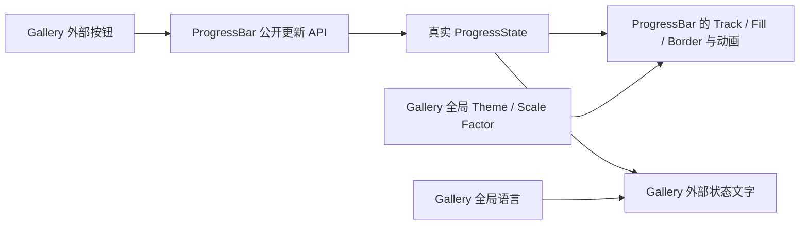

# ProgressBar Gallery 交互演示

## 目标与设计思路

在 Gallery 中接入真正可用的 ProgressBar，并通过**一条进度条和外部控制按钮**覆盖它的主要行为。页面使用 Widgetry 实际公开类型、BSN 构造与 `World` / `Commands` 更新 API，不制作伪进度条，也不让 ProgressBar 本体承担点击、选择或业务计算。

这个页面只需要一个可交互的演示实例，不再另外摆放固定 0%、50%、100% 的静态对照条。用户通过外部按钮将同一个实例调整到不同值，观察边框、填充、倒退、平滑过渡和不确定模式循环效果。百分比与状态说明使用进度条外的 Text，并随真实 `ProgressState` 更新。

## 单实例操作与状态反馈

页面提供一个默认从 `Determinate(0.0)` 创建的 ProgressBar；旁边或下方提供 `+10%`、`-10%`、`重置` 和`模式切换`的外部按钮。应用按钮而非控件本体触发状态提交：在确定模式下增加或减少 `0.1` 的比例，并允许从较高进度倒退到较低进度；重置回 `Determinate(0.0)`；模式切换可以进入或退出 `Indeterminate`。

Gallery 应在控制行为中构造合法值域内的数值，不以错误输入驱动日常演示，也不把库级 API 的严格值域检查改成静默 Clamp。例如在 100% 再点 `+10%` 时，演示按钮可以保持 100%，而 ProgressBar 的公开更新 API 仍按自身契约拒绝超过 1 的调用。反向操作到 0% 后同理。

退出 `Indeterminate` 的语义是**上层此时已经能够提供明确的完成比例**。真实任务通常在得知已完成工作量 `completed` 与总工作量 `total` 后，由上层计算 `completed / total`，再提交 `Determinate { value }`；ProgressBar 不保存业务工作量，也不自行猜测进度。已知比例也可以直接由上层提供，无需强制拥有两个原始计数。

Gallery 没有真实任务，因此由外部按钮维护页面自身的模拟进度值：`+10%`、`-10%` 和 `重置` 确定该值。切换到 `Indeterminate` 时，页面保留自己的演示值；再次切回 `Determinate` 时，由 Gallery 将当前演示值作为此时已知的完成比例提交。此数值属于 Gallery 的模拟输入，不是 ProgressBar 内部偷偷保留的上次填充量，也不是无依据写死的固定百分比。切回时直接展示这一确定值，不播放跨模式的填充增长动画。

外部状态文字在确定模式显示实时百分比，例如 `65%`，在不确定模式显示相应的运行中/未知进度提示。文本从 ProgressBar 的真实状态查询或由已提交状态可靠投影获得，不在 Gallery 中维护第二份互相同步的业务进度权威。文字只是 Gallery 组合出的示例，控件内部仍无内建 Text。

操作应能实际看到 0% 及 100% 的清晰 Border、填充伸缩、`150ms` 左右的 Ease-Out、从新可见位置接续的快速重复点击效果，以及进入、退出 Indeterminate 时不产生伪造的“0% 到目标值”动画。

## 接入现有 Gallery 机制

在当前 Gallery 的导航/页面组织中增加 ProgressBar 入口，页面使用实际 BSN 控件。页面离开时清理演示控件和局部临时数据，再次进入重新创建实例并恢复初始演示状态。Header、Sidebar 以及全局 Theme、Language、Scale Factor 不因进入或离开本页重置。

复用 Gallery 当前的四套 Theme（`Dark`、`Light`、`PinkDream`、`KamuriViolet`）运行时切换机制；切换时同一进度条即刻更新 Track、Fill 和 Border 颜色，既不改写进度也不重建控件。页面上的标题、说明、按钮和状态文本进入已有 English / 简体中文国际化系统；语言切换只刷新本地化内容。不同 Scale Factor 下仍显示完整 Border、正确填充和循环动画。

Gallery 如沿用其他控件的 Theme Colors / Overrides 展示习惯，可在同一个页面按需展示 ProgressBar 的 Track、Fill、Border 主题颜色与局部覆盖；不额外复制进度条为固定数值演示。展示区的颜色说明属于 Gallery UI，不是 ProgressBar 的公共文本配置。

## 完成条件与验证

- Gallery 编译通过，存在可正常导航的 ProgressBar 页面；首次进入、离开、重新进入的实例与局部状态生命周期符合现有 Gallery 约定。
- 通过真实控件的公开 API，`+10%`、`-10%`、`重置` 能驱动同一个进度条；边界处不越过 `[0,1]`；状态文字与真实模式及进度一致。
- 反向进度、快速连续操作和 0% / 100% 可见填充正确；模式切换能观察持续向右循环的高亮段，回到确定进度不播放错误的跨模式数值动画。
- 四套 Theme 的即时切换、局部配色覆盖（若展示）、中英文实时切换和 Gallery 全局 Scale Factor 都能与真实进度条配合工作；不出现填充越界或 Border 被盖住。
- 保持单实例演示，不额外生成静态 0% / 50% / 100% 实例，不内置按钮、文本、Thumb 或业务进度变化事件。

遵守 Gallery 现有的编译与针对性 GUI / BRP 验证要求：通过实际按钮输入及 Screenshot、必要的 ECS 状态查询核对视觉与数据，不以直接向 ECS 注入预期结果替代按钮行为。Gallery 的单独展示页不强制增加无意义的 Unit / Integration Test；本页相关的导航、文案和可观察功能同步 `docs/gallery.md`，必要时更新 crate 文档中关于外部组合的示例。库侧此前已覆盖的行为不因 Gallery 另立纯回归阶段，但本页需验证直接受其集成影响的所有可见行为。