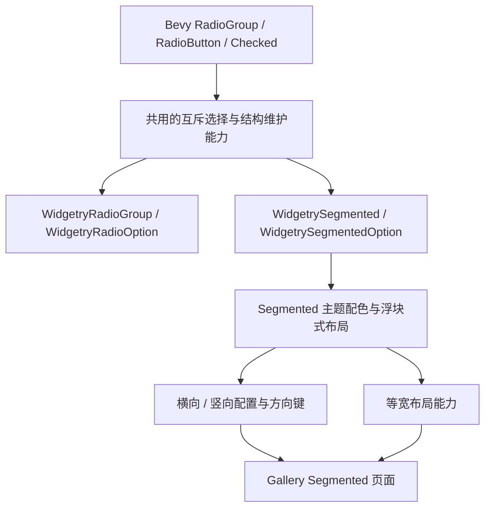

# 单选分段控件与 RadioGroup 共用选择能力

Segmented 是用于少量选项之间快速切换的独立控件，外观与 RadioGroup 不同，但两者共享互斥选择的基础语义。RadioGroup 现有固定子项结构需要扩展为可动态添加、删除的结构；它原有的 Tab 导航也按这次统一的焦点约定移除。Segmented 在这一基础上增加一体式浮块外观、可选等宽布局和横竖方向。

图中的“共用能力”表示设计关系，不预先规定必须新建哪个模块或 crate。优先复用 Bevy 现有 Headless 组件与当前项目逻辑；只有当存在真实重复时才抽取内部实现。两个控件保持独立的公开组件和视觉样式，不让 Segmented 依赖 WidgetryRadioGroup 的私有渲染结构。

这里存在两条不同的变化线：RadioGroup 的动态子项支持及 Tab 行为调整，和 Segmented 从无到有的交互、视觉与演示能力。它们通过底层选择语义关联，但不代表必须一次提交所有内容。

整条实施链按独立功能增量安排；测试、文档同步随对应功能完成，而不是另外设置验收阶段。涉及动态结构与键盘输入的行为应遵守项目既有的 ECS 延迟命令、输入派发前初始化、Widget API 错误处理和主题更新约束。应用的 UI 构造继续通过 BSN 及其 Patch 机制完成。

## 实施顺序

1. [RadioGroup 支持动态增删选项](01-radio-dynamic-options.md)
2. [RadioGroup 退出 Tab 焦点导航](02-radio-no-tab.md)
3. [Segmented 实现独立互斥选择交互](03-segmented-headless.md)
4. [Segmented 实现浮块式主题外观](04-segmented-style.md)
5. [Segmented 支持等宽选项](05-segmented-equal-width.md)
6. [Segmented 支持竖向方向](06-segmented-vertical.md)
7. [Gallery 展示和验证 Segmented](07-segmented-gallery.md)
