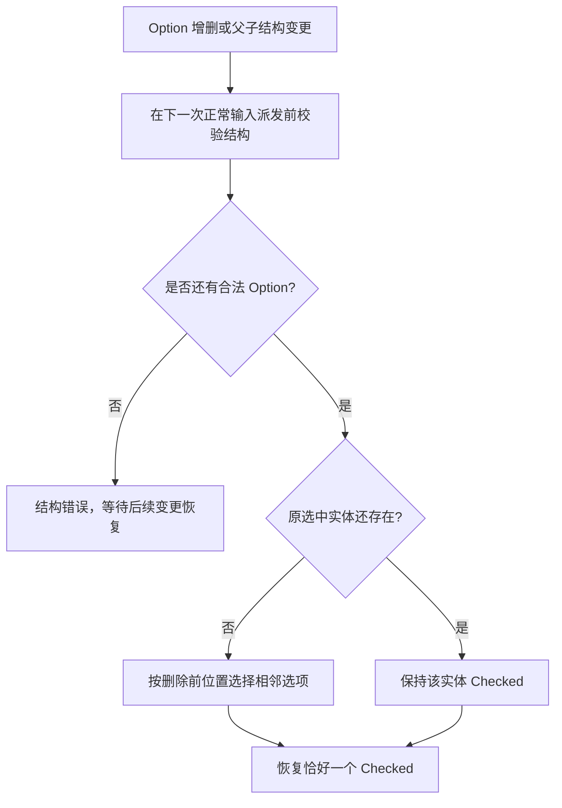

# RadioGroup 支持动态增删选项

当前 WidgetryRadioGroup 管理构造期固定的一组直接 WidgetryRadioOption 子实体，初始化时选中第一项，使用 Bevy 的 `RadioGroup`、`RadioButton` 和 `Checked` 维护互斥选择。这里改变的是子项集合的生命周期：允许应用在运行期间添加或删除选项，而不改变 RadioGroup 的单选身份与对外事件语义。

## 选择状态如何随结构变化

严格单选的含义是：**在结构有效、至少存在一个选项时恰好有一个选中项**。空集合属于结构错误，不能以“允许空选中”规避。这是结构约束，不意味着在 BSN 尚未挂接 Children 的瞬间就抛出错误。

- 初始化且未指定选中项时，沿用第一项默认选中的既有规则。
- 添加选项时，如果已有合法选中项，保留原选中实体；如果此前因空集合失效，在有合法选项后恢复默认选择。新增子项本身不应抢走合法的既有选择。
- 删除未选中项时，保留当前选中实体，不根据索引意外切换。
- 删除当前选中项时，优先选中其**删除前位置的后继项**；没有后继时选前驱项。选择目标可以是 Disabled 选项，因为 Disabled 只限制用户输入。
- 删除全部选项时，经正常结构校验报告错误；重新加入合法选项后恢复。持续相同错误沿用 FailureState 的诊断去重与恢复日志语义。
- 仅改变集合不意味着支持随意重排：运行时选项排序与 Children 重组仍不在本次受支持能力内。

例如 `[A, B, C]` 选中 `B`，删除 `B` 后选择 `C`；随后删除 `C`，选择 `A`。删除 `A` 而 `B` 仍然存在的场景则保持 `B`，不因索引变化而修改实际选择。

## 维护变化前的位置

现有代码通过 `Insert` / `Remove` / `Discard<ChildOf>` 等 Observer 将结构变化记入待处理集合，并在 `PreUpdate` 初始化环节校验。这个节奏保留，但只检查当前 Children 并不足以判断被删除选项的旧索引。因此，结构维护必须在选中项仍存在时保有足够的信息，以便删除后按旧位置恢复；具体采用轻量记录或等效机制，由实现阶段依照当前 ECS 生命周期决定，不另外维护第二套选择权威状态。

WidgetryRadioOption 仍然只能作为 WidgetryRadioGroup 的直接 Child；选项内部可以通过 BSN 自由组合任意内容。单个结构无效实例不得阻止其他有效 Group 更新。结构恢复不应对未变化的合法选择重复写入 Checked。

## 程序化选择与事件

现有 `set_selected(&mut Commands, entity, index)` 以执行时的直接 Children 顺序校验索引并设置 `Checked`，维持原有 `ValueChange<usize>` 的用户交互来源。排队调用要在命令实际执行时验证当前结构和索引，不能假设入队时的下标仍有效。

程序设置、初始化以及删除触发的自动替补选择，不发送用户选择事件；合法同值设置保持静默。失效 Root、非法直接 Child、空集合与索引越界继续按照现有 API 约定返回或传播 `BevyError`，失败操作不能部分修改选择。

整体和选项禁用仍只拦截用户交互，不拦截合法的程序化选择或结构修复。已选中的选项后来变为 Disabled 时仍保持 Checked；其他选项继续可交互时，用户可以改选。

## 完成条件与直接影响

- 用结构变更测试覆盖未选中项删除、首中末选中项删除、连续删除、新增选项、清空后恢复、已禁用替补项，以及两个独立 Group 互不干扰的情况。
- 验证空集合、不合法直接 Child、失效 Root、越界请求的错误传播与去重日志；同值/失败/自动修复均不发送用户选择通知。
- 确认稳定结构不在每帧重复全量校验，实际结构变化才触发必要维护；原有静态 RadioGroup 用例保持可用。
- 更新 `docs/crates/radio_group.md` 中“固定选项集合”“不提供动态增删”的旧契约，并让相应测试与实现一致。

## 边界与未决细节

这里不建立专用的选项排序 API，也不把外部直接破坏层级结构当作正常的 Selection Setter。删除前位置记录属于实现必须解决的 ECS 生命周期细节，不可用“删除后总选第一项”来替代既定的相邻回退规则。

如果 Bevy 原生 RadioGroup 的子项变化处理与上述行为有差异，应在 Widgetry 层完成结构恢复与选择约束，而不是同时维持两份 Checked 权威数据。
