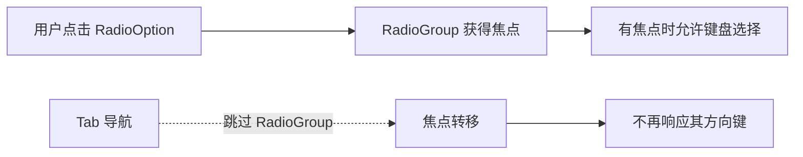

# RadioGroup 退出 Tab 焦点导航

RadioGroup 原有 `TabIndex::default()` 使它参与 Tab 导航。本改动保留 RadioGroup 的鼠标与焦点内键盘能力，但将 Tab 排除在进入该控件的方式之外；它可独立于动态结构改动实施、测试和验收。

## 焦点获取与输入边界

通过与项目其他不参与 Tab 导航的组件一致的索引配置（例如现有 Button 使用的 `TabIndex(-1)`）表达“能被指针赋予焦点，但不是 Tab 导航目的地”。最终应根据 Bevy 0.20 当前输入焦点实现确认准确挂载位置与生效方式，不以移除焦点能力来实现排除 Tab。

- 鼠标点击 Option 后，Group 能获得焦点并继续接受其已有键盘操作；选择更改不会额外抢夺别的控件焦点。
- Group 没有焦点时，即使自身含有 Checked，也不能响应导航键。
- Tab 从相邻控件经过时跳过该 Group；不阻断 Tab 对其他控件的导航。
- Disabled 不因 Tab 策略变化而变得可交互。此次不顺便改变 RadioGroup 其他方向键细节。

这里的修改只针对 RadioGroup 的 Tab 参与规则，和 Segmented 后续明确的方向键首尾不循环规则不能无意混为一谈。

## 完成条件与直接影响

通过键盘输入测试验证点击获得焦点、离焦停止方向键操作、Tab 前后遍历跳过 RadioGroup、其他控件的正常导航及禁用状态。必要时用 Gallery 或现有输入测试检查真实焦点流转。更新 `docs/crates/radio_group.md` 的焦点与 Tab 约定，删除与新行为冲突的说明。
