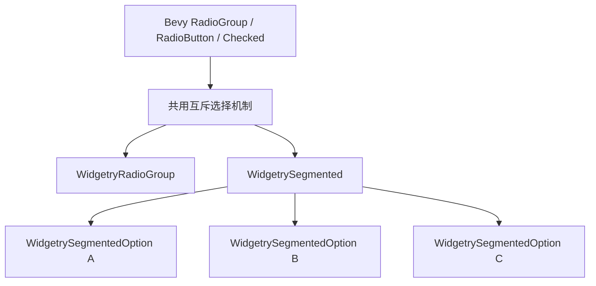
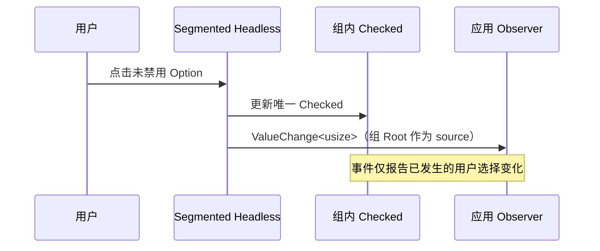

# Segmented 实现独立互斥选择交互

Segmented 是面向少量选项的快速互斥切换控件，不是 RadioGroup 的样式变体。这里交付独立可在 BSN 中声明的 `WidgetrySegmented` / `WidgetrySegmentedOption`、严格单选状态、指针与横向键盘交互、程序化选择和选择事件。视觉外观和竖向布局分别属于后续独立增量。

## 控件与选择职责



`WidgetrySegmented` 是直接选项集合的根实体。每个直接 Child 必须是 `WidgetrySegmentedOption`，而 Option 内部仍可放置任意 BSN Children。文字、图标、文字与图标组合或更复杂的内容都是普通 Scene 组合，不另建只接受字符串或特定图标的内容 API。

根控件承担组内单选、焦点与用户变更的索引事件；选项承担自己的选中和禁用状态。互斥选择优先复用 Bevy 官方 `RadioGroup`、`RadioButton`、`Checked` 与 `radio_self_update`，以及已有的结构校验、程序化索引选择和诊断逻辑。`Checked` 保持唯一的选择状态权威，不同步维护一份会产生偏差的平行 Selection。只有出现共同逻辑的真实重复时，才提取内部共享实现；两个控件的公开类型、Props、样式仍然独立。

## 初始化、动态集合与程序控制

在拥有一个或多个合法 Option 时，Segmented **恰好选择一个**。初始选择直接使用 Bevy 原生 `Checked` 标记，不添加 `initial_selected` Props：如果所有直接 Option 都没有初始 `Checked`，则默认选中第一个；恰好一个 Option 已有 `Checked`，就以该 Option 为初始选择；若多个 Option 同时标记 `Checked`，应报告结构错误，不得悄悄选择其中一个或改写为首项。点击已选择项不能取消它，应用不提供清空选择接口。构造期间的空子节点结构可暂时存在，但下一次输入派发前校验仍为空就报告结构错误，而不是允许有效的空选中。

例如，BSN 调用方可以在第二项上直接挂载初始 `Checked`：

```rust
@WidgetrySegmented
Children [
    @WidgetrySegmentedOption--
    @WidgetrySegmentedOption Checked--
    @WidgetrySegmentedOption
]
```

`Checked` 在这里只承担 Scene 构造时的初始选择标记，初始化后仍是唯一选择状态权威。完成初始化后的外部程序化修改使用 `set_selected()`，而不是重新插入或移除初始 `Checked` 绕过组的单选约束。多重初始 `Checked` 错误须在正常输入派发前完成结构校验、按既有诊断方式报告；失败时不得以任意选择覆盖用户声明的冲突状态。这个初始标记契约属于 Segmented，不要求同步改造 RadioGroup 旧有的默认首项规则。

运行期间可动态增删直接 Option，但不提供重排接口。选项添加不覆盖合法已有选择；删除未选择的选项不改变选择；删除选中项时优先选择原位置的后继项，若不存在则选择前驱项。所有选项删除后进入结构错误状态，后续重新加入合法选项可恢复并选中第一项。替补项可以是 Disabled 选项，因为程序选择不受 Disabled 限制。

例如，`[A, B, C]` 选中 `B`，删掉 `B` 后选中 `C`；再次删掉 `C` 后选中 `A`。这些由结构变化触发的选择恢复不产生用户操作事件。

程序化选择沿用 `set_selected(&mut Commands, root, index)` 的索引式用法；合法同值调用保持静默，排队调用必须按命令实际执行时的 Children 集合校验。失效 Root、空集合、无效直接 Child 或越界 Index 依照既有 Widget API / BevyError 契约失败，不修改选择也不发事件。

## 用户输入和事件



- 用户点击未禁用的其他 Option：立即提交选择，并通过组根实体来源的 `ValueChange<usize>` 报告新索引。已选中项重复点击不重复发事件。
- 应用程序调用 `set_selected()`、首次初始化、动态删选项后的恢复与自动修复：都不发用户选择事件。
- 根级和 Option 级 Disabled 分别生效，有效禁用按继承 OR 语义计算；用户不能选禁用项，但程序可以选，且禁用当前选中项不自动清除它。
- 鼠标点击后 Segmented 获得焦点。只有拥有焦点时，左右方向键才从当前项向前、向后寻找下一个可用选项；跳过禁用项，到首尾停止不循环。整个控件禁用时不响应键盘。
- Segmented 不参与 Tab 焦点遍历，焦点转移后其方向键不应再改变选中项；程序化选择不自动抢夺焦点。

这里不能无条件照搬官方 RadioGroup 的全部键盘细节：需要核查并在 Widgetry 层保证“有焦点、跳过 Disabled、不循环、不参与 Tab”的实际行为。初始横向布局需要满足指针命中与焦点交互；完整的背景、边框和主题呈现不属于这一增量。

## 与已有能力的关系及完成条件

该增量依赖已完成的动态选项维护机制；它可以复用现有 RadioGroup 的结构变化检测、错误去重与恢复能力，但不能假设“静态 RadioGroup 原样复制”就已覆盖删除选中项后的相邻回退。须同时接入新的 crate / Plugin、必要的 facade feature 与公开导出，遵循项目的 BSN、ECS、Windows 64 位目标约束，并同步记录对应控件的 Headless 行为契约。

验证需要覆盖：独立 Group 互不串扰；无初始 `Checked` 时默认首项、恰好一个初始 `Checked` 时采用指定项、多重初始 `Checked` 时报告错误且不隐式修复；选中项与未选中项的增删；最终空结构错误及恢复；禁用项保留 Checked 与程序合法选中；左右键边界、跳过禁用、无焦点忽略、Tab 跳过；重复点击、同值程序调用、结构自动修复的事件静默；非法结构、Root 与索引请求的错误传播。特别检查用户事件观察者读取的选择状态已经提交，Commands 延迟操作不会把旧索引误当成入队时快照。

不在此增量建立新的数据绑定总线、独立 UI 构造 DSL 或特殊的 Option 内容型别，也不引入控件选项运行时重排接口。
