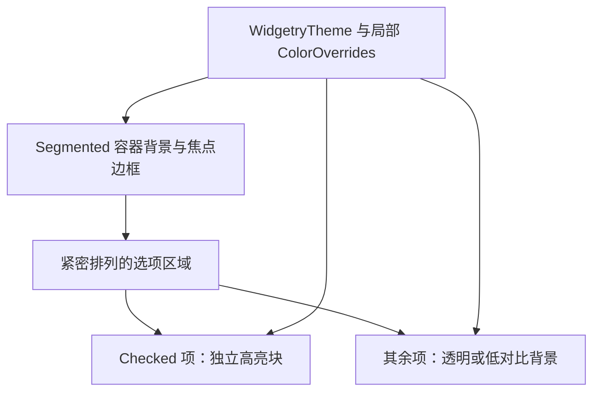

# Segmented 实现浮块式主题外观

Headless 已经决定选中哪个 Option，Style 负责把它清楚地画出来。选用一体式、Ant Design 风格的浮块：一个共享的柔和背景容器内排列若干选项，选中项出现独立的较亮块状背景，而不是分离的 Button，也不采用带显眼分隔线的 Material 风格。本增量交付这一基本外观与主题状态响应；等宽策略和竖向模式后续分别加入。

## 布局与选中呈现

默认呈横向单行布局，选项宽度由实际 Children 内容和边距决定，不强制每段占用同样空间。例如“今天 / 最近7天 / 最近30天”应根据文字宽度自然变化。选项的 UI 内容仍全部通过 BSN Scene 组合，Style 只负责与选择视觉、内边距、背景相关的外壳，不限于文字或图标。

控件默认整体高度参考现有 Button 的 `32px`，外层保留较小内边距，使高亮块与容器边缘分开。调用方通过 BSN Patch 覆盖 `Node` 的尺寸、padding、圆角等，不额外提供 Small / Medium / Large 尺寸枚举，也不为了 UI 构造另造一套 Builder。

切换选中项时，高亮块直接转移到目标选项，不引入任何位置插值、宽度动画、动画完成事件或视觉排队。这样 Style 永远体现本帧最终的有效 Checked，程序化切换与用户操作走同一个呈现分支。

## 颜色、焦点与禁用视觉

**中性高亮是一种默认配色倾向，而不是脱离 Theme 的硬编码颜色。** 在浅色主题中可以是浅灰容器加偏白的高亮块；深色主题中可以是深灰容器加更亮的中性高亮。四套现有 Theme（Dark、Light、Pink Dream、Kamuri Violet）都需要为 Segmented 配置相应颜色数据，允许主题改变其风格。所有状态色从 `WidgetryTheme` 解析，并沿用项目既有的 ColorOverrides 与局部覆盖/刷新机制，不把某个预览图中的示意 RGB 直接写为固定设计值。

- **普通未选中**：低对比背景，前景清晰；Hover 时有轻微反馈，不与 Checked 视觉竞争。
- **普通已选中**：独立高亮块、清晰的前景色，必要时使用轻微阴影体现浮起感；不使用必然为主题强调色的整片填充。
- **组获得焦点**：整个 Segmented 容器的外边框略突出，由 Theme 的 Focus 配色控制；不对各 Option 单独加焦点环，以区分“组拥有键盘焦点”和“哪一项被选中”。
- **普通 Option 被禁用**：前景降低对比度、没有 Hover 反馈，其他可交互项保持正常。
- **已选中 Option 被禁用**：高亮块和文字都淡化但保留块状区分，仍能辨认选中项。
- **整体 Disabled**：所有内容降低对比度并取消交互反馈，同时保留选中项的可识别高亮块。

在选项本地禁用和祖先整体禁用叠加时，颜色应使用真实生效的 Disabled 状态。Style 不修改 Checked，不因 Theme 切换改写业务 Selection。容器失去焦点只恢复普通边框，不取消选中项。

## 主题消费与外部内容边界

通过与 RadioGroup / Button 类似的主题变化通知与 Changed/Added 过滤更新受影响的实体，保证本地 Hover/Checked/Disabled、组级颜色覆盖、局部 Option 覆盖及主题切换能够及时生效；稳定状态避免逐帧无意义地重新解析全部颜色。

选项内部的任意 Children 由调用方负责声明。控件可以通过项目已有的前景色传播机制设置合适的默认颜色，但不能强行覆盖调用方自定义的独立视觉配置。Theme 颜色覆盖须按照现有验证、错误传播与托管 Style 输出约定处理。

## 完成条件

完成横向基础外观的 UI / 主题测试：不同长度的 Children 导致内容自适应宽度；选中背景瞬间切换；Hover、焦点边框、选中禁用、单项禁用、整体禁用能区分；恢复禁用后本地状态保留；四套主题切换与局部 ColorOverrides 不改变业务 Checked；稳定结构不会持续重复样式工作。同步主题 Colors 定义、默认主题数据、必要 facade 导出与控件样式文档。

该增量不引入选中块移动动画或独立尺寸档位，也不要求调用方只传入纯文字、纯图标或固定布局的 Children。
